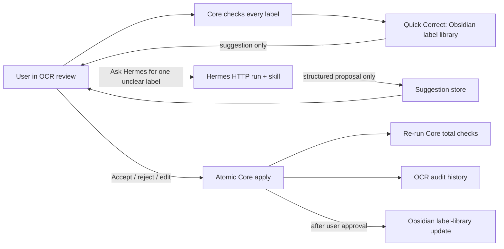

# Hermes OCR Label Correction Plan

**Status:** User-marked, sequential Hermes label review is implemented and tested; Quick Correct backend core is implemented
**Date:** 2026-07-29
**Scope:** Vietnamese OCR table hierarchy (`L`, `L0`, `L1`, `L2`, `L3`)
**Primary rule:** Hermes proposes; deterministic code verifies; the user approves.

## 1. Goal

Add a Hermes-assisted review step that helps the user:

1. find likely hierarchy-level mistakes in Vietnamese labels;
2. reuse user-approved label patterns before calling Hermes;
3. let the user mark unclear labels, then ask Hermes about one marked label at a time;
4. explain every suggestion with visible and arithmetic evidence;
5. apply only user-accepted suggestions; and
6. save reusable approved patterns to Obsidian.

The first release should optimize for **precision and auditability**, not for
automatic correction volume. A missed suggestion is safer than a wrong edit.

## 2. What “correct a label” means

The project must keep these two tasks separate:

### A. Hierarchy correction — first release

Assign the correct structural level:

- `L`: text-only section label with no financial value;
- `L0`: grand total or statement-level total;
- `L1`: group or subtotal;
- `L2`: line item;
- `L3`: detail.

Evidence can come from exact totals, neighboring levels, statement numbering,
label wording, row order, and accepted examples from earlier reviews.

### B. OCR label-text correction — later release

Correct text such as a misspelled or truncated Vietnamese label.

This requires comparison with the scanned page. The current page-result model
stores Markdown but does not store cell bounding boxes or style evidence.
Therefore Hermes must not claim that it visually verified label text until one
of these is available:

- a vision-capable Hermes model that can inspect the rendered page; or
- OCR-worker layout metadata containing table/cell bounding boxes, font size,
  bold probability, and line geometry.

Until then, text corrections are semantic suggestions and must be marked
`visual_confirmation_required`.

## 3. Architecture decision: Quick Correct first, Hermes on demand

The workflow has two suggestion sources. Neither source can change a label;
the user makes every final decision.

```text
OCR page → deterministic Core checks → Quick Correct lookup
                                      ├─ strong/weak match → user suggestion
                                      └─ no useful match → user may ask Hermes
```

### Quick Correct: reusable user-approved patterns

Quick Correct is the normal path. It searches a small, structured part of the
Obsidian vault; it does not call Hermes and does not scan the whole vault.

- The reusable label library is Vietnamese only.
- It is shared across companies, but separates balance sheet, income statement,
  cash-flow statement, and specialist statement families such as banks or
  insurance.
- It starts with exact normalized label matching: trim spaces, normalize case,
  and retain an accent-free search key. It does not use fuzzy spelling matches
  in the first release.
- It also compares parent label, nearby labels, and deterministic total
  structure. Label text alone is not enough.
- A pattern becomes a **strong** Quick Correct suggestion only after three
  approvals from three different verified documents. It is still only a
  suggestion.

The Core keeps a small in-memory index of this library and reloads it when a
library note changes. This makes lookup fast without SQLite being the source of
truth for reusable patterns.

### Obsidian label library

The label library lives in a dedicated, human-readable folder, for example:

```text
Obsidian/Financial Analyze/Label Library/
├── Balance Sheet/
├── Income Statement/
└── Cash Flow/
```

Create one note per normalized Vietnamese label. A note can contain multiple
context patterns so a later example never overwrites an earlier valid one.

```yaml
---
label: Tài sản ngắn hạn
normalized_label: tai san ngan han
statement_type: balance_sheet
patterns:
  - correct_level: L1
    parent_label: Tổng tài sản
    approval_sources:
      - document_hash: abc123
      - document_hash: def456
      - document_hash: ghi789
---
```

Only the Core writes this structured note after the user approves a correction.
Hermes has read-only access: it learns by reading approved notes, not by
retraining its model or by editing the library itself.

### Hermes: optional reviewer for an unclear label

Hermes is a fallback, not an automatic step. The user marks one or more unclear
labels and chooses **Ask Hermes**. The Core sends only one marked label at a
time, with deterministic evidence. After a result returns, it sends the next
marked label. Never send a whole document or a whole page to the local model.

The backend starts a local background queue and calls the Hermes HTTP gateway
once per marked label. It records queue progress so the browser can show which
label has been sent. Run one label at a time because the local model is slow
and shared. Each request uses the configured timeout; the user may retry or
set the level manually.

### Hermes skill: policy and workflow

Create one focused skill:

```text
~/.hermes/skills/financial/kiem-tra-nhan-ocr/
├── SKILL.md
└── references/
    ├── label-level-rules.md
    ├── vietnamese-statement-patterns.md
    └── output-contract.md
```

The skill tells Hermes:

- when to review a label;
- which read-only evidence it may use;
- how to rank evidence;
- when to stop and ask the user;
- never to calculate totals itself;
- never to modify reviewed Markdown directly;
- never to treat unverified OCR as trusted data; and
- how to return structured suggestions.

Skills still consume model tokens when Hermes reasons. Token savings come from
Quick Correct and deterministic checks running before the user chooses a
Hermes review.

### MCP tools: optional read-only evidence

Expose a small OCR-review tool set to Hermes. Keep it below ten tools:

1. `get_ocr_review_context(review_id, page_number)`
   - Returns review revision, page hash, document labels, statement type, tables,
     current label levels, and page status.
2. `get_ocr_table(review_id, page_number, table_number)`
   - Returns a normalized table with stable coordinates and raw visible text.
3. `detect_label_levels(review_id, page_number, table_number)`
   - Calls the existing deterministic hierarchy engine.
4. `verify_label_totals(review_id, page_number, table_number)`
   - Calls the existing exact-decimal total verifier.
5. `get_label_examples(statement_type, normalized_label, limit)`
   - Returns a small set of approved Obsidian label-library examples.
6. `get_table_visual_evidence(...)`
   - Returns cell geometry/style signals or a page/table image resource when
     visual support is available.
7. `submit_label_suggestions(run_id, suggestions)`
   - Stores proposals only; it cannot edit OCR Markdown.

The first release prepares the compact evidence packet in Core and sends it to
the Hermes HTTP gateway. MCP remains available for safe, read-only inspection;
it is not required for every label request. Database mutations and Obsidian
writes remain inside the Core.

## 4. Trust boundary



Hard boundaries:

- The browser never receives the Hermes gateway key.
- The backend is the only HTTP client for the Hermes gateway.
- Hermes cannot call the existing page-correction mutation directly.
- Hermes cannot write the Obsidian label library.
- Hermes cannot approve, verify, publish, or overwrite a page.
- Arithmetic is produced only by Core code using exact decimals.
- A proposal is valid only for the page content hash it inspected.
- User acceptance and Hermes proposal are recorded as separate actors.

## 5. Review workflow

### Step 1 — Core checks the page

The user opens one OCR review page. The Core keeps the page editable and runs
the deterministic pre-pass locally. No Hermes request starts at this point.

### Step 2 — Deterministic pre-pass

Before Hermes receives anything, the Core:

1. locates tables;
2. parses financial values and explicit zero dashes;
3. runs automatic label-level detection;
4. runs direct-child total verification;
5. identifies rows already supported by exact arithmetic; and
6. identifies ambiguous rows and text-only rows.

Rows with strong deterministic evidence become Core suggestions. They still
need user acceptance before anything changes.

### Step 3 — Quick Correct searches approved patterns

For each candidate label, Quick Correct searches the Obsidian label library by
exact normalized Vietnamese label and statement family. It scores context using
parent label, nearby labels, and deterministic totals.

- Three different verified documents with the same pattern: strong suggestion.
- One or two matching documents: weak or medium suggestion.
- No exact/context match: no Quick Correct suggestion.

Every Quick Correct result is shown to the user; it never changes Markdown.

### Step 4 — User marks labels and optionally asks Hermes

Only when the user selects **Ask Hermes** does the Core create a queue. Hermes
receives one bounded evidence packet per marked label:

- table/page/row coordinate;
- current label text and current level;
- two or three neighboring rows above and below;
- statement type and unit;
- deterministic parent/child candidates;
- total-check results;
- numbering or note code;
- visual evidence when available; and
- up to three relevant accepted examples.

Do not send the whole document, the whole page, or unmarked rows. The Core runs
at most one Hermes label request at a time, then sends the next marked row.

### Step 5 — Hermes returns one structured proposal

Hermes returns JSON through the HTTP run result, never free-form Markdown:

```json
{
  "table": 1,
  "row": 8,
  "current_label": "Tài sản Có khác",
  "suggested_label": null,
  "current_level": 2,
  "suggested_level": 1,
  "confidence": "high",
  "reason_codes": [
    "exact_child_total",
    "peer_structure",
    "statement_semantics"
  ],
  "explanation": "The row equals the direct L2 children and is a group subtotal.",
  "evidence": {
    "parent_value": "30.703.324",
    "child_sum": "30.703.324",
    "child_rows": [9, 10, 11, 12]
  },
  "visual_confirmation_required": false
}
```

Allowed output is deliberately narrow:

- change level;
- mark `no_change`;
- mark `needs_user`;
- provide evidence and confidence.

### Step 6 — Core validates every proposal

Reject a proposal if:

- the page hash or review revision is stale;
- the table/row no longer exists;
- the “before” value differs from the current cell;
- the level is outside `L`/`L0`–`L3`;
- `L` is proposed for a row containing a financial value;
- numeric cells are included in a label-only proposal; or
- the JSON does not match the schema.

### Step 7 — User reviews one combined suggestion list

Show suggestions directly in the spreadsheet:

- suggested label/level badge on the affected label cell;
- before → after preview;
- confidence;
- concise reason;
- exact arithmetic evidence where relevant;
- source badge: `Quick Correct` or `Hermes`;
- **Accept**, **Reject**, and **Edit suggestion**;
- **Ask Hermes** only when the selected label is unclear;
- **Next suggestion** control in the existing footer area.

Suggested visual priority:

1. selected cell: green;
2. arithmetic mismatch: red;
3. Hermes suggestion: purple or amber; Quick Correct: blue;
4. ordinary hierarchy styling.

Never replace the original text before the user applies changes.

### Step 8 — Apply decisions atomically

The user may mark several suggestions accepted, then choose
**Apply accepted suggestions**.

The Core:

1. checks the current revision and page hash;
2. validates all selected proposals again;
3. applies them in one Markdown mutation;
4. increments the review revision once;
5. records a page correction audit event;
6. records each Quick Correct or Hermes suggestion and the user decision
   separately;
7. reruns level detection and total verification; and
8. returns new mismatches and any suggestions invalidated by the edit.

Batch application avoids making every remaining suggestion stale after the
first accepted change.

### Step 9 — Write approved reusable patterns to Obsidian

Do not save unapproved Hermes proposals or rejected Quick Correct suggestions.

After the user accepts a correction and the Core reruns total verification, the
Core updates the relevant Obsidian label note. It adds a document hash once per
document, preventing repeat uploads or repeat clicks from inflating the
approval count. The existing OCR database continues to store review runs,
suggestions, and audit history; Obsidian is the sole reusable label-library
source of truth.

## 6. Persistence model

Use the existing two workflow tables rather than placing the whole workflow in
generic audit JSON.

### `ocr_label_review_runs`

- `id`
- `review_id`
- `page_number`
- `base_revision`
- `page_content_sha256`
- `status`
- `skill_name`
- `skill_version`
- `model`
- `tool_call_count`
- `input_token_count` / `output_token_count` when available
- `duration_ms`
- `error`
- timestamps

### `ocr_label_suggestions`

- `id`
- `run_id` (nullable for Quick Correct)
- `source`: `core`, `quick_correct`, or `hermes`
- `table_number`
- `row_number`
- `label_cell_hash`
- `current_label` / `suggested_label`
- `current_level` / `suggested_level`
- `confidence`
- `reason_codes` JSON
- `evidence` JSON
- `visual_confirmation_required`
- `decision`: `pending`, `accepted`, `rejected`, `edited`, `stale`
- `user_edited_value`
- `applied_revision`
- timestamps

Existing `OCRAuditEvent` records final applied changes with:

- proposal actor: `core`, `quick-correct`, or `hermes-agent`;
- decision actor: `local-user`; and
- skill/run IDs for traceability.

## 7. API surface

Draft Core endpoints:

```text
POST /api/ocr-inbox/reviews/{review_id}/pages/{page}/quick-correct-preview
POST /api/ocr-inbox/reviews/{review_id}/pages/{page}/labels/{table}/{row}/hermes-runs
GET  /api/ocr-inbox/reviews/{review_id}/pages/{page}/label-review-runs/{run_id}
GET  /api/ocr-inbox/reviews/{review_id}/pages/{page}/label-suggestions
POST /api/ocr-inbox/label-suggestions/{suggestion_id}/decision
POST /api/ocr-inbox/reviews/{review_id}/pages/{page}/apply-label-suggestions
```

The Hermes POST returns a job ID immediately. The Core uses Hermes
`POST /v1/runs`, polls its status, and exposes progress to the UI. The Core
allows one active Hermes label run per review page. A user may cancel a run;
after five minutes the Core marks it timed out without changing the page.

The apply endpoint requires:

- current review revision;
- base page hash;
- selected suggestion IDs; and
- optional user-edited replacements.

## 8. Hermes skill policy

The `SKILL.md` should encode this order:

1. Receive one Core-prepared label evidence packet.
2. Refuse if the page is verified/published or the requested revision is stale.
3. Review only the target label; do not request the whole page.
4. Use supplied Quick Correct examples as supporting evidence.
5. Prefer exact arithmetic over semantic intuition.
6. Use label semantics only as supporting evidence.
7. Return `no_change` or `needs_user` when evidence is insufficient.
8. Return one structured proposal.
9. Stop without modifying data.
10. Never apply, approve, verify, publish, or save an unverified canonical note.

Run limits:

- one target label per run;
- one active label run at a time;
- five-minute timeout;
- user can cancel or retry;
- explicit `needs_user` result instead of guessing.

Use one Hermes agent. A multi-agent design is unnecessary for this focused
workflow and would make audit and failure recovery harder.

## 9. Learning safely from the user

Hermes learns by reading the approved Obsidian label library. It does not train
its model, edit notes, or turn corrections into automatic page mutations.

### Store structured feedback

For every accepted correction, write an Obsidian pattern containing:

- statement type;
- normalized label;
- neighboring labels;
- numbering code;
- arithmetic relationship;
- visual/style features when available;
- document hash; and
- approval count based on unique document hashes.

### Retrieve examples, not unrestricted memory

Quick Correct searches only the dedicated library. Hermes receives at most
three matching examples when the user asks for help. Examples are evidence, not
authority. Current document arithmetic always takes priority.

### Promote recurring patterns cautiously

A Quick Correct pattern becomes strong when it appears in three different
verified documents and has no conflicting pattern for the same context. It
remains a user-reviewed suggestion, not an automatic rule.

## 10. Failure behavior

- **Hermes unavailable:** existing manual editing, auto-level detection, and
  Quick Correct, and total verification continue working.
- **Hermes timeout/cancel:** keep the page unchanged; offer retry or manual
  level selection.
- **MCP unavailable:** continue with the Core-prepared evidence packet; never
  ask Hermes to calculate.
- **Stale revision/hash:** mark suggestions stale and offer rerun.
- **Ambiguous hierarchy:** show `needs_user`, candidate levels, and evidence.
- **No table:** skip the page without spending model tokens.
- **No visual evidence:** do not claim text accuracy; request user confirmation.
- **Malformed agent output:** reject it at the schema boundary and retry once.
- **Partial apply failure:** apply nothing; return the failing suggestion.

## 11. Evaluation set and acceptance criteria

Build a golden set from already manually reviewed pages:

- balance sheet with parent-before-children totals;
- income statement with parent-after-children totals;
- cash-flow statement;
- duplicate current/prior-year columns;
- parentheses negatives;
- dash-as-zero rows;
- weak equality;
- merged or wrapped labels;
- text-only `L` sections;
- intentionally wrong hierarchy;
- intentionally wrong OCR label text; and
- arithmetic mismatch where the source statement itself is inconsistent.

Measure:

- high-confidence suggestion precision: **at least 98%**;
- overall accepted-or-user-edited usefulness: **at least 90%**;
- unauthorized OCR mutations: **zero**;
- stale proposal applications: **zero**;
- arithmetic generated by Hermes: **zero**;
- every applied correction has page/table/row provenance: **100%**;
- deterministic-only pages invoke Hermes: **zero**;
- every Obsidian approval source has the verified document hash: **100%**.

## 12. Implementation phases

### Phase 0 — Capability and contract spike

- Confirm the authenticated Hermes HTTP gateway accepts `POST /v1/runs`.
- Confirm Core can poll, cancel, and time out one label run.
- Confirm the local model response time is acceptable for user-requested help.
- Freeze the one-label evidence and JSON result contracts.

**Exit:** one user-selected label returns a schema-valid, non-mutating
suggestion through the gateway.

### Phase 1 — Read-only OCR MCP tools

- Extract normalized table-reading functions from the review code.
- Wrap existing level detection and total verification.
- Add task-scoped authorization and tool tests.
- Add structured tool errors and run tracing.

**Exit:** Core and, when needed, Hermes can inspect exact verification evidence
without modifying the review.

### Phase 2 — Suggestion runs and persistence

- Replace page-wide automatic Hermes runs with one-label, user-requested runs.
- Use Hermes `/v1/runs` and support polling, cancel, five-minute timeout, and
  one active run at a time.
- Add source-aware suggestions: Core, Quick Correct, or Hermes.
- Keep schema validation, hash/revision checks, limits, and failure states.
- Update the `kiem-tra-nhan-ocr` skill for one target label.

**Exit:** a page produces stored, auditable suggestions with no UI mutation.

### Phase 3 — Human review UI

- Add Quick Correct suggestions from the Obsidian label library.
- Replace the page-wide Hermes button with **Ask Hermes** on one selected
  unclear label.
- Render one combined list with `Quick Correct` and `Hermes` source badges.
- Show Hermes progress, elapsed time, cancel, timeout, retry, and manual edit.
- Add accept/reject/edit decisions.
- Implement atomic batch apply and rerun verification.

**Exit:** the user can review and apply Quick Correct or Hermes suggestions
without editing Markdown manually.

### Phase 4 — Visual label-text verification

- Extend the OCR page contract with table/cell layout metadata, or enable
  vision input for Hermes.
- Add table/cell image resources to MCP.
- Permit high-confidence label-text proposals only with visual evidence.

**Exit:** Hermes can cite the scanned source when proposing a text correction.

### Phase 5 — Obsidian Quick Correct library

- Add the dedicated Vietnamese label-library folder and note schema.
- Seed it from one user-verified statement of each main statement type.
- Build a small reloadable Core index for exact normalized-label lookup.
- Store multiple context patterns per label note.
- Write only user-accepted corrections with unique document hashes.

**Exit:** Quick Correct returns user-reviewable suggestions from the Obsidian
library without calling Hermes.

### Phase 6 — Acceptance and rollout

- Run the golden set and record precision/latency/token metrics.
- Test Quick Correct no-match, conflicting-pattern, gateway-down, stale-review,
  cancel, timeout, malformed-output, and partial-apply cases.
- Start with one statement type and manual invocation.
- Expand only after the precision target is met.

**Exit:** the workflow meets the acceptance criteria and never bypasses the
human verification gate.

## 13. Recommended first release

Build the Obsidian Quick Correct library and hierarchy-level review first.
Quick Correct is the normal path. Hermes is a user-selected, one-label fallback
through the HTTP gateway. Keep OCR label-text correction behind
`visual_confirmation_required` until Phase 4 supplies source-image evidence.

This gives immediate value from shared Vietnamese statement vocabulary, uses
very few local-model calls, and keeps every correction under user control.

## 14. Decisions for user review

1. **Decided:** First release corrects hierarchy only; Vietnamese text spelling
   waits for visual evidence.
2. **Decided:** Quick Correct searches one shared Vietnamese library across
   companies, separated by statement family and specialist financial formats.
3. **Decided:** Every Quick Correct and Hermes result is a user-reviewed
   suggestion; nothing applies automatically.
4. **Decided:** A pattern is strong after three approvals from three different
   verified documents; its Obsidian note is the reusable-library source.
5. **Decided:** Hermes runs only when the user selects one unclear label, using
   the authenticated HTTP gateway with a five-minute timeout.
   signals? This determines the visual-verification path.
