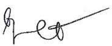
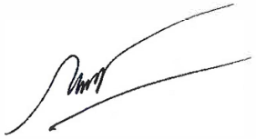
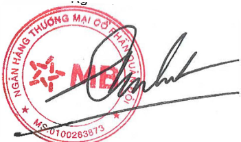
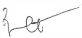
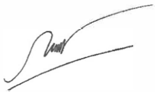
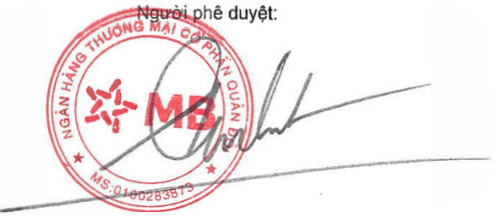
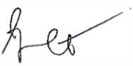
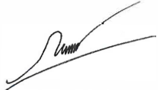
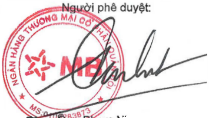

<otsl><fcel>Số/No: 561 /MB-HĐQT<nl><fcel>V/v: công bố thông tin báo cáo tài chính riêng và hợp nhất quý I năm 2026<nl><fcel>Re: disclosure of information of Separated & Consolidated Financial Statements for first quarter of 2026<nl></otsl>

# hplit
CỘNG HOÀ XÃ HỘI CHỦ NGHĨA VIỆT NAM
Độc lập - Tự do - Hạnh phúc
THE SOCIALIST REPUBLIC OF VIETNAM
Independence – Freedom - Happiness

da

Hà Nội, ngày 28 tháng 04 năm 2026

Ha Noi, 28 Apr 2026

## Kính gửi/To:

NGÂN Digitally signed by NGÂN HANG THUO'NG MAI CO PHAN QUAN ĐOI

HANG DN: C=VN, L=THAHH PHO HÀ NOI, CN=NGÂN HANG THUO'NG MAI CO PHAN QUAN ĐOI, OID.0.9.2342.19200300.100.1. 1=MST:0100283873

MAI CO Reason: I am the author of this document

PHAN Location: your signing location here

QUAN ĐOI Date: 2026-04-28 14:26:00 Foxit Reader Version: 9.7.0

- Ngân hàng Nhà nước Việt Nam

The State Bank of Vietnam

- Ủy ban Chứng khoán Nhà nước

The State Securities Commission;

- Sở giao dịch chứng khoán Việt Nam;

Vietnam Stock Exchange;

- Sở giao dịch chứng khoán Thành phố Hồ Chí Minh

Hochiminh Stock Exchange;

- Sở giao dịch chứng khoán Thành phố Hà Nội;

Hanoi Stock Exchange;

Công ty/Company: Ngân hàng TMCP Quân đổi / Military Commercial Joint Stock Bank

Mã chứng khoán/ MBB

Securities symbol

Địa chỉ trụ sở chính/ Số 18 Lê Văn Lương, Phường Yên Hòa, Thành phố Hà Nội

Head office address No 18 Le Van Luong, Yen Hoa Ward, Hanoi City

Điện thoại/Telephone: 024.6266.1088

Fax: 024.6266.1080

/**0####Nguroi thực hiện công bố Ông/Mr. Luru Trung Thái thông tin/ Submitted by:

<otsl><fcel>Chức vụ/Position:<fcel>Chủ tịch HĐQT / BOD Chairman<lcel><nl><fcel>Loai thông tin công bố/Type of Information<fcel>☑ định kỳ/periodic☐ 24 giờ/ hours<fcel>☐ bất thường/irregular☐ theo yêu cầu/on demand<nl></otsl>

Nội dung thông tin công bố: Báo cáo tài chính riêng và hợp nhất quý I năm 2026

Content of Information disclosure: Separated & Consolidated Financial Statements for $1^{st}$ Quarter of 2026

NGAN HANG THUONG MAI

-size-adjust

Thông tin trên đã được công bố trên trang thông tin điện tử MB www.mbbank.com.vn - Mục Nhà đầu tư – Phân Thông báo.

The above information was disclosed on MB website at www.mbbank.com.vn - Investors Relation - Announcement

<!-- page-break -->

## Ngân hàng Thương mai Cô phân Quân đối
Địa chỉ: Số 18 Lê Văn Lương - Phường Yến Hòa - Hà Nội
BÁO CÁO TÍNH HỊNH TÀI CHÍNH RIÊNG
Tại ngày 31 tháng 03 năm 2026

<table><tr><td rowspan="2"></td><td rowspan="2">Thuyết minh</td><td>31/03/2026</td><td>31/12/2025 đã kiểm toán</td></tr><tr><td>triệu đồng</td><td>triệu đồng</td></tr><tr><td>TÀI SAN</td><td></td><td></td><td></td></tr><tr><td>Tiền mặt, vàng bạc, đá quý</td><td>III.1</td><td>5.630.243</td><td>4.842.368</td></tr><tr><td>Tiền gửi tại Ngân hàng Nhà nước (“NHNN”)</td><td>III.2</td><td>13.306.026</td><td>66.404.931</td></tr><tr><td>Tiền, vàng gửi tại và cho vay các tổ chức tín dụng (“TCTD”) khác</td><td>III.3</td><td>155.691.708</td><td>168.866.071</td></tr><tr><td>Chứng khoản kinh doanh</td><td>III.4</td><td>3.304.860</td><td>3.050.285</td></tr><tr><td>Chứng khoản kinh doanh</td><td></td><td>3.304.860</td><td>3.050.285</td></tr><tr><td>Dự phòng rủi ro chứng khoản kinh doanh</td><td></td><td>-</td><td>-</td></tr><tr><td>Các công cụ tài chính phải sinh và các tài sản tài chính khác</td><td>III.18</td><td>-</td><td>-</td></tr><tr><td>Cho vay khách hàng</td><td></td><td>1.054.747.551</td><td>1.019.471.567</td></tr><tr><td>Cho vay khách hàng</td><td>III.5</td><td>1.067.845.358</td><td>1.031.103.706</td></tr><tr><td>Dự phòng rủi ro cho vay khách hàng</td><td>III.6</td><td>(13.097.807)</td><td>(11.632.139)</td></tr><tr><td>Hoạt động mua nợ</td><td>III.7</td><td>2.264.075</td><td>2.443.895</td></tr><tr><td>Mua nợ</td><td></td><td>2.287.269</td><td>2.465.314</td></tr><tr><td>Dự phòng rủi ro hoạt động mua nợ</td><td></td><td>(23.194)</td><td>(21.419)</td></tr><tr><td>Chứng khoản đầu tư</td><td>III.8</td><td>250.432.348</td><td>212.303.235</td></tr><tr><td>Chứng khoản đầu tư sản sáng để bán</td><td>III.8.1</td><td>250.455.030</td><td>211.971.942</td></tr><tr><td>Chứng khoản đầu tư giữ đến ngày đáo hạn</td><td>III.8.2</td><td>515.400</td><td>537.000</td></tr><tr><td>Dự phòng rủi ro chứng khoản đầu tư</td><td>III.9.3</td><td>(538.082)</td><td>(205.707)</td></tr><tr><td>Góp vốn, đầu tư dài hạn</td><td>III.9</td><td>8.744.597</td><td>8.745.197</td></tr><tr><td>Đầu tư vào công ty con</td><td>III.9.1</td><td>8.402.111</td><td>8.402.111</td></tr><tr><td>Đầu tư dài hạn khác</td><td>III.9.2</td><td>371.973</td><td>372.573</td></tr><tr><td>Dự phòng giảm giá đầu tư dài hạn</td><td>III.9.3</td><td>(29.487)</td><td>(29.487)</td></tr><tr><td>Tài sản cố định</td><td></td><td>4.528.125</td><td>4.632.979</td></tr><tr><td>Tài sản cố định hữu hình</td><td>III.10</td><td>3.228.629</td><td>3.306.227</td></tr><tr><td>Nguyên giá tài sản cố định</td><td></td><td>8.312.118</td><td>8.275.967</td></tr><tr><td>Hao môn tài sản cố định</td><td></td><td>(5.083.489)</td><td>(4.969.740)</td></tr><tr><td>Tài sản cố định vô hình</td><td>III.11</td><td>1.299.496</td><td>1.326.752</td></tr><tr><td>Nguyên giá tài sản cố định</td><td></td><td>4.231.767</td><td>4.183.529</td></tr><tr><td>Hao môn tài sản cố định</td><td></td><td>(2.932.271)</td><td>(2.856.777)</td></tr><tr><td>Tài sản Có khác</td><td></td><td>30.703.324</td><td>37.818.677</td></tr><tr><td>Các khoản phải thu</td><td>III.12</td><td>14.759.038</td><td>22.847.390</td></tr><tr><td>Các khoản lãi, phí phải thu</td><td></td><td>14.367.438</td><td>12.035.745</td></tr><tr><td>Tài sản Có khác</td><td>III.13</td><td>1.597.816</td><td>2.960.510</td></tr><tr><td>Dự phòng rủi ro cho các tài sản Có nội bằng khác</td><td>III.14</td><td>(20.968)</td><td>(24.968)</td></tr><tr><td>TONG TÀI SAN CÓ</td><td></td><td>1.529.352.857</td><td>1.528.579.205</td></tr></table>

<!-- page-break -->

## -size
Ngân hàng Thương mại Cổ phần Quán đổi
Địa chỉ: Số 18 Lê Văn Lương - Phường Yên Hòa - Hà Nội

## Dear CÁO TÍNH HIHN TÀI CHÍNH RIÊNG (tiếp theo)
Tai ngày 31 tháng 03 năm 2026

<table><tr><td rowspan="2"></td><td rowspan="2">Thuyết minh</td><td>31/03/2026</td><td>31/12/2025 đã kiểm toán</td></tr><tr><td>triệu đồng</td><td>triệu đồng</td></tr><tr><td>NỢ PHẢI TRÁ</td><td></td><td></td><td></td></tr><tr><td>Các khoản nợ Chính phủ và NHNN</td><td>III.15</td><td>28.346.499</td><td>47.474.800</td></tr><tr><td>Tiền gửi và vay các TCTD khác</td><td>III.16</td><td>232.167.498</td><td>220.585.065</td></tr><tr><td>Tiền gửi của khách hàng</td><td>III.17</td><td>905.800.592</td><td>917.083.583</td></tr><tr><td>Các công cụ tài chính phải sinh và các khoản nợ tài chính khác</td><td>III.18</td><td>661.326</td><td>698.507</td></tr><tr><td>Vốn tài trợ, ủy thác đầu tư, cho vay TCTD chịu rủi ro</td><td>III.19</td><td>5.100</td><td>6.284</td></tr><tr><td>Phát hành giấy tờ có giá</td><td>III.20</td><td>195.016.391</td><td>175.151.513</td></tr><tr><td>Các khoản nợ khác</td><td></td><td>29.668.114</td><td>36.939.797</td></tr><tr><td>Các khoản lãi, phí phải trả</td><td></td><td>15.742.312</td><td>12.817.185</td></tr><tr><td>Các khoản phải trả và công nợ khác</td><td>III.21</td><td>13.925.802</td><td>24.122.612</td></tr><tr><td>TONG NỢ PHẢI TRÁ</td><td></td><td>1.391.665.520</td><td>1.397.939.549</td></tr><tr><td>VỐN CHỦ SỞ HỮU</td><td></td><td></td><td></td></tr><tr><td>Vốn của TCTD</td><td></td><td>81.854.333</td><td>81.854.333</td></tr><tr><td>Vốn điều lệ</td><td></td><td>80.549.999</td><td>80.549.999</td></tr><tr><td>Thặng dư vốn cổ phần</td><td></td><td>1.304.334</td><td>1.304.334</td></tr><tr><td>Quỹ của TCTD</td><td></td><td>19.035.110</td><td>19.079.365</td></tr><tr><td>Lợi nhuận chưa phân phối</td><td></td><td>36.797.894</td><td>29.705.958</td></tr><tr><td>TONG VỐN CHỦ SỞ HỮU</td><td>III.22</td><td>137.687.337</td><td>130.639.656</td></tr><tr><td>TONG NỢ PHẢI TRÁ VÀ VỐN CHỦ SỞ HỮU</td><td></td><td>1.529.352.857</td><td>1.528.579.205</td></tr></table>

<!-- page-break -->

## Ngân hàng Thương mại Cổ phần Quản đối
Địa chỉ: Số 18 Lê Văn Lương - Phường Yên Hòa - Hà Nội

Dear CÁO TỈNH HINH TÀI CHÍNH RIÊNG (tiếp theo)

Tài ngày 31 tháng 03 năm 2026

*hàng
CÁC CHỈ TIÊU NGOÀI BÁO CÁO TÍNH HỊNH TÀI CHÍNH RIÊNG*

<table><tr><td rowspan="2"></td><td rowspan="2">Thuyết minh</td><td>31/03/2026</td><td>31/12/2025 đã kiểm toán</td></tr><tr><td>triệu đồng</td><td>triệu đồng</td></tr><tr><td>NGHIA VU NQ TIEM AN</td><td>V.1</td><td></td><td></td></tr><tr><td>Bảo lãnh vay vốn</td><td></td><td>1.681.823</td><td>1.684.717</td></tr><tr><td>Cam kết giao dịch hồi doái</td><td></td><td>723.980.330</td><td>618.888.427</td></tr><tr><td>- Cam kết mua ngoại tệ</td><td></td><td>1.302.737</td><td>9.738.358</td></tr><tr><td>- Cam kết bán ngoại tệ</td><td></td><td>2.160.046</td><td>8.752.345</td></tr><tr><td>- Cam kết mua giao dịch hoán đổi ngoại tệ</td><td></td><td>359.933.489</td><td>299.830.234</td></tr><tr><td>- Cam kết bán giao dịch hoán đổi ngoại tệ</td><td></td><td>360.584.058</td><td>300.567.490</td></tr><tr><td>Cam kết trong nghiệp vụ L/C</td><td></td><td>71.759.861</td><td>59.722.523</td></tr><tr><td>Bảo lãnh khác</td><td></td><td>185.870.200</td><td>190.104.216</td></tr><tr><td>Cam kết khác</td><td></td><td>116.579.336</td><td>126.935.262</td></tr></table>

Người lập:

Gueroi kiêm soát:

Dear Lê Thị HUYEN Trang

Giám doc trung tâm kế toán

Hà Nội, Việt Nam

Ngay 28 tháng 04 năm 2026

bà Đặng Thúy Dung

Ké toán trường

Người phê duyệt:

hplit

Bà Nguyễn Thị Thanh Nga

Giám đốc Tài chính

NGAN HANG THUONG MAI CO PHANQUAN
MB
MS.0100263873

Dear

Ông Phạm Nhu Ánh

Tổng Giám đốc

NGAN HANG TH
QUAN DOI

<!-- page-break -->

<table><tr><td rowspan="2"></td><td rowspan="2">Thuyết</td><td colspan="2">Số phát sinh Quý 1</td><td colspan="2">LUY KẾ D/DD NÄM ĐEN CUOI QUY</td></tr><tr><td>Näm nay</td><td>Näm trước</td><td>Näm nay</td><td>Näm trước</td></tr><tr><td></td><td></td><td>triệu đồng</td><td>triệu đồng</td><td>triệu đồng</td><td>triệu đồng</td></tr><tr><td>Thu nhập lãi và các khoản thu nhập tương tự</td><td></td><td>26.127.526</td><td>17.545.676</td><td>26.127.526</td><td>17.545.676</td></tr><tr><td>Chi phí lãi và các khoản chi phí tương tự</td><td></td><td>(13.603.847)</td><td>(7.693.320)</td><td>(13.603.847)</td><td>(7.693.320)</td></tr><tr><td>Thu nhập lãi thuần</td><td>IV.1</td><td>12.523.679</td><td>9.852.356</td><td>12.523.679</td><td>9.852.356</td></tr><tr><td>Thu nhập từ hoạt động dịch vụ</td><td></td><td>2.255.819</td><td>1.402.596</td><td>2.255.819</td><td>1.402.596</td></tr><tr><td>Chi phí hoạt động dịch vụ</td><td></td><td>(839.529)</td><td>(655.557)</td><td>(839.529)</td><td>(655.557)</td></tr><tr><td>Lãi thuần từ hoạt động dịch vụ</td><td>IV.2</td><td>1.416.290</td><td>747.039</td><td>1.416.290</td><td>747.039</td></tr><tr><td>Lãi thuần từ hoạt động ngoại hối</td><td>IV.3</td><td>(33.079)</td><td>538.866</td><td>(33.079)</td><td>538.866</td></tr><tr><td>Lãi thuần từ chứng khoản kinh doanh</td><td>IV.4</td><td>27.153</td><td>86.951</td><td>27.153</td><td>86.951</td></tr><tr><td>Lãi thuần từ chứng khoản đầu tư</td><td>IV.4</td><td>(388.552)</td><td>462.793</td><td>(388.552)</td><td>462.793</td></tr><tr><td>Lãi thuần từ hoạt động kinh doanh khác</td><td>IV.5</td><td>1.011.057</td><td>1.048.337</td><td>1.011.057</td><td>1.048.337</td></tr><tr><td>Thu nhập từ góp vốn, mua cổ phần</td><td>IV.6</td><td>-</td><td>-</td><td>-</td><td>-</td></tr><tr><td>TỔNG THU NHẬP HOAT ĐONG</td><td></td><td>14.556.548</td><td>12.736.342</td><td>14.556.548</td><td>12.736.342</td></tr><tr><td>TỔNG CHI PHÍ HOAT ĐONG</td><td>IV.7</td><td>(3.361.707)</td><td>(3.030.640)</td><td>(3.361.707)</td><td>(3.030.640)</td></tr><tr><td>Lợi nhuận thuần từ hoạt động kinh doanh trước chi phí dự phòng rui ro</td><td></td><td>11.194.841</td><td>9.705.702</td><td>11.194.841</td><td>9.705.702</td></tr><tr><td>Chi phí dự phòng rui ro</td><td>IV.9</td><td>(2.328.616)</td><td>(2.016.534)</td><td>(2.328.616)</td><td>(2.016.534)</td></tr><tr><td>TỔNG LỢI NHUẬN TRUOC THUÉ</td><td></td><td>8.866.225</td><td>7.689.168</td><td>8.866.225</td><td>7.689.168</td></tr><tr><td>Chi phí thuế TNDN hiện hành</td><td></td><td>(1.772.429)</td><td>(1.554.673)</td><td>(1.772.429)</td><td>(1.554.673)</td></tr><tr><td>Chi phí thuế TNDN</td><td>IV.11</td><td>(1.772.429)</td><td>(1.554.673)</td><td>(1.772.429)</td><td>(1.554.673)</td></tr><tr><td>LỢI NHUẬN SAU THUÉ</td><td></td><td>7.093.796</td><td>6.134.495</td><td>7.093.796</td><td>6.134.495</td></tr></table>

Người lập:

Guài kiêm soát:

Dear Thj HUYên Trang

Giám doc trung tâm kế toán

Hà Nội, Việt Nam

Ngay 28 tháng 04 năm 2026

ubò Đăng Thúy Dung

Ké toán trưởng

Đà Nguyễn Thị Thanh Nga

Giám đốc Tài chính

Người phê duyệt:

Ông Phạm Nhu Anh

Tổng Giám đốc

<!-- page-break -->

## d内容
Ngân hàng Thương mại Cổ phần Quản đối

Địa chỉ: Số 18 Lê Văn Lương – Phường Yên Hòa – Hà Nội

Dear CÁO LƯU CHUYẾN TIỀN TỆ RIÊNG (phương pháp trực tiếp)

Tại ngày 31 tháng 03 năm 2026

<table><tr><td rowspan="2"></td><td rowspan="2">Thuyết minh</td><td>Giai đoạn từ 01/01/2026 đến 31/03/2026</td><td>Giai đoạn từ 01/01/2025 đến 31/03/2025</td></tr><tr><td>triệu đồng</td><td>triệu đồng</td></tr><tr><td>LUU CHUYỀN TIỀN TỪ HOẠT ĐỒNG KINH DOANH</td><td></td><td></td><td></td></tr><tr><td>Thu lãi và các khoản thu tương tự nhận được</td><td></td><td>24.251.407</td><td>16.112.492</td></tr><tr><td>Chi lãi và các khoản chi tương tự đã trả</td><td></td><td>(11.258.455)</td><td>(6.470.081)</td></tr><tr><td>Thu nhập từ hoạt động dịch vụ nhận được</td><td></td><td>1.416.290</td><td>747.039</td></tr><tr><td>Chênh lệch số tiền thực thu/(thực chi) từ hoạt động kinh doanh (ngoại tệ, chứng khoán)</td><td></td><td>62.057</td><td>1.164.391</td></tr><tr><td>Thu nhập/(Chi phí) khác</td><td></td><td>367.075</td><td>126.300</td></tr><tr><td>Tiền thu các khoản nợ đã được xử lý,xoá, bù đáp bằng nguồn dự phòng rủi ro</td><td></td><td>643.472</td><td>921.928</td></tr><tr><td>Tiền chi trả cho nhân viên và hoạt động quản lý công vụ</td><td></td><td>(4.655.561)</td><td>(3.755.736)</td></tr><tr><td>Tiền thuế thu nhập thực nộp trong kỳ</td><td>IV.10</td><td>(3.544.880)</td><td>(2.976.467)</td></tr><tr><td>Luu chuyển tiền thuần từ hoạt động kinh doanh trước những thay đổi về tài sản và vốn lưu động</td><td></td><td>7.281.405</td><td>5.869.866</td></tr><tr><td>Nhùng thay đổi về tài sản hoạt động</td><td></td><td>(64.644.470)</td><td>(54.572.012)</td></tr><tr><td>(Tăng)/Giảm các khoản tiền gửi và cho vay các TCTD khác</td><td></td><td>1.784.116</td><td>2.233.881</td></tr><tr><td>(Tăng)/Giảm các khoản về kinh doanh chứng khoán</td><td></td><td>(38.716.063)</td><td>(39.132.833)</td></tr><tr><td>(Tăng)/ Giảm các công cu tài chính phải sinh và các tài sản tài chính khác</td><td></td><td>-</td><td>-</td></tr><tr><td>(Tăng)/Giảm các khoản cho vay khách hàng và mua nợ</td><td></td><td>(36.563.607)</td><td>(19.014.732)</td></tr><tr><td>Giảm nguồn dự phòng để xử lý rủi ro, xử lý, bù đáp tón thất các khoản (tin dụng, chứng khoán, đầu tư, phải thu khác)</td><td></td><td>(862.039)</td><td>(2.397.552)</td></tr><tr><td>(Tăng)/Giảm khác về tài sản hoạt động</td><td></td><td>9.713.123</td><td>3.739.224</td></tr><tr><td>Nhùng thay đổi về công nợ hoạt động</td><td></td><td>(2.188.019)</td><td>21.344.333</td></tr><tr><td>Tăng/(Giảm) các khoản nợ Chính phủ và NHNN</td><td></td><td>(19.128.301)</td><td>(2.661.864)</td></tr><tr><td>Tăng/(Giảm) các khoản tiền gửi, tiền vay các TCTD khác</td><td></td><td>11.582.433</td><td>695.873</td></tr><tr><td>Tăng/(Giảm) tiền gửi của khách hàng</td><td></td><td>(11.282.991)</td><td>9.138.645</td></tr><tr><td>Tăng/(Giảm) phát hành giấy tờ có giá</td><td></td><td>23.663.441</td><td>14.559.507</td></tr><tr><td>Tăng/(Giảm) vốn tài trợ, ủy thác đầu tư, cho vay mà TCTD chịu rủi ro</td><td></td><td>(1.184)</td><td>(5.349)</td></tr><tr><td>Tăng/(Giảm) các công cu tài chính phải sinh</td><td></td><td>(37.182)</td><td>334.688</td></tr><tr><td>Tăng/(Giảm) khác của các khoản nợ khác</td><td></td><td>(6.938.120)</td><td>(570.750)</td></tr><tr><td>Chi từ các quỹ của TCTD</td><td></td><td>(46.115)</td><td>(146.417)</td></tr><tr><td>Luu chuyển tiền thuần từ hoạt động kinh doanh</td><td></td><td>(59.551.084)</td><td>(27.357.813)</td></tr><tr><td>LUU CHUYỀN TIỀN TỪ HOẠT ĐỒNG DAUDU</td><td></td><td></td><td></td></tr><tr><td>Mua sắm tài sản cố định</td><td></td><td>(352.741)</td><td>(147.255)</td></tr><tr><td>Tiền thu từ thanh lý, nhượng bán tài sản cố định</td><td></td><td>510</td><td>109</td></tr><tr><td>Tiền thu/(chi) đầu tư, góp vốn vào các đơn vị khác (Dầu tư bán/(mua) công ty con, góp vốn liên doanh, liên kết và các khoản đầu tư dài hạn khác)</td><td></td><td>600</td><td>(182.059)</td></tr><tr><td>Tiền thu cổ tức và lợi nhuận được chia từ các khoản đầu tư, góp vốn dài hạn</td><td></td><td>-</td><td>-</td></tr><tr><td>Luu chuyển tiền thuần sử dụng trong hoạt động đầu tư</td><td></td><td>(351.631)</td><td>(329.205)</td></tr></table>

<!-- page-break -->

# -size
Ngân hàng Thương mại Cổ phần Quản đối
Địa chỉ: Số 18 Lê Văn Lương – Phường Yên Hòa – Hà Nội

# -size-adjust
BÁO CÁO LƯU CHUYẾN TIÊN TỆ RIÊNG (tiếp theo)
Tại ngày 31 tháng 03 năm 2026

<table><tr><td rowspan="2"></td><td>Thuyết minh</td><td>Giai đoạn từ 01/01/2026 đến 31/03/2026</td><td>Giai đoạn từ 01/01/2025 đến 31/03/2025</td></tr><tr><td></td><td>triệu đồng</td><td>triệu đồng</td></tr><tr><td>LƯU CHUYẾN TIỀN TỪ HOẠT ĐỒNG TÀI CHIHNH</td><td></td><td></td><td></td></tr><tr><td>Tăng vốn có phân từ góp vốn và/hoặc phát hành có phiếu</td><td></td><td>-</td><td>-</td></tr><tr><td>Tiền thu từ phát hành giấy tờ có giá dài hạn đủ điều kiện tính vào vốn tự có và các khoản vốn vay dài hạn khác</td><td></td><td>-</td><td>2.198.563</td></tr><tr><td>Tiền chi thanh toán giấy tờ có giá dài hạn có đủ điều kiện tính vào vốn tự có và các khoản vốn vay dài hạn khác</td><td></td><td>(3.798.563)</td><td>-</td></tr><tr><td>Cổ tức trả cho cổ đông trong kỳ</td><td></td><td>-</td><td>-</td></tr><tr><td>Lưu chuyển tiền thuần từ hoạt động tài chính</td><td></td><td>(3.798.563)</td><td>2.198.563</td></tr><tr><td>Lưu chuyển tiền thuần trong kỳ</td><td></td><td>(63.701.278)</td><td>(25.488.455)</td></tr><tr><td>Tiền và các khoản tương đương tiền tại thời điểm đầu kỳ</td><td></td><td>238.279.619</td><td>100.666.711</td></tr><tr><td>Tiền và các khoản tương đương tiền tại thời điểm cuối kỳ</td><td>IV.12</td><td>174.578.341</td><td>75.178.256</td></tr></table>

Người lập:

Dear Lê Thị HUYên Trang

Giám doc trung tâm kế toán

Hà Nội, Việt Nam

Ngày 28 tháng 04 năm 2026

Guruoi kiêm soát:

Dear Thúy Dung

Ké toán trường

Bà Nguyễn Thị Thanh Nga

Giám đốc Tài chính

Dong Pham Nhu Anh

Tổng Giám đốc

