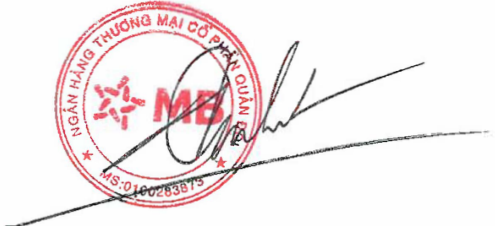
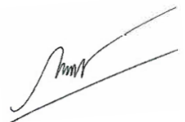
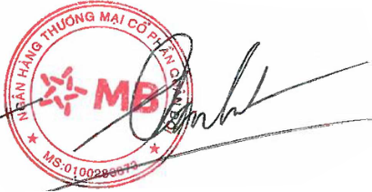

#include Số/No: 1470/MB-HDQT

V/v: công bố thông tin báo cáo tài chính riêng và hợp nhất quý III năm 2026

Re: disclosure of information of Separated & Consolidated Financial Statements for third quarter of 2026

# hplit
CỘNG HOÀ XÃ HỘI CHỦ NGHĨA VIỆT NAM
Độc lập - Tự do - Hạnh phúc
THE SOCIALIST REPUBLIC OF VIETNAM
Independence - Freedom - Happiness

Dsđà Noi, ngày 30 tháng 10 năm 2026

Ha Noi, 30 October 2026

Thì: - Ngân hàng Nhà nước Việt Nam

The State Bank of Vietnam

- Ủy ban Chứng khoán Nhà nước

The State Securities Commission;

- Sở giao dịch chứng khoán Việt Nam;

Vietnam Stock Exchange;

- Sở giao dịch chứng khoán Thành phố Hồ Chí Minh

Hochiminh Stock Exchange;

- Sở giao dịch chứng khoán Thành phố Hà Nội;

Hanoi Stock Exchange;

Công ty/Company: Ngân hàng TMCP Quản đối / Military Commercial Joint Stock Bank

Mã chứng khoán/ MBB

Securities symbol

Địa chỉ trụ sở chính/ Head office address Sở 18 Lê Văn Lương, Phường Yên Hòa, Thành phố Hà Nội No 18 Le Van Lương, Yen Hoa Ward, Hanoi City

Tel: 024.6266.1088

Fax: 024.6266.1080

/** Pequì thực hiện công bố Ông/Mr. Lru Trung Thái thông tin/ Submitted by:

<otsl><fcel>Chức vụ/Position:<fcel>Chủ tịch HDQT / BOD Chairman<lcel><nl><fcel>Loại thông tin công bố/Type of Information<fcel>☑ định kỳ/periodic☐ 24 giờ/hours<fcel>☐ bất thường/irregular☐ theo yêu cầu/on demand<nl></otsl>

Nội dung thông tin công bố: Báo cáo tài chính riêng và hợp nhất quý III năm 2026

Content of Information disclosure: Separated & Consolidated Financial Statements for 3$^{rd}$ Quarter of 2026

-size-init;

Thông tin trên đã được công bố trên trang thông tin điện tử MB www.mbbank.com.vn - Mục Nhà đầu tư – Phân Thông báo.

The above information was disclosed on MB website at www.mbbank.com.vn - Investors Relation - Announcement

NGAN HANG THUON
MS:

<!-- page-break -->

Ngân hàng TMCP Quân đối xin cam kết các thông tin công bố trên day là đúng sự thất và hoàn toàn chịu trách nhiệm trước pháp luật về nội dung các thông tin đã công bố.

assistant{MB declares that all information provided above is true and accurate and we shall take full responsibility before the law for the disclosed information.

Trân trọng cảm on!

Best Regards!

Noi nhận/ Recipients:

- Nhu trên/As above;

- HDQT, BKS (b/c) / BOD, SB (for reporting);

- Luru: VT, VP HDQT./

Archive at Admin Office, BOD Office.

CHỦ TIch HOI ĐÔNG QUẢN TRI

BOD CHAIRMAN

NGAN HANG THUONG MAI CO PHAN QUANG
MB
MS:0100283873

Trung Thái

MAI CO PHAN QUAN DOI
MB
283873

<!-- page-break -->

## iable
Ngân hàng Thương mại Cổ phần Quản đối
Địa chỉ: Số 18 Lê Văn Lương – Phường Yên Hòa – Thành Phó Hà Nội

Dear CÁO TÍNH HIHN TÀI CHÍNH HỢP NHẤT

Tài ngày 30 tháng 09 năm 2026

<table><tr><td rowspan="2"></td><td rowspan="2">Thuyết minh</td><td>30/09/2026</td><td>31/12/2025 đã kiểm toán</td></tr><tr><td>triệu đồng</td><td>triệu đồng</td></tr><tr><td>TÀI SAN</td><td></td><td></td><td></td></tr><tr><td>Tiền mặt, vàng bạc, đã quý</td><td>III.1</td><td>4.844.018</td><td>4.965.786</td></tr><tr><td>Tiền gửi tại Ngan hàng Nhà nước (“NHNN”)</td><td>III.2</td><td>15.822.936</td><td>68.494.426</td></tr><tr><td>Tiền, vàng gửi và cho vay các tổ chức tín dụng (“TCTD”) khác</td><td>III.3</td><td>183.829.058</td><td>182.923.726</td></tr><tr><td>Chứng khoản kinh doanh</td><td>III.4</td><td>41.443.685</td><td>4.653.229</td></tr><tr><td>Chứng khoản kinh doanh</td><td></td><td>41.494.707</td><td>4.692.622</td></tr><tr><td>Dư phòng rủi ro chứng khoản kinh doanh</td><td></td><td>(51.022)</td><td>(39.393)</td></tr><tr><td>Cho vay khách hàng</td><td></td><td>1.269.946.556</td><td>1.070.868.777</td></tr><tr><td>Cho vay khách hàng</td><td>III.5</td><td>1.288.128.443</td><td>1.084.019.370</td></tr><tr><td>Dư phòng rủi ro cho vay khách hàng</td><td>III.6</td><td>(18.181.887)</td><td>(13.150.593)</td></tr><tr><td>Hoạt động mua nợ</td><td>III.7</td><td>6.435.425</td><td>2.443.895</td></tr><tr><td>Mua nợ</td><td></td><td>6.489.462</td><td>2.465.314</td></tr><tr><td>Dư phòng rủi ro hoạt động mua nợ</td><td></td><td>(54.037)</td><td>(21.419)</td></tr><tr><td>Chứng khoản đầu tư</td><td>III.8</td><td>256.975.081</td><td>225.574.850</td></tr><tr><td>Chứng khoản đầu tư sản sáng để bán</td><td>III.8.1</td><td>252.453.626</td><td>221.512.464</td></tr><tr><td>Chứng khoản đầu tư giữ đến ngày đáo hạn</td><td>III.8.2</td><td>4.758.333</td><td>4.295.125</td></tr><tr><td>Dư phòng rủi ro chứng khoản đầu tư</td><td></td><td>(236.878)</td><td>(232.739)</td></tr><tr><td>Góp vốn, đầu tư dài hạn</td><td>III.9</td><td>430.520</td><td>468.396</td></tr><tr><td>Đầu tư dài hạn khác</td><td>III.9.1</td><td>521.748</td><td>559.624</td></tr><tr><td>Dư phòng giảm giá đầu tư dài hạn</td><td></td><td>(91.228)</td><td>(91.228)</td></tr><tr><td>Tài sản cố định</td><td></td><td>6.112.427</td><td>5.616.547</td></tr><tr><td>Tài sản cố định hữu hình</td><td>III.10</td><td>4.273.312</td><td>3.805.533</td></tr><tr><td>Nguyên giá tài sản cố định</td><td></td><td>10.208.543</td><td>9.423.236</td></tr><tr><td>Hao món tài sản cố định</td><td></td><td>(5.935.231)</td><td>(5.617.703)</td></tr><tr><td>Tài sản cố định vô hình</td><td>III.11</td><td>1.839.115</td><td>1.811.014</td></tr><tr><td>Nguyên giá tài sản cố định</td><td></td><td>6.071.338</td><td>5.684.904</td></tr><tr><td>Hao món tài sản cố định</td><td></td><td>(4.232.223)</td><td>(3.873.890)</td></tr><tr><td>Bắt động sản đầu tư</td><td>III.12</td><td>213.258</td><td>222.313</td></tr><tr><td>Nguyên giá bất động sản đầu tư</td><td></td><td>250.155</td><td>255.126</td></tr><tr><td>Hao món bất động sản đầu tư</td><td></td><td>(36.897)</td><td>(32.313)</td></tr><tr><td>Tài sản Có khác</td><td></td><td>51.804.488</td><td>49.531.482</td></tr><tr><td>Các khoản phải thu</td><td>III.13</td><td>22.120.894</td><td>28.125.764</td></tr><tr><td>Các khoản lãi, phí phải thu</td><td></td><td>19.827.834</td><td>13.549.018</td></tr><tr><td>Tài sản thuế TNDN hoãn lại</td><td></td><td>40.382</td><td>34.339</td></tr><tr><td>Tài sản Có khác</td><td>III.14</td><td>9.888.397</td><td>7.894.091</td></tr><tr><td>Dư phòng rủi ro cho các tài sản Có nội bằng khác</td><td></td><td>(73.019)</td><td>(71.730)</td></tr><tr><td>TONG TÀI SAN CÓ</td><td></td><td>1.837.857.452</td><td>1.615.763.927</td></tr></table>

<!-- page-break -->

## iable
Ngân hàng Thương mại Cổ phần Quản đối
Địa chỉ: Số 18 Lê Văn Lương – Phường Yên Hòa – Thành Phó Hà Nội

<otsl>BÁO CÁO TÍNH HIHNH TÀI CHÍNH HỢP NHẤT (tiếp theo)

Tài ngày 30 tháng 09 năm 2026

<table><tr><td rowspan="2"></td><td rowspan="2">Thuyết minh</td><td>30/09/2026</td><td>31/12/2025 đã kiểm toán</td></tr><tr><td>triệu đồng</td><td>triệu đồng</td></tr><tr><td>NQ PHẢI TRẢ</td><td></td><td></td><td></td></tr><tr><td>Các khoản nợ Chính phủ và NHNN</td><td>III.15</td><td>37.855.678</td><td>47.474.800</td></tr><tr><td>Tiền gửi và vay các TCTD khác</td><td>III.16</td><td>265.848.000</td><td>248.017.489</td></tr><tr><td>Tiền gửi của khách hàng</td><td>III.17</td><td>993.988.042</td><td>921.368.132</td></tr><tr><td>Các công cụ tài chính phải sinh và các khoản nợ tài chính khác</td><td>III.18</td><td>697.387</td><td>698.507</td></tr><tr><td>Vốn tài trợ, ủy thác đầu tư, cho vay TCTD chịu rủi ro</td><td>III.19</td><td>2.139.069</td><td>3.912.833</td></tr><tr><td>Phát hành giấy tờ có giá</td><td>III.20</td><td>302.399.200</td><td>187.236.104</td></tr><tr><td>Các khoản nợ khác</td><td></td><td>70.788.468</td><td>65.033.537</td></tr><tr><td>Các khoản lãi, phí phải trả</td><td></td><td>22.754.159</td><td>13.245.868</td></tr><tr><td>Thuế TNDN hoãn lại phải trả</td><td></td><td>-</td><td>-</td></tr><tr><td>Các khoản phải trả và công nợ khác</td><td>III.21</td><td>48.031.854</td><td>51.785.481</td></tr><tr><td>Dư phòng các khoản nợ khác</td><td></td><td>2.455</td><td>2.188</td></tr><tr><td>TONG NQ PHẢI TRẢ</td><td></td><td>1.673.715.844</td><td>1.473.741.402</td></tr><tr><td>VỐN CHỦ SỞ HỮU</td><td></td><td></td><td></td></tr><tr><td>Vốn và các quỹ</td><td></td><td></td><td></td></tr><tr><td>Vốn của TCTD</td><td>III.22</td><td>104.103.044</td><td>83.965.544</td></tr><tr><td>Vốn điều lệ</td><td></td><td>100.687.499</td><td>80.549.999</td></tr><tr><td>Thặng dư vốn cổ phần</td><td></td><td>1.304.334</td><td>1.304.334</td></tr><tr><td>Vốn khác</td><td></td><td>2.111.211</td><td>2.111.211</td></tr><tr><td>Quy của TCTD</td><td></td><td>24.836.962</td><td>19.390.884</td></tr><tr><td>Chênh lệch tỷ giá hối doái</td><td></td><td>178.108</td><td>202.211</td></tr><tr><td>Lợi nhuận chưa phân phối</td><td></td><td>27.898.649</td><td>32.577.391</td></tr><tr><td>Lợi ích của cổ đông KHONG KIỂM SOÁT</td><td></td><td>7.124.845</td><td>5.886.495</td></tr><tr><td>TONG VỐN CHỦ SỞ HỮU</td><td></td><td>164.141.608</td><td>142.022.525</td></tr><tr><td>TONG NQ PHẢI TRẢ VÀ VỐN CHỦ SỞ HỮU</td><td></td><td>1.837.857.452</td><td>1.615.763.927</td></tr></table>

<!-- page-break -->

# -size-adjust
BÁO CÁO TÍNH HIHNH TÀI CHÍNH HỢP NHẤT (tiếp theo)
Tài ngày 30 tháng 09 năm 2026

CÁC CHỈ TIÊU NGOÀI BÁO CÁO TÍNH HỊNH TÀI CHÍNH HỢP NHẤT

<table><tr><td rowspan="2"></td><td rowspan="2">Thuyết minh</td><td>30/09/2026</td><td>31/12/2025 đã kiểm toán</td></tr><tr><td>triệu đồng</td><td>triệu đồng</td></tr><tr><td>NGHIA VU NỢ TIEM AN</td><td>V.1</td><td></td><td></td></tr><tr><td>Bảo lãnh vay vốn</td><td></td><td>2.232.092</td><td>1.684.717</td></tr><tr><td>Cam kết giao dịch hồi doái</td><td></td><td>741.843.792</td><td>618.888.427</td></tr><tr><td>- Cam kết mua ngoại tệ</td><td></td><td>2.193.395</td><td>9.738.358</td></tr><tr><td>- Cam kết bán ngoại tệ</td><td></td><td>1.778.466</td><td>8.752.345</td></tr><tr><td>- Cam kết mua giao dịch hoán đổi ngoại tệ</td><td></td><td>366.554.847</td><td>299.830.234</td></tr><tr><td>- Cam kết bán giao dịch hoán đổi ngoại tệ</td><td></td><td>371.317.084</td><td>300.567.490</td></tr><tr><td>Cam kết trong nghiệp vụ LC</td><td></td><td>80.667.381</td><td>59.728.018</td></tr><tr><td>Bảo lãnh khác</td><td></td><td>238.231.032</td><td>190.317.517</td></tr><tr><td>Các cam kết khác</td><td></td><td>114.669.741</td><td>127.878.633</td></tr></table>

Người lập:

Guiai kiêm soát:

Dear Thí Huyên Trang

Giám doc trung tâm kế toán

Hà Nội, Việt Nam

Ngay 20 tháng 10 năm 2026

Gueroi phê duyệt:

bà Đặng Thúy Dung

Ké toán trường

Đà Nguyễn Thị Thanh Nga

Giám đốc Tài chính

NGAN HANG THUONG MAI CO PHAN QI
MB
MS:0100283873

tightly

Ông Pham Nhu Anh

Tổng Giám đốc

<!-- page-break -->

*Thưong mai Cổ phân Quản đổi
Địa chỉ: Số 18 Lê Văn Lương – Phường Yên Hòa – Thành Phô Hà Nội
BÁO CÁO KẾT QUẢ HOẠT ĐỘNG HỢP NHẤT
Quy III/2026*

<table><tr><td rowspan="3"></td><td rowspan="3">Thuyết minh</td><td colspan="2">Số phát sinh quý III</td><td colspan="2">LUY KẾ TỪ DAU NAIL ĐEN CUOI QUY</td></tr><tr><td>Năm nay</td><td>Năm trước</td><td>Năm nay</td><td>Năm trước</td></tr><tr><td>triệu đồng</td><td>triệu đồng</td><td>triệu đồng</td><td>triệu đồng</td></tr><tr><td>Thu nhập lãi và các khoản thu nhập tương tự</td><td></td><td>37.792.619</td><td>22.265.897</td><td>100.781.528</td><td>62.955.335</td></tr><tr><td>Chi phí lãi và các khoản chi phí tương tự</td><td></td><td>(19.956.645)</td><td>(9.275.373)</td><td>(51.138.783)</td><td>(25.900.510)</td></tr><tr><td>Thu nhập lãi thuần</td><td>IV.1</td><td>17.835.974</td><td>12.990.524</td><td>49.642.745</td><td>37.054.825</td></tr><tr><td>Thu nhập từ hoạt động dịch vụ</td><td></td><td>4.541.097</td><td>4.234.200</td><td>14.374.625</td><td>12.460.036</td></tr><tr><td>Chi phí hoạt động dịch vụ</td><td></td><td>(2.863.335)</td><td>(2.907.645)</td><td>(9.182.444)</td><td>(7.982.522)</td></tr><tr><td>Lãi thuần từ hoạt động dịch vụ</td><td>IV.2</td><td>1.677.762</td><td>1.326.555</td><td>5.192.181</td><td>4.477.514</td></tr><tr><td>Lãi thuần từ hoạt động kinh doanh ngoại hới</td><td>IV.3</td><td>361.492</td><td>424.608</td><td>467.026</td><td>1.496.529</td></tr><tr><td>Lãi thuần từ mua bán chứng khoán kinh doanh</td><td>IV.4</td><td>279.987</td><td>172.422</td><td>529.511</td><td>588.122</td></tr><tr><td>Lãi thuần từ mua bán chứng khoán đầu tư</td><td>IV.4</td><td>8.136</td><td>(527.544)</td><td>11.723</td><td>767.729</td></tr><tr><td>Lãi thuần từ hoạt động kinh doanh khác</td><td>IV.5</td><td>927.265</td><td>1.197.659</td><td>3.087.574</td><td>3.740.666</td></tr><tr><td>Thu nhập từ góp vốn, mua cổ phần</td><td>IV.6</td><td>827</td><td>12.470</td><td>25.203</td><td>39.684</td></tr><tr><td>TONG THU NHAP HOAT ĐONG</td><td></td><td>21.091.443</td><td>15.596.694</td><td>58.955.963</td><td>48.165.069</td></tr><tr><td>TONG CHI PHÍ HOAT ĐONG</td><td>IV.7</td><td>(5.520.053)</td><td>(4.545.266)</td><td>(15.494.414)</td><td>(13.451.694)</td></tr><tr><td>Lợi nhuận thuần từ hoạt động kinh doanh trước chi phí dự phòng rui ro</td><td></td><td>15.571.390</td><td>11.051.428</td><td>43.461.549</td><td>34.713.375</td></tr><tr><td>Chi phí dự phòng rui ro</td><td>IV.9</td><td>(5.241.290)</td><td>(3.801.508)</td><td>(12.943.191)</td><td>(11.574.139)</td></tr><tr><td>TONG LOI NHUAN TRUOC THUÉ</td><td></td><td>10.330.100</td><td>7.249.920</td><td>30.518.358</td><td>23.139.236</td></tr><tr><td>Chi phí thuế TNDN hiện hành</td><td></td><td>(2.074.288)</td><td>(1.452.742)</td><td>(6.124.318)</td><td>(4.658.225)</td></tr><tr><td>Chi phí thuế TNDN hoán lại</td><td></td><td>(3.939)</td><td>3.263</td><td>6.026</td><td>(985)</td></tr><tr><td>Chi phí thuế TNDN trong kỳ</td><td>IV.11</td><td>(2.078.227)</td><td>(1.449.479)</td><td>(6.118.292)</td><td>(4.659.210)</td></tr><tr><td>LOI NHUAN SAU THUÉ</td><td></td><td>8.251.873</td><td>5.800.441</td><td>24.400.066</td><td>18.480.026</td></tr><tr><td>Lợi ích của có đồng không kiểm soát</td><td></td><td>212.376</td><td>229.417</td><td>615.994</td><td>463.657</td></tr><tr><td>LOI NHUAN SAU THUÉ CUA NGAN HANG</td><td></td><td>8.039.497</td><td>5.571.024</td><td>23.784.072</td><td>18.016.369</td></tr></table>

Người lập:

Guruoi kiêm soát:

Nguoi phê duyệt:

Bà Lê Thị HUYên Trang

Giám đốc trung tâm kế toán

Hà Nội, Việt Nam

Ngày 20 tháng 10 năm 2026

bà Đăng Thúy Dung

Ké toán trường

hplit

Bà Nguyễn Thị Thanh Nga

Giám doc Tài chính

Đông Pham Nhu Ánh

Tổng Giám đốc

<!-- page-break -->

Below is the text from the image:

Ngân hàng Thương mại Cổ phần Quản động

Địa chỉ: Số 18 Lê Văn Lương – Phường Yến Hòa – Thành Phó Hà Nội

BÁO CÁO LƯU CHUYỄN TIỀN TỆ HỢP NHẤT (phương pháp trực tiếp)

Tài ngày 30 tháng 09 năm 2026

<table><tr><td rowspan="2"></td><td rowspan="2">Thuyết minh</td><td>Giai đoạn từ 01/01/2026 đến 30/09/2026</td><td>Giai đoạn từ 01/01/2025 đến 30/09/2025</td></tr><tr><td>triệu đồng</td><td>triệu đồng</td></tr><tr><td>LUU CHUYẾN TIỀN TỪ HOẠT ĐỒNG KINH DOANH</td><td></td><td></td><td></td></tr><tr><td>Thu lãi và các khoản thu tương tự nhận được</td><td></td><td>94.508.911</td><td>60.560.839</td></tr><tr><td>Chi lãi và các khoản chi tương tự đã trả</td><td></td><td>(42.132.405)</td><td>(25.199.442)</td></tr><tr><td>Thu nhập từ hoạt động dịch vụ nhận được</td><td></td><td>7.099.412</td><td>4.477.514</td></tr><tr><td>Chênh lệch số tiền thực thu/(chi) từ hoạt động kinh doanh (ngoai tế, vàng bạc, chứng khoản)</td><td></td><td>1.298.885</td><td>3.443.732</td></tr><tr><td>Thu nhập/(Chi phí) khác</td><td></td><td>999.875</td><td>597.722</td></tr><tr><td>Tiền thu các khoản nợ đã được xử lý,xoá, bù đáp bằng nguồn rúi ro</td><td></td><td>2.079.601</td><td>2.912.170</td></tr><tr><td>Tiền chi trả cho nhân viên và hoạt động quản lý, công vụ</td><td></td><td>(15.644.380)</td><td>(13.071.918)</td></tr><tr><td>Tiền thuế thu nhập doanh nghiệp thực nộp trong kỳ</td><td>IV.10</td><td>(7.885.447)</td><td>(5.063.803)</td></tr><tr><td>Luu chuyển tiền thuần từ hoạt động kinh doanh trước những thay đổi về tài sản và vốn lưu động</td><td></td><td>40.324.452</td><td>28.656.814</td></tr><tr><td>Nhùng thay đổi về tài sản hoạt động</td><td></td><td>(287.828.153)</td><td>(190.269.302)</td></tr><tr><td>(Tăng)/Giảm các khoản tiền gửi và cho vay các TCTD khác</td><td></td><td>(7.827.841)</td><td>(1.781.347)</td></tr><tr><td>(Tăng)/Giảm các khoản về kinh doanh chứng khoản</td><td></td><td>(68.206.455)</td><td>(21.853.766)</td></tr><tr><td>(Tăng)/Giảm các công cu tài chính phải sinh và các tài sản tài chính khác</td><td></td><td>-</td><td>-</td></tr><tr><td>(Tăng)/Giảm các khoản cho vay khách hàng và mua nợ</td><td></td><td>(208.133.221)</td><td>(156.348.069)</td></tr><tr><td>Giảm nguồn dự phòng để xử lý rúi ro, xử lý, bù đáp tön thất các khoản (tín dung, chứng khoản, đầu tư, phải thu khác)</td><td></td><td>(7.877.179)</td><td>(9.453.907)</td></tr><tr><td>(Tăng)/Giảm khác về tài sản hoạt động</td><td></td><td>4.216.543</td><td>(849.108)</td></tr><tr><td>Nhùng thay đổi về công nợ hoạt động</td><td></td><td>182.238.796</td><td>173.534.073</td></tr><tr><td>Tăng/(Giảm) các khoản nợ Chính phủ và NHNN</td><td></td><td>(9.619.122)</td><td>14.999.043</td></tr><tr><td>Tăng/(Giảm) các khoản tiền gửi, tiền vay các TCTD khác</td><td></td><td>17.830.511</td><td>44.155.785</td></tr><tr><td>Tăng/(Giảm) tiền gửi của khách hàng</td><td></td><td>72.619.910</td><td>73.875.849</td></tr><tr><td>Tăng/(Giảm) phát hành giấy tờ có giá</td><td></td><td>108.762.659</td><td>32.803.256</td></tr><tr><td>Tăng/(Giảm) vốn tài trợ, ủy thức đầu tư, cho vay mà TCTD chịu rúi ro</td><td></td><td>(1.773.764)</td><td>1.255.264</td></tr><tr><td>Tăng/(Giảm) các công cu tài chính phải sinh và các tài sản tài chính khác</td><td></td><td>(1.120)</td><td>1.036.700</td></tr><tr><td>Tăng/(Giảm) khác về công nợ hoạt động</td><td></td><td>(5.120.233)</td><td>5.886.673</td></tr><tr><td>Chi từ các quy của TCTD</td><td></td><td>(460.045)</td><td>(478.497)</td></tr><tr><td>Luu chuyển tiền thuần từ hoạt động kinh doanh</td><td></td><td>(65.264.905)</td><td>11.921.585</td></tr><tr><td>LUU CHUYẾN TIỀN TỪ HOẠT ĐỒNG DAUDU TU</td><td></td><td></td><td></td></tr><tr><td>Mua sám tài sản có định</td><td></td><td>(1.559.173)</td><td>(926.144)</td></tr><tr><td>Tiền thu từ thanh lý, nhượng bán tài sản có định</td><td></td><td>8.098</td><td>230.774</td></tr><tr><td>Tiền thu/(chi) bất động sản đầu tư</td><td></td><td>-</td><td>-</td></tr><tr><td>Tiền thu/(chi) đầu tư, góp vốn vào các đơn vi khác</td><td></td><td>4.110</td><td>(521.997)</td></tr><tr><td>Tiền thu có tức và lợi nhuận được chia từ các khoản đầu tư, góp vốn dài hạn</td><td></td><td>25.203</td><td>39.684</td></tr><tr><td>Luu chuyển tiền thuần sử dụng trong hoạt động đầu tư</td><td></td><td>(1.521.762)</td><td>(1.177.683)</td></tr></table>

<!-- page-break -->

## Ngân hàng Thương mại Cổ phần Quản đối
Địa chỉ: Số 18 Lê Văn Lương – Phường Yến Hòa – Thành Phó Hà Nội

-size-adjust

BÁO CÁO LUU CHUYỄN TIÊN TỆ HỢP NHẤT (tiếp theo)

Tai ngày 30 tháng 09 năm 2026

<table><tr><td rowspan="2"></td><td>Thuyết minh</td><td>Giai đoạn từ 01/01/2026 đến 30/09/2026</td><td>Giai đoạn từ 01/01/2025 đến 30/09/2025</td></tr><tr><td></td><td>triệu đồng</td><td>triệu đồng</td></tr><tr><td>LUU CHUYẾN TIỀN TỪ HOAT ĐÔNG TÀI CHÍNH</td><td></td><td></td><td></td></tr><tr><td>Tăng vốn cổ phần từ gộp vốn và/hoặc phát hành cổ phiếu</td><td></td><td>9.228.454</td><td>-</td></tr><tr><td>Tiền thu từ phát hành giấy tờ cổ giá dài hạn đủ điều kiện tính vào vốn tự cổ và các khoản vốn vay dài hạn khác</td><td></td><td>14.600.000</td><td>9.843.563</td></tr><tr><td>Tiền chi thanh toán giấy tờ cổ giá dài hạn cổ đủ điều kiện tính vào vốn tự cổ và các khoản vốn vay dài hạn khác</td><td></td><td>(8.199.563)</td><td>-</td></tr><tr><td>Cổ tức trả cổ đông</td><td></td><td>(8.557.134)</td><td>(2.072.592)</td></tr><tr><td>Luu chuyển tiền thuần từ hoạt động tài chính</td><td></td><td>7.071.757</td><td>7.770.971</td></tr><tr><td>Luu chuyển tiền thuần trong kỳ</td><td></td><td>(59.714.910)</td><td>18.514.873</td></tr><tr><td>Tiền và các khoản tương đương tiền tại thời điểm đầu kỳ</td><td></td><td>239.259.989</td><td>97.040.273</td></tr><tr><td>Tiền và các khoản tương đương tiền tại thời điểm cuối kỳ</td><td>IV.12</td><td>179.545.079</td><td>115.555.146</td></tr></table>

Người lập:

Gueroi kiêm soát:

Dear Thj HUYEN Trang

Giám doc trung tâm kế toán

Hà Nội, Việt Nam

Ngay 20 tháng 10 năm 2026

ubò Đặng Thúy Dung

Ké toán trường

Người phê duyệt:

hplit

Bà Nguyễn Thị Thanh Nga

Giám đốc Tài chính

Dear Sir,

Opening Pham Nhu Anh

Tóng Giám doc

<!-- page-break -->

## Thuyết Minh Báo Cáo Tài Chính Hợp NHẤT

QUY III/2026

HẠC ĐIỂM HOẠT ĐÔNG CUA TỐ CHỨC TÍN DUNG

## -sized-text:
1. Giấy phép thành lập và hoạt động, thời hạn có giá trị

hàng Thương mại Cổ phần Quan đổi là ngân hàng thương mại cổ phần được thành lập tại nước Công|hòa Xá hội Chủ nghĩa Việt Nam với hoạt động chính là thực hiện các dịch vụ ngân hàng và tài chính có liên quan theo Giấy phép hoạt động số 03/GP-NHNN ngày 16/01/2026 do Thống đốc Ngân hàng Nhà nước Việt Nam ("NHNNVN") cấp, thay thế Giấy phép hoạt động số 100/GP-NHNN ngày 16/10/2018 và các văn bản sửa đổi, bổ sung liên quan, có thời hạn là 99 năm kể từ ngày 14/9/1994.

## hình thức sở hữu vốn: Cổ phần

## thành phần Hội Đồng Quản Trị

<table><tr><td>Họ và tên</td><td>Chức vụ</td></tr><tr><td>Ông Lulu Trung Thái</td><td>Chủ tịch</td></tr><tr><td>Bà Vũ Thị Hải Phương</td><td>Phó Chủ tịch</td></tr><tr><td>Bà Nguyễn Thị Hải Lý</td><td>Phó Chủ tịch</td></tr><tr><td>Ông Vũ Thành Trung</td><td>Phó Chủ tịch</td></tr><tr><td>Ông Phạm Nhu Ánh</td><td>Thành viên</td></tr><tr><td>Ông Lê Việt Hải</td><td>Thành viên</td></tr><tr><td>Ông Nguyễn Việt Quân</td><td>Thành viên</td></tr><tr><td>Bà Hoàng Thị Thu Hiên</td><td>Thành viên</td></tr><tr><td>Ông Vũ Xuân Nam</td><td>Thành viên</td></tr><tr><td>Ông Hoàng Văn Säm</td><td>Thành viên HĐQT độc lập</td></tr></table>

## tỉnh phân Ban Kiêm soát

<table><tr><td>Họ và tên</td><td>Chức vụ</td></tr><tr><td>Bà Lê Thị Lợi</td><td>Trưởng Ban Kiểm soát</td></tr><tr><td>Bà Nguyễn Thị An Bình</td><td>Phó trưởng Ban Kiểm soát</td></tr><tr><td>Bà Đỗ Thị Tuyét Mai</td><td>Thành viên</td></tr><tr><td>Bà Nguyễn Thị Nguyễn Hà</td><td>Thành viên</td></tr><tr><td>Ông Đỗ Văn Tiến</td><td>Thành viên</td></tr></table>

## thành phần Ban Điều hành

<table><tr><td>Họ và tên</td><td>Chức vụ</td></tr><tr><td>Ông Phạm Nhu Ánh</td><td>Tổng Giám đốc</td></tr><tr><td>Bà Nguyễn Minh Châu</td><td>Phó Tổng Giám đốc</td></tr><tr><td>Bà Phạm Thị Trung Hà</td><td>Phó Tổng Giám đốc</td></tr><tr><td>Ông Trần Minh Đạt</td><td>Phó Tổng Giám đốc</td></tr><tr><td>Ông Lê Quốc Minh</td><td>Phó Tổng Giám đốc</td></tr><tr><td>Ông Nguyễn Xuân Học</td><td>Phó Tổng Giám đốc</td></tr><tr><td>Bà Trần Thị Bảo Quế</td><td>Thành viên Ban Điều hành</td></tr><tr><td>Ông Vũ Hồng Phú</td><td>Thành viên Ban Điều hành</td></tr><tr><td>Bà Nguyễn Thị Ngoc</td><td>Thành viên Ban Điều hành</td></tr><tr><td>Bà Nguyễn Thị Thủy</td><td>Thành viên Ban Điều hành</td></tr><tr><td>Bà Nguyễn Thị Thanh Nga</td><td>Giám đốc Tài chính</td></tr></table>

<!-- page-break -->

-size-adjusted-text-line-size=14

6. Trụ sở chính của Ngân hàng: đất tại số 18 Lê Văn Lương, phường Yên Hòa, Hà Nội, Việt Nam.

Dsố chi nhánh: 1 Hội sở chính, 129 Chi nhánh (trong đó có 1 chi nhánh nước ngoài), 238 Phòng Giao dịch

Tại ngày 30 tháng 09 năm 2026, Ngân hàng có các công ty con như sau:

<table><tr><td>Tên công ty</td><td>Giấy phép hoạt động/ Giấy phép kinh doanh lần đầu</td><td>Lĩnh vực hoạt động</td><td>Tỷ lệ % sở hữu của Ngân hàng</td></tr><tr><td>Công ty TNHH Quân lý Nợ và Khai thác tài sản Ngân hàng TMCP Quân đối (&quot;MB AMC&quot;)</td><td>0105281799 ngày 11 tháng 9 năm 2002 do Sở kế hoạch và Đầu tư Hà Nội cấp lần đầu</td><td>Quản lý nợ và khai thác tài sản</td><td>100,00%</td></tr><tr><td>Công ty Cổ phần Chứng khoán MB (&quot;MBS&quot;)</td><td>116/GP-UBCK ngày 9 tháng 12 năm 2013 do Ủy ban Chứng khoán Nhà nước cấp lần đầu</td><td>Môi giới, đầu tư và kinh doanh chứng khoán</td><td>66,40%</td></tr><tr><td>Công ty Cổ phần Quản lý Quỹ Đầu tư MB (&quot;MB Capital&quot;)</td><td>21/UBCK-GPDCQLQ ngày 15 tháng 11 năm 2007 do Ủy Ban Chứng khoán Nhà nước cấp</td><td>Quản lý quỹ đầu tư</td><td>90,77%</td></tr><tr><td>Công ty Tài chính Tín dụng Tiêu dùng Trách nhiệm hữu hạn MB Shinsei (&quot;Mcredit&quot;)</td><td>32/GP-NHNN ngày 13 tháng 3 năm 2020 do Ngân hàng Nhà nước Việt Nam cấp</td><td>Tài chính tiêu dùng</td><td>50,00%</td></tr><tr><td>Công ty TNHH bảo hiểm nhân tho MB Ageas (&quot;MBLife&quot;)</td><td>74/GP/KDBH ngày 21 tháng 7 năm 2016 do Bộ Tài Chính cấp lần đầu</td><td>Bảo hiểm nhân tho, bảo hiểm liên kết chung, bảo hiểm sức khỏe và đầu tư tài chính</td><td>61,00%</td></tr><tr><td>Tổng công ty Cổ phần Bảo hiểm Quản đối (&quot;MIC&quot;)</td><td>43/GP/KDBH ngày 8 tháng 10 năm 2007 do Bộ Tài Chính cấp lần đầu</td><td>Bảo hiểm phi nhân tho</td><td>67,68%</td></tr><tr><td>Ngân hàng Đại chứng TNHH MB Campuchia (MBCambodia)</td><td>MOC-00021616 do Bộ thương mại Vương quốc Campuchia cấp ngày 02 tháng 01 năm 2023</td><td>Ngân hàng Thương mại</td><td>100,00%</td></tr><tr><td>Ngân hàng TNHH Möt thành viên Việt Nam Hiện đại (MBV) (*)</td><td>0048/NH-GP ngày 30 tháng 12 năm 1993 do Ngân hàng Nhà nước Việt Nam cấp lần đầu</td><td>Ngân hàng Thương mại</td><td>100,00%</td></tr></table>

ubò, NGANHNNVN dã công bô quyét định chuyên giao bät buoc Ngân hàng Thuong mai TNHH Môt thành viên Đai Dương cho Ngân hàng theo phuong chi chuyên giao bät buoc duoc NHNNVN phê duyét ngay 17 tháng 10 năm 2024. Sau khi duoc chuyên giao bät buoc, Ngân hàng Thuong mai TNHH MTV Dai Dương tiép tuc hoat động duoi hình thuc là một ngan hàng trách nhiêm hūru han môt thành viên do Ngân hàng sô hūru 100% vón diêu le. Ngan hàng Thuong mai TNHH Môt thành viên Đai Dương sau do duoc dôi tên thành Ngan hàng TNHH MTV Việt Nam Hiên Đai (“MBV”) theo Quyét định số 741/QĐ-TTGSNH1 ngay 5 tháng 12 năm 2024 cúa Co quan Thanh tra giảm sát ngan hàng thuoç Ngan hàng Nhà nước Việt Nam. Tai ngay 30 tháng 09 năm 2026, Ngan hàng chura có khoản góp vón nào vao MBV.

hàng 1, Điều 185 của Luật các Tổ chức tin dụng số 32/2024/QH15 ngày 18 tháng 1 năm 2024, Ngân hàng không phải hợp nhất bảo cáo tài chính của ngân hàng thương mại được chuyển giao bất buộc. Theo đó bảo cáo tài chính hợp nhất của Ngân hàng cho kỳ kế toán kết thúc tại ngày 30 tháng 09 năm 2026 bao gồm Ngân hàng và các công ty con Hung không bao gồm MBV (được goi chung là “MB”).

CAN DOI

<!-- page-break -->

## tổng số can bộ công nhân viên

-size: Small

Tỉnh đến ngày 30 tháng 09 năm 2026, MB có 18.675 nhân viên.

## hình ảnh
II- CHUÂN MỰC VÀ CHÉ ĐỘ KÉ TOÁN ÁP DUNG

## dây 1. Tuân thủ theo các Chuẩn mục Kế toán Việt Nam và Hệ thống Kế toán các TCTD Việt Nam

hàng MB không định báo cáo tài chính hợp nhất định kèm được lập phù hợp với các Chuẩn mục kế toán Việt Nam, Hệ thống kế toán các tổ chức tín dụng Việt Nam và các quy định pháp lý có liên quan đến việc lập và trình bày báo cáo tài chính hợp nhất.

## d内容 sò lập các báo cáo tài chính hợp nhất

hàng cáo tài chính hợp nhất của MB sử dụng đơn vị tiền tệ là đồng Việt Nam ("VND" hay "đong"), các số liệu được làm tròn đến hàng triệu và trình bày theo đơn vị triệu đồng Việt Nam ("triệu đồng"). Các bao cáo tài chính hợp nhất của Ngân hàng được lập theo Hệ thống Kế toán các Tổ chức Tín dụng Việt Nam theo Quyết định số 479/2004/QĐ-NHNN ngày 29 tháng 04 năm 2004 ("Quyết định 479/2004") của Thông đốc Ngân hàng nhà nước Việt Nam có hiệu lực ngày 01 tháng 10 năm 2004 và các văn bản bổ sung, sửa đổi Quyết định 479/2004; Quyết định số 16/2007/QĐ-NHNN ngày 18 tháng 04 năm 2007 ("Quyết định 16/2007") của Thông đốc Ngân hàng Nhà nước Việt Nam và các văn bản sửa đổi, bổ sung Quyết định 16/2007 và Hệ thống Chuẩn mục Kế toán Việt Nam do Bộ Tài chính ban hành bao gồm:

-du个

▶ Quyết định số 149/2001/QĐ-BTC ngày 31 tháng 12 năm 2001 về việc ban hành và công bố 4 chuẩn mục kế toán Việt Nam (đöt 1);

的二句: Quyết định số 165/2002/QĐ-BTC ngày 31 tháng 12 năm 2002 về việc ban hành và công bố 6 chuẩn mục kế toán Việt Nam (đ)t 2);

/**

Quyết định số 234/2003/QĐ-BTC ngày 30 tháng 12 năm 2003 về việc ban hành và công bố 6 chuẩn mục kế toán Việt Nam (đ氧t 3);

>dây Quyết định số 12/2005/QĐ-BTC ngày 15 tháng 02 năm 2005 về việc ban hành và công bố 6 chuẩn mục kế toán Việt Nam (đöt 4); và

-du个

▶ Quyết định số 100/2005/QD-BTC ngày 28 tháng 12 năm 2005 về việc ban hành và công bố 4 chuẩn mục kế toán Việt Nam (đöt 5).

otsl

Theo đó, báo cáo tài chính hợp nhất được trình bày kèm theo và việc sử dụng báo cáo này không đánh cho các đối tượng không được cung cấp các thông tin về các thủ tục, nguyên tắc và thông lệ kế toán tại Việt Nam và hơn nữa báo cáo này không được chủ định trình bày tình hình tài chính hợp nhất, kết quả hoạt động kinh doanh hợp nhất và tình hình lưu chuyển tiền tệ hợp nhất theo những nguyên tắc và thông lệ kế toán được chấp nhận rộng rãi ở các nước và lãnh hypoth khác ngoài Việt Nam.

hplit

Các khoản mục không được trình bày trên báo cáo tài chính hợp nhất này theo Chế độ báo cáo tài chính đối với các tổ chức tín dụng do Ngân hàng nhà nước ("NHNN") ban hành tại Quyết định số 16/2007 và các văn bản sửa đổi, bổ sung là các khoản mục không có số dư.

<!-- page-break -->

## Hợp nhất các báo cáo tài chính

Báo cáo tài chính hợp nhất bao gồm báo cáo tài chính của Ngân hàng mẹ và báo cáo tài chính của các công ty con được hợp nhất tại kỳ báo cáo kết thúc ngày 30 tháng 09 năm 2026.

hóa còng ty con được hợp nhất toàn bộ kế từ ngày mua, là ngày Ngân hàng năm quyền kiểm soát còng ty con và tiếp tục hợp nhất cho đến ngày Ngân hàng cham dử quyền kiểm soát còng ty con, và theo các quy định hiện hành về hợp nhất.

Báo cáo tài chính của Ngân hàng me và các công ty con sử dụng để hợp nhất được lập cho cùng một kỳ kế toán và được áp dụng các chính sách kế toán một cách thông nhất.

having các tài khoản trên Báo cáo tính hình tài chính giữa Ngân hàng me và các công ty con, giữa các công ty có cùng Ngân hàng me, các khoản thu nhập và chi phí, các khoản lãi hoặc lãi nội bộ chưa thực hiện phát sinh từ các giao dịch này được loại trừ hoàn toàn.

hplit c-uà các cô đồng không kiểm soát là phân lợi ich trong lãi, hoặc lõ, và trong tài sản thuần của công ty con không được nắm giữ bởi MB và được trình bày riêng biệt trên Báo cáo kết quả hoạt động hợp nhất và trong phân vốn chủ sở hữu trên Báo cáo tình hình tài chính hợp nhất.

## 4. Các co sở đánh giá và các uớc tính kế toán áp dụng

hàng

Việc trình bày báo cáo tài chính hợp nhất yêu cầu Ban Điều hành phải thực hiện các ước tính và giá định ảnh hưởng đến số liệu báo cáo của tài sản, no phải trả cùng như việc trình bày các công no kiểm ảnh. Các ước tính và giá định này cùng ảnh hưởng đến thu nhập, chi phí và kết quả số liệu dự phòng. Các ước tính này được lập được trên các giá định về một số yêu tố với các mức độ khác nhau về chủ quan và tính không khác chân. Do vậy, các kết quả thực tế có thể khác với các ước tính dẫn đến việc điều chỉnh các khoản mục có liên quan sau này.

## Dây CÁC thay đổi trong chính sách kế toán và thuyét minh

h

Các chính sách kế toán của MB áp dụng nhất quán cho kỳ lập báo cáo tài chính năm và giữa niên độ.

## hình 6. Tiền và các khoản tương đương tiền

otsl

Tiền và các khoản tương đương tiền bao gồm tiền mặt, tiền gửi tại NHNN, tín phiếu Chính phủ và các giấy tờ có giá ngắn hạn khác đủ điều kiện tài chiết khấu với NHNN, chứng khoán, các khoản tiền gửi thanh toán và tiền gửi tại các tổ chức tín dụng khác có thời hạn đào hạn không quá ba tháng kể từ ngày phát sin, có tính thanh khoản cao, có khả năng chuyển đổi để đăng thành các lượng tiền xác định và không có nhiều r,ui ro trong chuyển đổi thanh tiền.

## d内容
7. Tiền gửi và cho vay các tổ chức tín dụng khác

Dsđc khoaan tiên gùi và cho vay các tổ chức tín dụng khác được công bố và trình bày theo số dư nợ gốc tại thời điểm kết thúc kỳ báo cáo.

Việc phân loại r,uì ro tín dụng đối với các khoản tiền gửi và cho vay các tổ chức tín dụng khác và trich lập dự phòng tương ứng được thực hiện theo quy định tại Thông tư 31/2024 và Nghị định 86/2024. Theo đó, Ngân hàng trich lập dự phòng cụ thể cho các khoản tiền gửi (trừ tiền gửi thanh toán) và cho vay các tổ chức tín dụng khác theo phương pháp được trình bày tại Thuyết minh số 9.

Theo Nghị định 86/2024, Ngân hàng không cần phải trích lập dự phòng chung đối với các khoản tiền gửi và cho vay các tổ chức tín dụng khác.

<!-- page-break -->

## Các khoản cho vay khách hàng

d)t

Các khoản cho vay khách hàng được trình bày theo số dư nợ gốc tại thời điểm kết thúc kỳ báo cáo.

dây phòng r尿 ro tín dụng của các khoản cho vay khách hàng được hạch toán và trình bày thành một dòng riêng trên Báo cáo tính hình tài chính hợp nhất.

hances cho vay ngân hạn là các khoản có thời hạn cho vay dưới 1 năm tính từ ngày giải ngân. Các khoản cho vay trung hạn có thời hạn cho vay từ 1 năm đến 5 năm tính từ ngày giải ngân. Các khoản cho vay dài hạn có thời hạn cho vay trên 5 năm tính từ ngày giải ngân.

Việc phân loại nợ và trích lập dự phòng rủi ro tín dụng được thực hiện theo Thông tư 31/2024 và Nghị định 86/2024 như trình bày trong Thuyết minh số 9.

## Dụ phòng rùi ro tín dụng

Phán loai nợ

Ngân hàng thực hiện phân loại các khoản nợ theo các mức độ rúi ro như sau: Nợ đủ tiêu chuẩn, Nợ cần chú ý, Nợ dưới tiêu chuẩn, Nợ nghị ngò và Nợ có khả năng mất vốn theo quy định tại Thông tư 31/2024. Các khoản nợ được phân loại là Nợ dưới tiêu chuẩn, Nợ nghị ngò và Nợ có khả năng mất vốn được coi là nợ xấu.

Các khoản nợ được phân loại nợ theo phương pháp định lượng quy định tại Điều 10 Thông tư 31/2024.

Dsđ

Trưởng hợp một khách hàng có nhiều hơn một khoản nợ với Ngân hàng mà có bất kỳ khoản nợ nào bị chuyển sang nhóm nợ r,uì ro cao hơn thì Ngân hàng phân loại các khoản nợ còn lại của khách hàng đó vào nhóm nợ r,uì ro cao hơn tương ứng với mức độ r,uì ro.

Ngân hàng phải sử dụng kết quả phân loại nhóm nợ đối với khách hàng do Trung tâm Thông tin Tín dụng ("CIC") cung cấp tại thời điểm phân loại để điều chỉnh kết quả tự phân loại nợ, cam kết ngoại bằng.

Ngân hàng đồng thời áp dụng các quy định về cơ cấu lại thời hạn trả nợ và giữ nguyên nhóm nợ đối với các khoản nợ đáp ứng được yêu cầu của Nghi định số 55/2015/NĐ-CP ("Nghi định 55/2015") ngày 9 tháng 6 năm 2015 về chính sách tín dụng phục vụ phát triển nông nghiệp, nông thôn và các văn bản sửa đổi, bổ sung Nghi định 55.

Ngân hàng đồng thời áp dụng Thông tư số 53/2024/TT-NHNN (“Thông tư 53”) do NHNN ban hành ngày 4 tháng 12 năm 2024 quy định về việc tổ chức tín dụng, Chi nhánh Ngân hàng nước ngoài cơ cấu lại thời hạn trả nợ đối với khách hàng gập khó khăn do ảnh hưởng, thiết hai của bảo số 3, ngap lút,sat lò đất sau bảo số 3 và Quyết định của Thủ tương chính phủ số 1510/QĐ-TTg ban hành ngày 4 tháng 12 năm 2024 về việc phân loại tài sản có, mức trích lập rủi ro, phương pháp trích lập dự phòng rủi ro và việc sử dụng dự phòng để xử lý rủi ro đối với khoản nợ của khách hàng gập khó khăn do ảnh hưởng, thiết hai của bảo số 3.

<!-- page-break -->

Việc trich lập dự phòng rui ro tín dụng được thực hiện theo Nghị định 86, Ngân hàng xác định dự phòng cụ thể tại ngày 30 tháng 09 năm 2026 được xác định bằng dự q sau khi trừ di giá trị tài sản đảm bảo đã được khấu trừ nhân với tỷ lệ dự phòng theo kết quả phân loại nhóm nợ theo Thông tư 31.

Tỷ lệ dự phòng cụ thể đối với từng nhóm nợ cụ thể như sau:

<table><tr><td colspan="2">Nhóm nợ</td><td>Phân loại nợ theo phương pháp định lượng</td><td>Tỷ lệ dự phòng</td></tr><tr><td>1</td><td>Nợ đủ tiêu chuẩn</td><td>(a) Nợ trong hạn và được đánh giá là có khả năng thu hồi đầy đủ cả nợ gốc và lãi đúng hạn; hoặc&lt;br/&gt;(b) Nợ quá hạn dưới 10 ngày và được đánh giá là có khả năng thu hồi đầy đủ nợ gốc và lãi bị quá hạn và thu hồi đầy đủ nợ gốc và lãi còn lại đúng thời hạn; hoặc&lt;br/&gt;(c) Nợ được phân loại vào nhóm 1 theo quy định tại khoản 2 Điều 10 Thông tư 31/2024.</td><td>0%</td></tr><tr><td>2</td><td>Nợ cần chú ý</td><td>(a) Nợ quá hạn từ 10 ngày đến 90 ngày; hoặc&lt;br/&gt;(b) Nợ điều chỉnh ký hạn trả nợ lần đầu; hoặc&lt;br/&gt;(c) Nợ được phân loại vào nhóm 2 theo quy định tại khoản 2, khoản 3 điều 10 Thông tư 31.</td><td>5%</td></tr><tr><td>3</td><td>Nợ dưới tiêu chuẩn</td><td>(a) Nợ quá hạn từ 91 ngày đến 180 ngày; hoặc&lt;br/&gt;(b) Nợ gia hạn nợ lần đầu còn trong hạn; hoặc&lt;br/&gt;(c) Nợ được miễn hoặc giảm lãi do khách hàng không đủ khả năng trả lãi đầy đủ theo thỏa thuận; hoặc&lt;br/&gt;(d) Nợ thuộc một trong các trường hợp sau đây chưa thu hồi được trong thời gian dưới 30 ngày kể từ ngày có quyết định thu hồi:&lt;br/&gt;■ Khoản nợ vi phạm quy định tại các khoản 1, 3, 4, 5, 6 Điều 134 Luật các tổ chức tín dụng; hoặc&lt;br/&gt;■ Khoản nợ vi phạm quy định tại các khoản 1, 2, 3, 4 Điều 135 Luật các tổ chức tín dụng; hoặc&lt;br/&gt;■ Khoản nợ vi phạm quy định tại các khoản 1, 2, 5, 9 Điều 136 Luật các tổ chức tín dụng.&lt;br/&gt;(e) Nợ trong thời hạn thu hồi theo kết luận thanh tra, kiểm tra; hoặc&lt;br/&gt;(f) Khoản nợ phải thu hồi theo quyết định thu hồi nợ trước hạn của ngân hàng, tổ chức tín dụng phi ngân hàng do khách hàng vi phạm thỏa thuận với ngân hàng, tổ chức tín dụng phi ngân hàng chưa thu hồi được trong thời gian dưới 30 ngày kể từ ngày có quyết định thu hồi&lt;br/&gt;(g) Nợ được phân loại vào nhóm 3 theo quy định khoản 2, khoản 3 điều 10 Thông tư 31;&lt;br/&gt;(h) Khoản nợ phải phân loại vào nhóm 3 theo quy định của khoản 4 Điều 8 Thông tư 31.</td><td>20%</td></tr><tr><td>4</td><td>Nợ nghi ngở</td><td>(a) Nợ quá hạn từ 181 ngày đến 360 ngày;&lt;br/&gt;(b) Nợ cơ cấu lại thời hạn trả nợ lần đầu quá hạn dưới 90 ngày theo thời hạn trả nợ được cơ cấu lại lần đầu; hoặc&lt;br/&gt;(c) Nợ cơ cấu lại thời hạn trả nợ lần thứ hai còn trong hạn; hoặc&lt;br/&gt;(d) Khoản nợ quy định tại điều m (d) của nợNhóm 3 chưa thu hồi được trong thời gian từ 30 ngày đến 60 ngày kể từ ngày có quyết định thu hồi; hoặc</td><td>50%</td></tr></table>

<!-- page-break -->

<table><tr><td colspan="2">Nhóm nợ</td><td>Phân loại nợ theo phương pháp định lượng</td><td>Tỷ lệ dự phòng</td></tr><tr><td></td><td></td><td>(e) Nợ phải thu hồi theo kết luận thanh tra, kiểm tra những quá thời hạn thu hồi theo kết luận thanh tra, kiểm tra đến 60 ngày mà văn chưa thu hồi được; hoặc&lt;br/&gt;(f) Khoản nợ phải thu hồi theo quyết định thu hồi nợ trước hạn của ngân hàng, tổ chức tín dụng phi ngân hàng do khách hàng vi phạm thỏa thuận với ngân hàng, tổ chức tín dụng phi ngân hàng chưa thu hồi được trong thời gian từ 30 ngày đến 60 ngày kể từ ngày có quyết định thu hồi;&lt;br/&gt;(g) Nợ được phân loại vào nhóm 4 theo quy định tại khoản 2, khoản 3 điều 10 Thông tư 31.&lt;br/&gt;(h) Khoản nợ phải phân loại vào nhóm 4 theo quy định của khoản 4 Điều 8 Thông tư 31.</td><td></td></tr><tr><td>5</td><td>Nợ có khả năng mất vốn</td><td>(a) Nợ quá hạn trên 360 ngày; hoặc&lt;br/&gt;(b) Nợ cơ cấu lại thời hạn trả nợ lần đầu quá hạn từ 91 ngày trở lên theo thời hạn trả nợ được cơ cấu lại lần đầu; hoặc&lt;br/&gt;(c) Nợ cơ cấu lại thời hạn trả nợ lần thứ hai và quá hạn theo thời hạn trả nợ được cơ cấu lại lần thứ hai; hoặc&lt;br/&gt;(d) Nợ cơ cấu lại thời hạn trả nợ lần thứ ba trở lên; hoặc&lt;br/&gt;(e) Khoản nợ quy định tại điều (d) của nợ Nhóm 3 chưa thu hồi được trong thời gian trên 60 ngày kể từ ngày có quyết định thu hồi; hoặc&lt;br/&gt;(f) Nợ phải thu hồi theo kết luận thanh tra những quá thời hạn thu hồi theo kết luận thanh tra trên 60 ngày mà văn chưa thu hồi được; hoặc&lt;br/&gt;(g) Khoản nợ phải thu hồi theo quyết định thu hồi nợ trước hạn của ngân hàng, tổ chức tín dụng phi ngân hàng do khách hàng vi phạm thỏa thuận với ngân hàng, tổ chức tín dụng phi ngân hàng chưa thu hồi được trên 60 ngày kể từ ngày có quyết định thu hồi;&lt;br/&gt;(h) Khoản nợ của khách hàng là tổ chức tín dụng đang được kiểm soát đặc biệt, chi nhánh ngân hàng nước ngoài đang bị phong tóa vốn và tài sản; hoặc&lt;br/&gt;(i) Nợ được phân loại vào nhóm 5 theo quy định tại khoản 3 Điều 10 Thông tư 31.&lt;br/&gt;(j) Khoản nợ phải phân loại vào nhóm 5 theo quy định của khoản 4 Điều 8 Thông tư 31.</td><td>100%</td></tr></table>

-sizedified-text:

Cơ sở xác định giá trị và giá trị khấu trừ của từng loại tài sản bảo đảm được quy định trong Nghị định 86/2024.

Ngoài ra, MB trích lập dự phòng cụ thể đối với Khách hàng được co cấu lại thời hạn trả nợ theo quy định tại Thông tư 53/2024 và Quyết định 1510 như sau:

-size

ards

- Đến thời điểm 31/12/2024: Tối thiểu 35% số tiền dự phòng cụ thể phải trích bổ sung;

-size

otsl

- Đèn thời điểm 31/12/2025: Tối thiểu 70% số tiền dự phòng cụ thể phải trích bổ sung;

- Đến thời điểm 31/12/2026: 100% số tiền dự phòng cụ thể phải trích bổ sung.

: Dụ phòng chung

Dụ phòng chung được lập với mức bằng 0,75% tổng số dư nợ nhóm 1 đến 4 theo quy định phân loại nợ theo Thông tư 31/2024 của các khoản nợ trừ các khoản tiền gửi và cho vay các tổ chức tín dụng khác và các khoản nợ được phân loại vào nhóm nợ có khả năng mất vốn. Dụ

<!-- page-break -->

phòng chung tại ngày 30 tháng 09 năm 2026 được tính được trên kết quả phân loại nợ và số dư nợ gốc tại ngày 30 tháng 09 năm 2026.

## hàng Xù lý rùi ro tín dung

Dụ phòng được ghi nhận như một khoản chi phí trên báo cáo kết quả hoạt động hợp nhất và được sử dụng dự phòng để xử lý rủi ro. Theo Nghị định 86/2024, Ngân hàng thành lập Hội đồng xử lý rủi ro để quyết định/phê duyệt việc sử dụng dự phòng để xử lý rủi ro đối với các khoản nợ được phân loai vào nhóm 5, hoặc Khách hàng là tổ chức bị giải thể, phí sản hoặc cá nhân bị chét, mất tích.

otsl

Các khoản nợ đã được xử lý r,uì ro bằng nguồn dự phòng được ghi nhận vào tài khoản ngoại bằng phù hợp để theo đổi và thu nợ. Số tiền thu hồi được từ nợ đã xử lý r,uì ro được ghi nhận vào báo cáo kết quả hoạt động khi thu được.

## hoaạt động mua, bán nợ

hóađộng mua, bán nợ của MB được ghi nhận theo Thông tư số 09/2015/TT-NHNN ("Thống tư 09/2015") và Thông tư 18/2022/TT-NHNN ("Thống tư 18/2022") của Ngân hàng nhà nước quy định về hoạt động mua, bán nợ của các tổ chức tín dụng, chi nhánh ngân hàng nước ngoài.

Giá tri ghi sổ khoản nợ được mua, bán gôm giá tri ghi sổ số dư nợ gốc, dư nợ lãi của khoản nợ và các nghĩa vụ tài chính khác liên quan đến khoản nợ (néu có) đến thời điểm mua, bán nợ đối với các khoản nợ đang được hạch toán nội bằng, ngoại bằng; hoặc trên sổ sách tai thời điểm xuất toán ngoại bằng hoặc tai thời điểm mua, bán nợ đối với khoản nợ đã xuất toán ra khối Báo cáo tình hình tài chính.

/**

Giá mua, bán nợ là số tiền bên mua nợ phải thanh toán cho bên bán nợ theo hợp đồng mua, bán nợ.

## Hoạt động mua nợ

Dsđi với các khoản nợ được mua, MB phân loại số tiền đã thanh toán để mua nợ vào nhóm có mức độ rủi ro không thấp hơn nhóm mà khoản nợ đó đã được phân loại trước khi mua. VICc phân loại nợ và trích lập dự phòng cho các khoản mua nợ được thực hiện tương tự như các khoản cho vay khách hàng khác được trình bày tại Thuyết minh 9.

<box>38 266 999 355</box>

Giá trị nợ gốc, lãi của khoản nợ đã mua được theo>döl ngoài ngoại bằng.

hplit

Néu thu được tiền lãi của khoản nợ bao gồm cả tiền lãi từ trước khi MB mua khoản nợ đó, MB thực hiện phân bổ số tiền lãi theo nguyên tắc: (i) ghi giảm giá trị của khoản mua nợ số tiền lãi trước khi mua; (ii) ghi nhận là thu nhập số tiền lãi của kỳ sau khi MB mua nợ.

<!-- page-break -->

## Hoạt động bán nợ

Doanh thu và chi phí bán nợ được ghi nhận theo Thông tư số 09/2015 và Thông tư 18/2022. Theo hướng dẫn, phân chênh lệch giữa giá mua, bán nợ và giá trị ghi số khoản nợ của bên bán nợ được xử lý như sau:

<box>55 288 975 375</box>

dược hach toán vào thu nhập trong kỳ của MB

Dsđ

- Trưởng hợp giá bán no thập hơn giá tri khoản no thi phân chênh lệch thập hơn được bù đáp từ tiền bồi thường của cá nhân, tập thể (trong trường hợp tồn thất đã được xác định do cá nhân, tập thể gây ra và phải bồi thường theo quy định), tiền bảo hiểm của tổ chức bảo hiểm và quỹ dự phòng rủi ro đã được trích lập chi phí trong năm, phân còn thiếu được hạch toán vào chi phí kinh doanh của MB trong năm.

Ds伊 với các khoản nợ đang theo đổi ngoại bằng, khoản nợ đã xuất toán ra khởi Bảo cáo tỉnh hình tài chính, thì số tiền bán khoản nợ được hạch toán vào thu nhập khác của MB.

Việc phân loại nợ và trích lập dự phòng cho các khoản nợ đã bán (trừ khoản nợ đã được sử dụng dự phòng để xử lý rui ro) những chưa thu được đầy đủ tiền bán nợ được thực hiện tương tự như các khoản cho vay khách hàng khác được trình bày tại Thuyét minh 9.

## chứng khoán kinh doanh

hình khoản kinh doanh bao gồm chứng khoán nợ và chứng khoán vốn được mua chủ yếu cho mục đích bán lại trong thời gian ngắn hạn hoặc có bằng chứng về việc kinh doanh các chứng khoán đó nhằm mục đích thu lợi ngắn hạn.

d)t

Chứng khoán kinh doanh được ghi nhận vào ngày MB trở thành một bên đối tác của hợp đồng mua các chứng khoán này (kế toán theo ngày giao dịch).

Chứng khoán nơ kinh doanh được ghi nhận theo giá gốc trừ đi dự phòng giảm giá chứng khoán kinh doanh (néu có). Dự phòng rui ro chứng khoán kinh doanh bao gồm dự phòng rui ro tín dụng trái phiếu chưa niêm yết và dự phòng giảm giá chứng khoán. Dự phòng giảm giá chứng khoán được ghi nhận vào báo cáo kết quả hoạt động hợp nhất trên khoản mục “Lãi/(lỗ) thuần từ mua bán chứng khoán kinh doanh”. Trái phiếu doanh nghiệp chưa niêm yết trên thị trường chứng khoán hoặc chưa đăng ký giao dịch trên thị trường giao dịch của các công ty đại chứng chưa niêm yết thi MB tiến hành trích lập dự phòng rui ro theo phương pháp như được trình bày tại Thuyết minh 9.

dú phòng giảm giá chứng khoán khác được trích lập khi có bằng chứng là giá thị trường của chứng khoán kinh doanh thấp hơn giá đang ghi nhận trên số sách kế toán:

Đối với các loại chứng khoán no kinh doanh đã niêm yét, giá thị trường được xác định theo giá giao dịch năm gần nhất tại Sở giao dịch chứng khoán trong vòng 10 ngày tính đến ngày kết thúc kỳ kế toán năm. Trường hợp không có giao dịch trong vòng 10 ngày tính đến ngày kết thúc kỳ kế toán năm, MB không trích lập dự phòng cho các chứng khoán này.

Đói với các loại chứng khoán vốn kinh doanh đã niêm yết, giá thi trường được xác định theo giá đóng cửa tại ngày gàn nhất có giao dịch tính đến ngày kết thúc kỳ kế toán năm.

hplit

Đối với các loại chứng khoán vốn kinh doanh chưa niêm yết những đã đăng ký giao dịch trên thị trường giao dịch chứng khoán của các công ty đại chứng chưa niêm yết ("sàn UPCOM"), giá thị trường được xác định là giá tham chiếu bình quân trong 30 ngày giao dịch liên=kê gàn nhất trước ngày kết thúc kỳ=kê toán năm.

Đôi với các loại chứng khoán vốn kinh doanh chưa niêm yết những được tự do mua bán trên thị trường phi tập trung ("OTC"), giá thị trường được xác định theo giá bình quân của các giá giao dịch tại ngày kết thúc kỳ kế toán năm được cung cấp bởi ba công ty chứng khoán có vốn điều lệ trên 300 tỷ VND.

<!-- page-break -->

Đối với chứng khoán kinh doanh chưa niêm yết khác, trong trường hợp giá thi trường của chứng khoán không có hoặc không thể được xác định một cách đăng tin>cây, các chứng khoán này được ghi nhận theo giá gốc.

Dụ phòng rùi ro tín dụng của chứng khoán kinh doanh là trái phiếu doanh nghiệp chưa niêm yét và dự phòng giảm giá chứng khoán kinh doanh khác được để cập ở trên sē được hoàn nhập khi giá trị có thể thu hồi của chứng khoán tăng trở lại sau khi khoản dự phòng được ghi nhận. Khoản dự phòng chỉ được hoàn nhập trong phạm vi sao cho giá trị ghi sổ của các khoản chứng khoán kinh doanh không vุดt quá giá trị ghi sổ của các khoản chứng khoán này khi giá định không có khoản dự phòng nào được ghi nhận.

Dsđt

Thu nhập từ lãi của chứng khoán nợ kinh doanh trong thời gian năm giữ được ghi nhận vào báo cáo kết quả hoạt động hợp nhất khi nhận được. Chứng khoán kinh doanh được dùng ghi nhận khi các quyền lợi nhận các luòng tiền từ các chứng khoán này đã chám dút hoặc Ngân hàng đã chuyển phân lớn ruir ro và lợi ích của việc sở hữu các chứng khoán này.

## chứng khoán đầu tư

## half Chứng khoán đầu tư sản sàng để bán

hình khoản đầu tư sản sáng để bán bao gồm các chứng khoán nợ và chứng khoán vốn được MB nắm giữ với mục đích đầu tư và sản sáng để bán, không thuộc loại chứng khoán mua vào bán ra thường xuyên nhưng có thể bán bất cứ lúc nào xét thấy có lợi.

hình khoản vốn được ghi nhận là chứng khoán đầu tư sắn sàng để bán là các chứng khoán được niêm yét trên các thị trường chứng khoán, được ghi nhận theo giá gốc vào ngày giao dịch và luôn được phân ảnh theo giá gốc trong thời gian năm giữ tiếp theo.

hích khoản nợ được ghi nhận theo mệnh giá vào ngày giao dịch. Lãi dự thu của chứng khoán trước khi mua (đối với chứng khoán nợ trả lãi sau) hoặc lãi nhận trước chỉ phân bổ (đối với chứng khoán nợ trả lãi trước) được phân ảnh trên một tài khoản riêng. Phân chiet khấu/phu tröl là chênh lệch âm/dươnggiữa giá gốc với giá trị của khoản tiền gồm mệnh giá cộng (+) lãi đơn tích trước khi mua (néu có) hoặc trừ (-) lãi nhận trước chỉ phân bổ (néu có), cùng được phân ảnh trên một tài khoản riêng.

Trong khoản thời gian năm giữ chứng khoán tiếp theo, các chứng khoán này được ghi nhận theo mệnh giá và chiết khấu/phú trो (nêu có) của chứng khoán sắn săng để bán được phân bổ vào Bảo cáo kết quả hoạt động hợp nhất theo phương pháp đường thông trong suất thời gian còn lại nước tính của chứng khoán. Số tiền lãi nhận được trong thời gian năm giữ chứng khoán được ghi nhận theo nguyên tắc: số tiền lãi đơn tích trước khi mua được ghi giảm giá trị của tài khoản lãi dự thu, và số tiền lãi đơn tích sau thời điểm mua được ghi nhận vào thu nhập của MB theo phương pháp công đơn. Số tiền lãi nhận trước được hach toán phân bổ vào thu lãi đầu tư chứng khoán theo phương pháp đường thông cho khoản thời gian đầu tư chứng khoán.

Dinh kỳ, chứng khoán sản>sàng để bán sẽ được xem xét về khả năng giảm giá.

otsl

Chứng khoán sản sáng để bán được lập dự phòng giảm giá khi giá trị ghi số cao hơn giá thj trường. Dự phòng giảm giá được ghi nhân vào Báo cáo kết quả hoat động hợp nhất trên khoản mục "Lãi thuần từ mua bán chứng khoán đầu tư và góp vốn, đầu tư dài hạn".

Dsối với trái phiếu doanh nghiệp chưa niêm yét trên thị trường chứng khoán hoặc chưa đăng ký giao dịch trên thị trường giao dịch của các doanh nghiệp đại chứng chưa niêm yét, MMB tiến hành phân loại và trích lập dự phòng rui ro được trình bày tại Thuyết minh số 9.

## hantly
12.2 Chúng khoản đầu tư giữ đến ngày đáo hạn

Chứng khoán giữ đến ngày=d韶 han là các chứng khoán no được MB mua hân với muc dịch đầu tư để hướng lại suất và MB có ý định và có khả năng giữ các chứng khoán này đến ngày=d韶 han. Chứng khoán giữ đến ngày=d韶 han có giá trị xác định và có ngày=d韶 han cụ thể. Trong trường hợp chứng khoán được bán hân trước thời điểm=d韶 han, các chứng khoán này sẽ được phân loại lại sang chứng khoán kinh doanh hay chứng khoán sắn sàng để bán.

<!-- page-break -->

Dsđng khoản giữ đến ngày đáo hạn được ghi nhận và do lượng tương tự như chứng khoản đầu tư sǎn sàng để bán được trình bày tại Thuyết mimh số 12.1.

## Đầu tư dài hạn khác

hàng khác thể hiện các khoản đầu tư vốn vào các đơn vị khác mà MB có tối đa 11% quyền biểu quyết và chưa niêm yét trên thị trường chứng khoán. Các khoản đầu tư này được ghi nhận theo giá gốc tại thời điểm đầu tư.

dây phòng giảm giá cho các khoản đầu tư dài hạn được lập trong trường hợp có bằng chứng khác承认 cho thấy có sự suy giảm giá trị của các khoản đầu tư này vào ngày kết thúc niên độ kế toán.

otsl

Dụ phòng được hoàn nhập khi các giá tri có thể thu hồi của khoản đầu tư tăng trở lại sau khi lập dự phòng. Khoản dự phòng được ghi nhận hoàn nhập trong phạm vi sao cho giá tri ghi số của các khoản đầu tư không verrat quá giá tri ghi số của các khoản đầu tư này khi giá định không có khoản dự phòng nào đã được ghi nhận.

Dsđt

Tăng hoặc giảm số dự tài khoản dự phòng được hạch toán vào khoản mục "Lãi thuần từ mua bán chứng khoán đầu tư và góp vốn, đầu tư dài hạn" trên Báo cáo kết quả hoạt động hợp nhất.

## tài sản cố định

h)t

Tài sắn có định được thể hiện theo nguyên giá trừ di giá tri khấu hao hay hao mòn l=u y k'é.

Dsđ

Nguyên giá tài sản cố định là toàn bộ các chi phí mà MB phải bổ ra để có được tài sản cố định tính đến thời điểm đưa tài sản đó vào trạng thái sản sáng sử dụng.

hplit

Các chi phí mua sắm, nâng cấp và đổi mới tài sản cố định được ghi tăng nguyên giá của tài sản cố định; chi phí bảo tri, sửa chữa và các chi phí khác có liên quan được hạch toán vào kết quả hoạt động kinh doanh hợp nhất khi phát sinh.

hình ảnh được bán hay thanh lý, nguyên giá và giá trị hao mòn l;y kế được xóa sổ và các khoản lãi/lỗ phát sinh do thanh lý tài sản (là phân chênh lệch giữa tiền thu thuần từ việc bán tài sản với giá trị còn lại của tài sản) được hạch toán vào Báo cáo kết quả hoạt động hợp nhất.

GUJAN BOI

<!-- page-break -->

## sān
15. Khǎu hao

hKhấu hao và hao mòn của tài sản có định được tính theo phương pháp đường thăng trong suất thời gian sử dụng ước tính của tài sản có định như sau:

<table><tr><td>Nhà cửa, vật kiến trúc</td><td>6-50 năm</td></tr><tr><td>Máy móc thiết bị</td><td>3-8 năm</td></tr><tr><td>Phương tiện vận tải</td><td>6-10 năm</td></tr><tr><td>Quyền sử dụng đất (*)</td><td>30-50 năm</td></tr><tr><td>Tài sản cố định hữu hình khác</td><td>3-8 năm</td></tr><tr><td>Phân mêm máy vi tính</td><td>3-8 năm</td></tr><tr><td>Tài sản cố định vô hình khác</td><td>3 năm</td></tr></table>

(*)UYỄN SỬ DUNG DẤT LẦU DÀI CÓ THU TIÊN SỬ DUNG DẤT HOẠC NHẬN CHUYỀN NHUỘONG KHONG ĐUO C TRích KHÁU HAO.UYỄN SỬ DUNG DẤT CÓ THOI HAN VÀUYỄN SỬ DUNG DẤT THUẾ ĐUO C KHÁU HAO THEO THOI GIAN THUẾ HOẠC THOI GIAN SỬ DUNG.

## Bát động sản đầu tư

## Bát động sản đầu tư cho thuê

doàn sắn đầu tư cho thuê được thể hiện theo nguyên giá trừ đi giá tri khấu hao lủy kế. Nguyên giá ban đầu của bất động sản đầu tư cho thuê bao gồm giá mua, chi phí quyền sử dụng đất và các chi phí liên quan trực tiếp đến việc đưa tài sản đến điều kiện cần thiết để tài sản có thể hoạt động theo cách thức đã dự kiến. Các chi phí phát sinh sau khi bất động sản đầu tư cho thuê đã được đưa vào hoạt động như chi phí sửa chữa và bảo trì được ghi nhận vào Báo cáo kết quả hoạt động hợp nhất trong kỳ mà các chi phí này phát sinh. Trong các trường hợp có thể chứng minh một cách rõ ràng rằng các khoản chi phí này làm tăng lợi ích kinh tế trong tương lai dự tính thu được từ bất động sản đầu tư cho thuê vuobt trên mức hoạt động tiêu chuẩn theo như đánh giá ban đầu,則 các chi phí này được vốn hóa như một khoản nguyên giá tăng thêm của bất động sản đầu tư cho thuê.

h*Khấu hao được tính theo phương pháp đường bằng d牙a trên thời gian hữu dụng ước tính của bất động sản đầu tư. Thời gian hữu dụng ước tính của quyền sử dụng đất và tài sản gán liên trên đất là 39 năm và 20 năm.

## Các khoản phải thu

## hàng 17.1 Các khoản nợ phải thu được phân loại là tài sản có r,ui ro tín dụng

Dsđc khoản phải thu được phân loại là tài sản có r,ui ro tín dụng được ghi nhận theo giá gốc và được MB thực hiện phân loại nợ và trích lập dự phòng r,ui ro theo quy định được trình bày tại Thuyết minh số 9.

<!-- page-break -->

## Các khoản phải thu khác

hplit

Các khoản phải thu khác không được phân loại là tài sản có r,uì ro tín dụng được ghi nhận theo giá gốc và luôn được phân ảnh theo giá gốc trong thời gian tiếp theo.

Các khoản nợ phải thu được xem xét trích lập dự phòng r,uì ro theo tuổi nợ quá hạn gốc của khoản nợ hoặc theo dự kiến tồn thất có thể xây ra trong trường hợp khoản nợ chưa đến hạn thanh toán nhưng tổ chức kinh tế đã phát sản, đã bổ trón khối địa điểm kinh doanh; đối tượng nợ đang bị các cơ quan pháp luật truy tố, giảm giữ, xét xử hoặc đang thi hành án hoặc đã chết hoặc khoản nợ đã được yêu cầu thi hành án nhưng không thể thực hiện được do đối tượng nợ bổ trón khối noi cu trú; khoản nợ đã được khối kiến đối nợ nhưng bị định chỉ giải quyết vụ án. Chi phí dự phòng được ghi nhận vào khoản mục “Chi phí dự phòng r,uì ro” trên Bảo cáo kết quả hoạt động.

<table><tr><td>Thới gian quá hạn</td><td>Mức trích dự phòng</td></tr><tr><td>Tù sâu (06) tháng đến dưới một (01) năm</td><td>30%</td></tr><tr><td>Tù một (01) năm đến dưới hai (02) năm</td><td>50%</td></tr><tr><td>Tù hai (02) năm đến dưới ba (03) năm</td><td>70%</td></tr><tr><td>Tù ba (03) năm trở lên</td><td>100%</td></tr></table>

## chí phí trả trước và chi phí chờ phân bổ

Dsđi phí trả trước bao gồm các chi phí trả trước ngắn hạn hoặc chi phí trả trước dài hạn trên Bảo cáo tỉnh hình tài chính hợp nhất và được phân bổ trong khoảng thời gian trả trước hoặc thời gian các lợi ích kinh tế tương ứng được tạo ra từ các chi phí này.

## hợp nhất kinh doanh và lợi thế thương mại

hợp nhất kinh doanh được hach toán theo phương pháp giá mua. Giá phí hợp nhất kinh doanh bao gồm giá tri hợp lý tại ngày điện ra trao đối của các tài sản edm trao đối, các khoản nợ phải trả đã phát sinh hoặc đã thừa nhận và các công cụ vốn do bên mua phát hành để đối lấy quyền kiểm soát bên j mua và các chi phí liên quan trực tiếp đến việc hợp nhất kinh doanh. Tài sản, nợ phải trả có thể xác định được và những khoản nợ kiểm tăng phải gánh chịu trong hợp nhất kinh doanh của bên j mua đểu ghi nhận theo giá tri hợp lý tại ngày hợp nhất kinh doanh.

Lợi thể thương mại phát sinh từ hợp nhất kinh doanh được ghi nhận ban đầu theo giá gốc, là phần chênh lệch giữa giá phí hợp nhất kinh doanh so với phân số hữu của bên mua trong giá trị hợp lý của tài sản, nợ phải trả có thể xác định được và các khoản nợ ti$m tăng đã ghi nhận. Nếu giá phí hợp nhất kinh doanh thấp hơn giá trị hợp lý của tài sản thuần của bên bj mua, phần chênh lệch do sē được ghi nhận vào Bảo cáo kết quả hoạt động hợp nhất. Sau ghi nhận ban đầu, lợi thể thương mại được xác định giá trị bằng nguyên giá trừ đi giá trị phân bổ lúy kế. Lợi thể thương mại được phân bổ theo phương pháp đường thăng trong thời gian hữu ich được với tính là widest (10) năm.

## Các hợp đồng mua lại và bán lại

Nhùng chứng khoản được bán đồng thời được cam kết sē mua lại vào một thời điểm nhất định trong tương lai văn được ghi nhận trên báo cáo tài chính hợp nhất. Khoản tiền nhận được theo thỏa thuận này được ghi nhận như một khoản di vay trên Báo cáo tình hình tài chính hợp nhất và phân chênh lệch giữa giá bán và giá mua được phân bổ theo phương pháp đường thăng theo lại suất trên hợp đồng vào Báo cáo kết quả hoạt động hợp nhất trong suất thời gian hiệu lực của hợp đồng.

Nhùng chứng khoán được mua đồng thời được cam kết sẽ bán lại vào một thời điểm nhất định trong tương lai không được ghi nhận trên báo cáo tài chính hợp nhất. Khoản tiền thanh toán theo thông thuần này được ghi nhận như một khoản cho vay trên Báo cáo tình hình tài chính hợp nhất và phân chênh lệch giữa giá bán và giá mua được phân bổ theo phương pháp đường bằng theo lãi suất trên hợp đồng vào Báo cáo kết quả hoạt động hợp nhất trong suất thời gian hiệu lực của hợp đồng.

<!-- page-break -->

## thuê tài sản

Dsđ: Việc xác định một thóa thuần có phải là thóa thuần thuê tài sản hay không được trên ban chất của thóa thuần đó tại thời điểm khởi đầu: liệu việc thực hiện thóa thuần này có phụ thuộc vào việc sử dụng một tài sản nhất định và thóa thuần có bao gồm điều khoản về quyền sử dụng tài sản hay không.

otsl

Thóa thuận thuê tài sản được phân loại là thuê tài chính nếu theo hợp đồng thuê tài sản bên cho thuê chuyển giao phân lớn r,uì ro và lợi ích gán liên với quyền sở hữu tài sản cho bên di thuê. Tất cả các thóa thuận thuê tài sản khác được phân loại là thuê hoạt động.

hợp MB là bên di thuê

hóatam tiền thuê theo hợp đồng thuê hoạt động được hạch toán vào Bảo cáo kết quả hoạt động hợp nhất theo phương pháp đường bằng trong suất thời hạn của hợp đồng thuê.

## hợp MB là bên cho thuê

hình tài chính hợp nhất. Chi phí trực tiếp ban đầu để thương thảo thóa thuần cho thuê hoạt động được ghi nhận vào Báo cáo kết quả hoạt động hợp nhất khi phát sinh.

d内容

Thu nhập từ tiền cho thuê hoạt động được hạch toán vào Báo cáo kết quả hoạt động hợp nhất theo phương pháp đường thẳng trong suất thời gian cho thuê.

## Dây CÁC KHOAN NỢ CHÍNH PHỦ VÀ NGÂN Hàng NHÀ NƯỚCC

Dsđác khoản nợ Chính phủ và Ngân hàng Nhà nước được phân ảnh theo giá gốc.

d内容

23. Tiền g-uì của các tổ chức tín dụng khác, tiền g-uì của khách hàng, phát hành giấy tờ có giá và vốn tài trợ, ủy thác đầu tư, cho vay tổ chức tín dụng chịu rủi ro

hóa an tiên gūi cúa các tổ chức tín dụng khác, cúa khách hàng, phát hành giấy tơ có giá và vốn tài trợ, ủy thác tài trợ, cho vay Tổ chức tín dụng hcu rui ro được công bố và trình bày theo số dư góc tai thời điểm kết thúc kỳ kế toán. Tai thời điểm ghi nhận ban đầu, chi phí phát hành trái phiếu được ghi giảm số dư góc cúa trái phiếu. MB thực hiện phân bổ dân các chi phí này vào “Chi phí lãi và các chi phí tương tự” theo phương pháp đường thống nhất phù hợp với kỳ hạn cúa giấy tơ có giá.

## Các khoản phải trả và chi phí trích trước

hóa phải trả và chi phí trích trước được ghi nhận cho số tiền phải trả trong tương lai liên quan đến hàng hóa và dịch vụ đã nhận được không phụ thuộc vào việc MB đã nhận được hóa đơn của nhà cung cấp hay chưa.

<!-- page-break -->

## Các nghiệp vụ bằng ngoại tệ

## : Các giao dịch bằng ngoại tệ

Theo hệ thống kế toán của Ngân hàng và các công ty con, tất cả các nghiệp vụ phát sinh của MB được hach toán theo nguyên tệ. Tại thời điểm cuối kỳ báo cáo, tài sản và công nợ có nguồn gốc ngoại tệ được quy đổi sang VND theo tỷ giá quy định vào ngày lập báo cáo tình hình tài chính hợp nhất (Thuyết minh số V.6). Các khoản thu nhập và chi phí bằng ngoại tệ của MB được quy đổi ra VND theo tỷ giá vào ngày phát sinh giao dịch. Chênh lệch tỷ giá do đánh giá lại các tài sản và công nợ bằng ngoại tệ sang VND trong năm được ghi nhận vào báo cáo kết quả hoạt động.

## Hoạt động ở nước ngoài

otsl

Tại thời điểm lập báo cáo tài chính, các tài sản và nợ phải trả của công ty con ở nước ngoài đang theo đồng tiền báo cáo khác được quy đổi sang VND theo tỷ giá hối đoái tại ngày kết thúc kỳ kế toán để hợp nhất. Doanh thu và chi phí của công ty con ở nước ngoài được quy đổi sang VND theo tỷ giá bình quân kỳ kế toán.

hóa chênh lệch tỷ giá hối đoái phát sinh do việc quy đổi để hợp nhất công ty con ở nước ngoài nếu trên được ghi nhận vào khoản mục “Chênh lệch tỷ giá hối đoái” thuộc nguồn vốn chủ sở hữu trên Báo cáo tính hình tài chính hợp nhất.

## chứng quyền mua có bảo đảm

Dsđng quyền mua có bảo đảm là chứng khoán có tài sản đảm bảo do Công ty Cổ phần Chứng khoán MB, thành viên của MB, phát hành, cho phép người sở hữu được quyền mua chứng khoán cơ sở từ tổ chức phát hành chứng quyền đó theo một mức giá đã được xác định trước, tại hoặc trước một thời điểm đã được án định, hoặc nhận khoản tiền chênh lệch giữa giá thực hiện và giá chứng khoán cơ sở tại thời điểm thực hiện.

high

Chứng quyền mua có bảo đảm được ghi nhận ban đầu theo giá gốc và được tiếp tục ghi nhận sau ghi nhận ban đầu theo giá trị hợp lý trên khoản mục “Các khoản phải trả và công nợ khác”.

Dsđác khoản chênh lệch do đánh giá lại chứng quyền mua có bảo đảm theo giá trị hợp lý so với kỳ trước được ghi nhận vào Báo cáo kết quả hoạt động hợp nhất trên khoản mục “Lãi thuần từ mua bán chứng khoản kinh doanh”.

d)t

Chi phí mua và phát hành chứng quyền được ghi nhận vào kết quả kinh doanh ngay khi phát sinh.

## Đ)y phòng nghiệp vụ bảo hiểm

hàng 15 tháng 5 năm 2017 của Bộ Tài chính hướng dẫn chế độ tài chính đối với doanh nghiệp bảo hiểm, doanh nghiệp tài bảo hiểm, doanh nghiệp môi giới bảo hiểm và chi nhánh doanh nghiệp bảo hiểm phi nhân thị nước ngoài ("Thông tư 50") và Thông tư số 67/2023/TT-BTC ngày 2 tháng 11 năm 2023 của Bộ Tài chính hướng dẫn một số điều của Luật kinh doanh bảo hiểm ("Thông tư 67/2023"). Nghị định số 46/2023/NĐ-CP ngày 1 tháng 7 năm 2023 của Chính phủ quy định chi tiết thi hành một số điều của Luật kinh doanh bảo hiểm ("Nghị định 46/2023"). Cụ thể phương pháp trích lập dự phòng như sau:

## Dự phòng phí chưa được hưởng

hplit

Dự phòng phí chưa được hướng cho các hợp đồng bảo hiểm, tái bảo hiểm có thời hạn từ 1 năm trở xuống được trích lập theo tỷ lệ phân trăm của tổng phí bảo hiểm, cụ thể:

dây với nghiệp vụ bảo hiểm hàng hóa vận chuyển bằng đường bộ, đường biển, đường thủy nội địa, đường sắt và đường hàng không: bằng 25% tổng phí bảo hiểm thuộc năm tài chính của nghiệp vụ bảo hiểm này.

Đối với các nghiệp vụ bảo hiểm phi nhân thịo khác: bằng 50% tổng phí bảo hiểm thuộc năm tài chính của nghiệp vụ bảo hiểm này.

<!-- page-break -->

Đói với nghiệp vụ bảo hiểm nhân thịo: dự phòng cho các khoản phí chưa được hưởng được tính toán trên phí bảo hiểm gộp cho tất cả các đơn bảo hiểm có thời hạn từ một (1) năm trở xuống còn hiệu lực vào ngày lập báo cáo.

dú phòng phí chưa được hướng cho các hợp đồng bảo hiểm, tái bảo hiểm có thời hạn từ trên 1 năm:

Đói với các nghiệp vụ bảo hiểm phi nhân thọ: Dự phòng phi chưa được hướng sẽ được tính theo công thức sau:

$$
\begin{array}{l l} \text{Dự phòng phí chưa được hưởng} & = \frac{\text{Phí bảo hiểm x Số ngày bảo hiểm còn lại của hợp đồng bảo hiểm, tái bảo hiểm}}{\text{Tổng số ngày bảo hiểm theo hợp đồng bảo hiểm, tái bảo hiểm}} \end{array}
$$

## Dự phòng toán học

Là khoản muc dự phòng của nghiệp vu nhân tho được tính là phân chênh lệch giữa giá trị hiện tại của các khoản bảo hiểm phải trả trong tương lai và giá trị hiện tại của phí bảo hiểm thuần được điều chỉnh theo phương pháp Zillmer đối với các khoản phải thu phí bảo hiểm trong tương lai. Dụ phòng toán học được tính toán cho các đơn bảo hiểm có thời hạn trên một (1) năm với các công thức tính toán bảo hiểm cụ thể và những nhân tố cho mới loại sản phẩm đã được đăng ký và chấp nhận bởi Bộ Tài chính. Lãi suất định giá tối đa được tính theo lãi suất bình quân của trái phiếu Chính phủ theo công thức quy định tại Thông tư 67/2023.

## Dự phòng bồi thường

Dsự phòng>bôi thường bao gồm dự phòng>bôi thường cho các tồn thất đã khieu nai nhưng đến cuối kỳ chưa giải quyết và dự phòng>bôi thường cho các tồn thất đã phát sinh trách nhiệm bảo hiểm chưa khieu nai.

Dsự phòng>bôi thường cho các tôn thất đã khieu nai nhung đến cuối năm chưa giải quyết được xác định được trên cơ sở uréc tính của từng vụôi thường thuộc trách nhiệm bảo hiểm đã được thông báo cho công ty bảo hiểm hoặc khách hàng khieu naiôi thường tuy nhiên chưa giải quyết tại thời điểm cuối kỳ;

Dự phòng bồi thường cho các tồn thất đã phát sinh trách nhiệm bảo hiểm|hung chưa thông báo hoặc chưa yêu cầu bồi thường ("IBNR") được trích theo quy định tại Thông tư 50 và Thông tư 67.

Dsđác khoản dự phòng bồi thường của hoạt động kinh doanh bảo hiểm gốc và nhận tái bảo hiểm được phân ảnh là no phải trả; dự phòng bồi thường nhượng tái bảo hiểm được phân ảnh vào “Các khoản nợ khác”

## Dự phòng dao động lóm

Dụ phòng bao động lớn được trích lập môi năm cho đến khi dự phòng đạt được mức 100% mức phí giữ lại trong năm và được trích lập trên tỷ lệ phí bảo hiểm giữ lại theo quy định tại Thông tư 67/2023.

Vào ngày 28 tháng 12 năm 2005, Bộ Tài Chính đã ban hành Quyết định số 100/2005/QĐ-BTC về việc ban hành;bón chuẩn mục kế toán (“CMKT”) mới, bao gồm Chuẩn mục kế toán số 19 về Hợp đồng bảo hiểm. Theo đó, kế từ tháng 1 năm 2006, việc trích lập dự phòng dao động lớn là không cần thiết do dự phòng này phân ảnh “các yêu cầu đối với thường không tồn tại thời điểm lập báo cáo tài chính”. Tuy nhiên, do Bộ Tài chính chưa có hướng dẫn cụ thể việc áp dụng Chuẩn mục kế toán số 19 và theo quy định tại Nghị định số 73/2016/NĐ-CP do Chính phủ ban hành ngày 1 tháng 7 năm 2016 về việc quy định chi tiết thi hành Luật kinh doanh bảo hiểm và Luật sửa đổi, bổ sung một số điều của Luật kinh doanh bảo hiểm (“Nghị định 73”) và Nghị định 46/2023/NĐ-CP do Chính phủ ban hành quy định chi tiết thi hành một số điều của luật kinh doanh bảo hiểm (“Nghị định 46”), MB hiện văn trích lập dự phòng dao động lớn trên báo cáo tài chính hợp nhất.

<!-- page-break -->

Là khoản dự phòng được trích lập bằng một phần träm (1%) của lợi nhuận trước thuế, được trích lập hàng năm cho đến khi dự phòng này bằng năm phần träm (5%) của phí bảo hiểm thu được trong năm tài chính của các hợp đồng bảo hiểm nhân thọ.

## Vốn và các quỹ

## Cổ phiếu phổ thông

Dsđ phiếu phổ thông được phân loại là vốn chủ sở hữu. Các chi phí phát sinh liên quan trực tiếp tới việc phát hành cổ phiếu phổ thông được ghi nhận là một khoản giảm trừ vào tháng du vốn cổ phần trong vốn chủ sở hữu.

## Dây THĂNG DƯVỐN CỐ PHÂN

Dsđong, phân chênh lệch giữa giá phát hành và mệnhh giá của cổ phiếu được ghi nhận vào tháng du vốn cổ phần trong vốn chủ sở hữu.

## Dong 28.3 Quỹ của Tổ chức tin dụng

d内容

MB thực hiện trích lập các quỹ sau khi có quyết định của Đại hội đồng Cổ đông hoặc chủ sở hữu tương ứng.

## Các quỹ của Ngân hàng Việt Nam

hàng d)ya trên các tỷ lệ quy định tại Luật tổ chức tín dụng và Nghị định số 135/2025/NĐ-CP và theo Nghị quyết của Đại hội đồng Cổ đồng:

Quỹ dự trữ bổ sung vốn điều lệ: 10% lợi nhuận sau thuế, tối đa không vุด quá vốn điều lệ của Ngân hàng;

Quỹ dự phòng tài chính: 10% lợi nhuận sau thuế sau khi trích lập Quỹ dự trừ bổ sung vốn điều lệ;

<otsl>>Các quỹ khác: trích theo quy định hiện hành và Nghị quyết của Đại hội đồng Cổ đông.

## Quỹ của các công ty con

dây Công ty TNHH Quản lý Nợ và Khai thác tài sản Ngắn hàng Thương mại Cổ phần Quản đối (“MB AMC”)

-sized-text:

MB AMC thực hiện trích lập quỹ khen thưởng phúc lợi theo quyết định của chủ sở hữu.

-sized-text) Các quỹ khác của MBS và MB Capital được trích lập theo Nghi quyết của Đại hội đồng Cổ đông.

## D Cong ty Tài chính Tín dụng Tiêu dùng TNHH MB Shinsei (“MCredit”)

Theo Nghị định số 93/2017/NĐ-CP, MCredit phải trích lập các quỹ dự trừ bất buộc trước khi phân phối lợi nhuận tương tự như Ngân hàng.

Tổng Công ty Cổ phần Bảo hiểm Quản đối (“MIC”) và Công ty TNHH Bảo hiểm nhân thọ MB Ageas (“MBLife”)

MIC và MBLife phải trích lập quỹ dự trừ bất buộc từ lợi nhuận sau thuế theo tỷ lệ là 5% cho tối khi bằng 10% mức vốn điều lệ.

<!-- page-break -->

## Ghi nhận doanh thu và chi phí

## hàng
Doanh thu và chi phí từ các hoạt động ngân hàng

Doanh thu lãi và chi phí lãi được ghi nhận trong báo cáo kết quả hoạt động riêng trên cơ sở dự thu, dự chi. Lãi dự thu phát sinh từ các khoản cho vay phân loại từ nhóm 2 đến nhóm 5 theo Thông tư 31 và các khoản vay được cơ cấu thời hạn trả nợ theo Nghi định 55 và Thông tư 53/2024 sẽ không được ghi nhận vào báo cáo kết quả hoạt động hợp nhất. Lãi dự thu của các khoản nợ này được chuyển ra theo đổi ở tài khoản ngoại bằng và được ghi nhận vào Báo cáo kết quả hoạt động hợp nhất khi MB thực thu.

<box>0 0 999 266</box>

Các khoản phí dịch vụ ngân hàng được ghi nhận khi dịch vụ được thực hiện.

Dsối với các khoản doanh thu khác, khi có thể xác định được kết quả hợp đồng một cách chắc chắn, doanh thu sẽ được ghi nhận được vào mức độ hoàn thành công việc. Nếu không thể xác định được kết quả hợp đồng một cách chắc chắn, doanh thu sẽ chỉ được ghi nhận ở mức có thể thu hồi được của các chi phí đã được ghi nhận

Theo Luật các TCTD số 32/2024/QH15 ngày 18 tháng 1 năm 2024 đối với các khoản phải thu đã hạch toán vào thu nhập nhưng sau đó được đánh giá không thu được hoặc đến kỳ hạn thu không thu được thi Ngân hàng hạch toán giảm doanh thu nếu cùng năm hoặc hạch toán vào chi phí nếu khác năm và theo đối ngoại bằng để đơn độc thu. Khi thu được các khoản này, MB sẽ hạch toán vào thu nhập trên Báo cáo kết quả hoạt động

## <box>0 0 999 266</box>

hàng

Doanh thu từ kinh doanh chứng khoán được xác định được trên mức chênh lệch giá bán và giá vốn bình quân gia quyền của chứng khoán.

hplit

Cổ tức bằng tiền được ghi nhận trong Bảo cáo kết quả hoạt động hợp nhất khi quyền nhận cổ tức bằng tiền của MB được thiết lập. Cổ tức được nhận dưới đang cổ phiếu, cổ phiếu thường và quyền mua cổ phiếu cho các cổ đông hiện tại, cổ phiếu được chia từ lợi nhuận chưa phân phối không được ghi nhận là một khoản thu nhập của MB mà chỉ cấp nhất số lượng cổ phiếu.

## : Doanh thu từ hoạt động kinh doanh bảo hiểm

-sizedified-text:

Doanh thu phí bảo hiểm gốc được ghi nhận theo quy định tại Thông tư 50/2017/TT-BTC và Thông tư 67/2023/TT-BTC.

## <box>10 186 987 325</box>

Dsanh thu được ghi nhận khi MB có khả năng nhận được các lợi ích kinh tế có thể xác định được một cách khác chan. Doanh thu được xác định theo giá trị hợp lý của các khoản đã thu hoặc sẽ thu được sau khi trừ di các khoản chiết khấu thương mại, giảm giá hàng bán và hàng bán bị trả lại.

dây đồng thời, doanh thu chuyển nhượng bất động sản được ghi nhận khi MB đã chuyển giao phần lớn rui ro và lợi ích gán liên với bất động sản cho người mua và doanh thu có thể được xác định một cách khác chan

## chí>bồi thường cho hoạt động kinh doanh bảo hiểm

Dsđ

Chi phí bồi thường bảo hiểm góc được ghi nhận trên cơ sở phát sinh khi công ty bảo hiểm chấp nhận bồi thường theo thông báo bồi thường.

Các khoản chi bổ thương nhận tái bảo hiêm được ghi nhận khi phát sinh, trên co sở bằng thông báo tài của các nhà nhượng tại bảo hiêm gửi cho công ty bảo hiêm, công ty bảo hiêm chấp nhận bổ thương.

<!-- page-break -->

hóa an thu đổi>bài thường nhượng tài bảo hiểm được ghi nhận trên cơ sở phát sinh theo số phải thu tương ứng với chi phí đổi thường đã ghi nhận trong kỳ và tỷ lệ nhượng tài.

Dsđác chi phí hoạt động kinh doanh bảo hiểm khác được ghi nhận khi thực tế phát sinh.

## chí phí hoa hồng cho hoạt động kinh doanh bảo hiểm

hóa hồng phải chi trả của môi loại sản phẩm bảo hiểm theo tỷ lệ phân trâm nhất định trên doanh thu phí bảo hiểm gốc phù hợp với các tỷ lệ quy định tại Thông tư 50 và Thông tư 67 và chỉ ghi nhận vào chi phí kinh doanh bảo hiểm cho phần chi phí hoa hồng được phân bổ trong năm theo tỷ lệ phù hợp với phần doanh thu phí được hưởng. Phần hoa hồng chưa được phân bổ sẽ được ghi nhận như là một khoản chi phí trả trước và sẽ được phân bổ vào chi phí kinh doanh bảo hiểm cho các kỳ tiếp theo.

## DHí phí khởi tạo khoản cho vay khách hàng tại công ty tài chính tiêu dùng

hả chi phí khối tạo khoản cho vay khách hàng bao gồm chi phí hoa hồng cho đại lý, các bên thứ ba và công tác viên kinh doanh được hạch toán phân bổ vào Báo cáo kết quả hoạt động hợp nhất theo phương pháp đường bằng trong khoảng thời gian từ 10 đến 31 tháng theo thời hạn trung bình của các sản phẩm cho vay.

## thúé thu nhập doanh nghiệp

## Th,uế thu nhập hiện hành

otsl

Tài sản thuế và thuế phải nộp cho kỳ hiện hành và các năm trước được xác định bằng giá trị dự kiến được thu hồi từ (hoắc phải nộp cho) cơ quan thuế, áp dụng mức thuế suất và các luật thuế có hiệu lực vào ngày kết thúc năm tài chính.

Dsaudi

Thuế thu nhập hiện hành được ghi nhận vào Báo cáo kết quả hoạt động hợp nhất ngoại trừ trường hợp thuế thu nhập phát sinh liên quan đến một khoản mục được ghi thông vào vốn chủ sở hữu, trong trường hợp này, thuế thu nhập hiện hành cũng được ghi nhận trực tiếp vào vốn chủ sở hữu.

MB chỉ được bù trừ các tài sản thuế thu nhập hiện hành và thuế thu nhập hiện hành phải trả khi MB có quyền hợp pháp được bù trừ giữa tài sản thuế thu nhập hiện hành với thuế thu nhập hiện hành phải nộp và MB dự định thanh toán thuế thu nhập hiện hành phải trả và tài sản thuế thu nhập hiện hành trên cơ sở thuần.

## Thuíé thu nhập hoaN lại

huwé thu nhập hoaN lại được xác định cho các khoản chênhh lệch tạm thời tại ngày lập Báo cáo tỉnh hình tài chính hợp nhất giữa cơ sở tỉnh thuế thu nhập của các tài sản và nợ phải trả và giá trị ghi số của chúng được trình bày trên báo cáo tài chính hợp nhất.

Dsđúe thu nhập hoán lại phải trả được ghi nhận cho tất cả những chênh lệch tạm thời chiu thuế.

otsl

Tài sản thué thu nhập hoán lại được ghi nhận cho tất cả những chênh lệch tam thời được khấu trừ, giá trị được khấu trừ chuyển sang các kỳ sua của các khoản lỗ tính thuế và các khoản ưu đãi thuế chưa sử dụng, khi chác chán trong tương lai sẽ có lợi nhuận tính thuế để sử dụng những chênh lệch được khấu trừ, các khoản lỗ tính thuế và các ưu đãi thuế chưa sử dụng này. Tài sản thué thu nhập hoán lại và thuế thu nhập hoán lại phải trả được xác định theo thuế suất dự tính sẽ áp dụng cho kỳ kế toán khi tài sản được thu hồi hay công nợ được thanh toán, đưa trên các mức thuế suất và luật thuế có hiệu lực vào ngày kết thúc kỳ kế toán.

## Các công cụ tài chính phải sinh

hàng MB ký kết các hợp đồng ngoại hối ký hạn và hoán đổi nhamic tạo điều kiện cho khách hàng chuyển, điều chỉnh hoặc giảm rúi ro hối doai hoặc các rúi ro thị trường khác, đồng thời phục vụ mục đích kinh doanh của MB.

<!-- page-break -->

## hợp đồng kỳ hạn ngoại tệ

hợp đồng ký hạn tiền tệ được ghi nhận theo giá trị cam kết trên hợp đồng tại ngày giao dịch, được định ký đánh giá lại theo tỷ giá giao ngay tại thời điểm cuối ký và được trình bày theo giá trị thuần quy đổi trên báo cáo tình hình tài chính hợp nhất. Chênh lệch từ việc đánh giá lại tỷ giá được ghi nhận vào khoản muc “Chênh lệch tỷ giá hối đoái” trên báo cáo tình hình tài chính hợp nhất và được kết chuyển vào báo cáo kết quả hoạt động hợp nhất vào thời điểm cuối ký kế toán năm hoặc khi đào han hợp đồng. Chênh lệch giữa giá trị VND của số lượng ngoại tệ cam kết mua/bàn theo tỷ giá ký han và tỷ giá giao ngay được phân bổ vào báo cáo kết quả hoạt động hợp nhất theo phương pháp đường bằng trong thời gian hiệu lực của các hợp đồng này.

## Các hợp đồng hoán đổi

hóa hợp đồng hoán đổi tiền tệ là các cam kết mua và bán cùng một lượng ngoại tệ (chì có hai đồng tiền được sử dụng trong giao dịch) với cùng một đối tác, trong đó một giao dịch có thời hạn thanh toán giao ngay và một giao dịch có thời hạn thanh toán xác định trong tương lai và tỷ giá của hai giao dịch được xác định đồng thời tại thời điểm xác nhận giao dịch giao ngay. Số tiền phụ trách hoặc chiết khấu do chênh lệch tỷ giá giao ngay tại ngày hiệu lực của hợp đồng và tỷ giá ky hạn này sẽ được ghi nhận ngay tại ngày hiệu lực của hợp đồng như một khoản mục tài sản nếu được hoặc khoản mục nợ phải trả nếu âm trên bảo cáo tình hình tài chính hợp nhất. Chênh lệch này sẽ được phân bổ theo phương pháp đường bằng vào bảo cáo kết quả hoạt động hợp nhất trong suất thời hạn của hợp đồng hoán đổi.

d内容

Chênh lệch lãi suất hoán đổi được ghi nhận vào Báo cáo kết quả hoạt động hợp nhất trên cơ sở đơn tích.

## having to phíeu

Dsđt

MB trình bày{lãi cơ bản trên cổ phiếu đối với các cổ phiếu phổ thông. Lãi cơ bản trên cổ phiếu được tính bằng cách chia lợi nhuận hoặc lỗ phân bổ cho cổ đông năm giữ cổ phiếu phổ thông của MB (sau khi đã điều chỉnh cho việc trích lập quỹ khen thưởng phúc lợi) cho số lượng bình quân gia quyền của số cổ phiếu phổ thông đang lưu hành trong kỳ.

Néu cổ phiếu phát hành trong năm chỉ làm thay đổi về số lượng cổ phiếu mà không dẫn đến sự thay đổi về nguồn vốn, MB sẽ thực hiện điều chỉnh số bình quân gia quyền cổ phiếu phổ thông đang lưu hành trong kỳ được trình bày trên báo cáo tài chính hợp nhất, dẫn đến điều chỉnh tương ứng của chỉ tiêu lãi cơ bản trên cổ phiếu.

## Lợi ích của nhân viên

## Answer: Trọ cáp nghì huu

Nhân viên MB tai Việt Nam khi nghị hulu sē được nhận trơ cấp về hulu từ Bảo hiểm Xá hội thuộc Bộ Lao động và Thương bình Xá hội. MB sē phải đóng bảo hiểm xá hội và bảo hiểm tai nan và bệnh nghề nghiệp cho môi nhân viên lần luobt bằng 17% và 0,5% luong co bản hàng tháng của hộ trong thời gian làm việc. Ngoài ra, MB không có một nghĩa vụ não khác. Bảo hiểm xá hội và bảo hiểm tai nan và bệnh nghề nghiệp được ghi nhận trong bảo cáo kết quả hoạt động hợp nhất.

## :T)rọ cáp thối việc

Theo Điều 46 Bộ Luật Lao động số 45/2019/QH14 có hiệu lực ngày 1 tháng 1 năm 2021, MB có nghĩa vụ chi trả trợ cấp thời việc bằng một nua tháng lương cho môi năm làm việc tính đến ngày 31 tháng 12 năm 2008 cộng với các trợ cấp khác (néu có) cho những nhân viên tự nguyên thời việc và đáp ứng đầy đủ các yếu tố theo quy định của pháp luật. Mức lương bình quân tháng được tính để thanh toán trợ cấp thời việc sẽ cần cử theo mức lương bình quân của sâu tháng gàn nhất tính đến thời điểm người lao động thời việc. Trợ cấp thời việc được ghi nhận trong báo cáo kết quả hoạt động hợp nhất khi có khoản chi trả.

<!-- page-break -->

## Answer: Trợ cấp thất nghiệp

Theo Thông tư số 28/2015/TT-BLDTBXH hướng dẫn Nghị định số 28/2015/NĐ-CP ngày 12 tháng 3 năm 2015 của Chính phủ quy định về bảo hiểm thất nghiệp, từ ngày 1 tháng 1 năm 2009, MB có nghĩa vụ đóng bảo hiểm thất nghiệp với mức bằng 1% quy tiến lương, tiền công đóng bảo hiểm thất nghiệp của những người tham gia bảo hiểm thất nghiệp và trích 1% tiền lương, tiền công tháng đóng bảo hiểm thất nghiệp của từng người lao động để đóng cùng lúc vào Quy Bảo hiểm Thất nghiệp. Bảo hiểm thất nghiệp được ghi nhận trong báo cáo kết quả hoạt động hợp nhất khi phát sinh.

## Báo cáo bộ phân

otsl

Mặt bộ phân là một hợp phân có thể xác định riêng biệt của MB tham gia vào việc cung cấp các sản phẩm hoặc dịch vụ liên quan (bộ phân chia theo hoạt động kinh doanh), hoặc cung cấp sản phẩm hoặc dịch vụ trong một môi trường kinh tế cụ thể (bộ phân chia theo vùng địa lý), mới bộ phân này chịu rủi ro và thu được lợi ích khác biệt với các bộ phân khác. Mẫu báo cáo bộ phân chính yếu của MB là được theo bộ phân chia theo lĩnh vực kinh doanh.

## Các bên liên quan

hóa cencing coi là bèn liên quan của MB nếu một bèn có khả năng, trực tiếp hoặc giảm tiếp, kiểm soát bèn kia hoặc gây ảnh hưởng đang kế tối bèn kia trong việc ra các quyết định tài chính và hoạt động, hoặc khi MB và bèn kia cùng chuj sự kiểm soát chung hoặc ảnh hưởng đang kế chung.

## Cán trù/bù trù

Dsì sản và công nợ tài chính được can trù và thể hiện giá trị rông trên Báo cao tính hình tài chính hợp nhất chỉ khi MB có quyền hợp pháp để thực hiện việc can trù và MB dự định thanh toán tài sản và công nợ theo giá trị rông, hoặc việc)tất toán tài sản và công nợ xây ra đồng thời.

<!-- page-break -->

hình TÀI CHÍNH HỢP NHẤT

III- THỔNG TIN BỐ SUNG CHO CÁC KHOAN MỰC TRINH BÀY TRONG BÁO CÁO TÍNH HỊNH TÀI CHÍNH HỢP NHẤT

## Vàng bạc, đá quý
1. Tiền mặt, vàng bạc, đá quý

<table><tr><td></td><td>30/09/2026Triệu đồng</td><td>31/12/2025Triệu đồng</td></tr><tr><td>Tiền mặt bằng VND</td><td>4.320.881</td><td>4.543.336</td></tr><tr><td>Tiền mặt bằng ngoại tệ</td><td>508.064</td><td>413.281</td></tr><tr><td>Vàng tiền tệ</td><td>15.073</td><td>9.169</td></tr><tr><td></td><td>4.844.018</td><td>4.965.786</td></tr><tr><td colspan="3">2. Tiền gửi tại NHNN</td></tr><tr><td></td><td>30/09/2026Triệu đồng</td><td>31/12/2025Triệu đồng</td></tr><tr><td>Tiền gửi tại Ngân hàng Nhà nước Việt Nam</td><td>13.982.183</td><td>66.235.893</td></tr><tr><td>- Bàng VND</td><td>13.039.907</td><td>55.806.369</td></tr><tr><td>- Bàng ngoại tệ</td><td>942.276</td><td>10.429.524</td></tr><tr><td>Tiền gửi tại Ngân hàng Nhà nước Lào</td><td>551.223</td><td>667.675</td></tr><tr><td>Tiền gửi tại Ngân hàng Quốc gia Campuchia</td><td>1.289.530</td><td>1.590.858</td></tr><tr><td></td><td>15.822.936</td><td>68.494.426</td></tr><tr><td colspan="3">3. Tiền gửi và cho vay các TCTD khác</td></tr><tr><td></td><td>30/09/2026Triệu đồng</td><td>31/12/2025Triệu đồng</td></tr><tr><td>Tiền gửi tại các TCTD khác</td><td>158.920.903</td><td>165.819.028</td></tr><tr><td colspan="3">Trong đó:</td></tr><tr><td>Tiền gửi không kỳ hạn</td><td></td><td></td></tr><tr><td>- Bàng VND</td><td>44.454.573</td><td>4.492.129</td></tr><tr><td>- Bàng ngoại tệ</td><td>8.849.895</td><td>9.822.949</td></tr><tr><td>Tiền gửi có kỳ hạn</td><td></td><td></td></tr><tr><td>- Bàng VND</td><td>80.440.234</td><td>148.618.970</td></tr><tr><td>- Bàng ngoại tệ</td><td>25.176.201</td><td>2.884.980</td></tr><tr><td>Cho vay các TCTD khác</td><td>24.918.109</td><td>17.113.794</td></tr><tr><td>- Bàng VND</td><td>17.014.952</td><td>15.025.322</td></tr><tr><td>- Bàng ngoại tệ</td><td>7.903.157</td><td>2.088.472</td></tr><tr><td>Dụ phòng rủi ro</td><td>(9.954)</td><td>(9.096)</td></tr><tr><td></td><td>183.829.058</td><td>182.923.726</td></tr></table>

<!-- page-break -->

## chứng khoán kinh doanh

-size: <otsl>Đầu tư vào chúng khoản kinh doanh chi tiết như sau:

<table><tr><td></td><td>30/09/2026 Triệu đồng</td><td>31/12/2025 Triệu đồng</td></tr><tr><td>Chứng khoán Nợ</td><td></td><td></td></tr><tr><td>Đã niêm yết</td><td>1.182.410</td><td>1.214.514</td></tr><tr><td>Chưa niêm yết</td><td>39.875.807</td><td>3.161.180</td></tr><tr><td>Chứng khoán Vốn</td><td></td><td></td></tr><tr><td>Đã niêm yết</td><td>265.510</td><td>290.593</td></tr><tr><td>Chưa niêm yết</td><td>170.980</td><td>26.335</td></tr><tr><td></td><td>41.494.707</td><td>4.692.622</td></tr><tr><td>Dư phòng giảm giá chứng khoán kinh doanh</td><td>(51.022)</td><td>(39.393)</td></tr><tr><td></td><td>41.443.685</td><td>4.653.229</td></tr><tr><td>5. Cho vay khách hàng</td><td></td><td></td></tr><tr><td></td><td>30/09/2026 Triệu đồng</td><td>31/12/2025 Triệu đồng</td></tr><tr><td>Dư nợ cho vay</td><td></td><td></td></tr><tr><td>Cho vay các TCKT, cá nhân trong nước</td><td>1.254.837.656</td><td>1.054.801.750</td></tr><tr><td>Cho vay chiết khấu công cụ chuyển nhượng và các giấy tờ có giá</td><td>2.769.882</td><td>3.007.877</td></tr><tr><td>Các khoản trả thay khách hàng</td><td>167.436</td><td>115.795</td></tr><tr><td>Cho vay bằng vốn tài trợ, ủy thác đầu tư</td><td>3.182</td><td>21.314</td></tr><tr><td>Cho vay các TCKT, cá nhân nước ngoài</td><td>13.654.668</td><td>11.032.049</td></tr><tr><td></td><td>1.271.432.824</td><td>1.068.978.785</td></tr><tr><td>Các khoản cho vay margin chứng khoán và ứng trước khách hàng tại MBS</td><td>16.695.619</td><td>15.040.585</td></tr><tr><td></td><td>1.288.128.443</td><td>1.084.019.370</td></tr><tr><td>- Phân tích chất lượng nợ cho vay:</td><td>30/09/2026 Triệu đồng</td><td>31/12/2025 Triệu đồng</td></tr><tr><td>Dư nợ cho vay</td><td></td><td></td></tr><tr><td>Nợ đủ tiêu chuẩn</td><td>1.249.640.585</td><td>1.059.781.834</td></tr><tr><td>+ Trong đó các khoản cho vay tại MBS</td><td>16.695.619</td><td>15.040.585</td></tr><tr><td>Nợ cần chú ý</td><td>17.013.532</td><td>10.210.040</td></tr><tr><td>Nợ dưới tiêu chuẩn</td><td>7.230.947</td><td>3.276.216</td></tr><tr><td>Nợ nghi ngõ</td><td>4.778.315</td><td>4.330.016</td></tr><tr><td>Nợ có khả năng mất vốn</td><td>9.465.064</td><td>6.421.264</td></tr><tr><td></td><td>1.288.128.443</td><td>1.084.019.370</td></tr><tr><td>- Phân tích du nợ theo thời gian:</td><td></td><td></td></tr><tr><td></td><td>30/09/2026 Triệu đồng</td><td>31/12/2025 Triệu đồng</td></tr><tr><td>Dư nợ cho vay</td><td></td><td></td></tr><tr><td>Nợ ngắn hạn</td><td>621.326.189</td><td>587.136.924</td></tr><tr><td>Nợ trung hạn</td><td>175.109.533</td><td>127.883.727</td></tr><tr><td>Nợ dài hạn</td><td>474.997.102</td><td>353.958.134</td></tr><tr><td></td><td>1.271.432.824</td><td>1.068.978.785</td></tr><tr><td>Các khoản cho vay margin chứng khoán và ứng trước khách hàng tại MBS</td><td>16.695.619</td><td>15.040.585</td></tr><tr><td></td><td>1.288.128.443</td><td>1.084.019.370</td></tr></table>

<!-- page-break -->

*- Phân tích dư nợ cho vay theo đối tượng khách hàng và theo loại hình doanh nghiệp*

<table><tr><td></td><td>30/09/2026</td><td>%</td><td>31/12/2025</td><td>%</td></tr><tr><td>Dư nợ cho vay khách hàng của Ngân hàng</td><td></td><td></td><td></td><td></td></tr><tr><td>Cho vay các TCKT</td><td>759.521.006</td><td>58,96</td><td>621.056.253</td><td>57,28</td></tr><tr><td>Công ty Nhà nước</td><td>46.488.233</td><td>3,61</td><td>39.709.933</td><td>3,66</td></tr><tr><td>Công ty TNHH MTV Vốn Nhà nước 100%</td><td>16.276.470</td><td>1,26</td><td>17.369.546</td><td>1,60</td></tr><tr><td>Công ty TNHH trên 1 Thành viên vốn Nhà nước lớn hơn 50%</td><td>8.886.928</td><td>0,69</td><td>4.337.893</td><td>0,40</td></tr><tr><td>Công ty TNHH khác</td><td>235.563.329</td><td>18,29</td><td>185.950.879</td><td>17,15</td></tr><tr><td>Công ty Cổ phần Vốn Nhà nước &gt; 50% (Nhà nước điểm cổ phần chi phối)</td><td>3.538.130</td><td>0,27</td><td>4.188.248</td><td>0,39</td></tr><tr><td>Công ty cổ phần khác</td><td>392.180.313</td><td>30,45</td><td>334.141.022</td><td>30,82</td></tr><tr><td>Công ty hợp danh</td><td>270</td><td>0,00</td><td>319</td><td>0,00</td></tr><tr><td>Doanh nghiệp có vốn đầu tư nước ngoài</td><td>56.341.553</td><td>4,37</td><td>35.103.879</td><td>3,24</td></tr><tr><td>Hợp tác xã và liên tiếp hợp tác xã</td><td>245.780</td><td>0,02</td><td>254.534</td><td>0,02</td></tr><tr><td>Cho vay cá nhân</td><td>501.406.948</td><td>38,93</td><td>437.686.958</td><td>40,38</td></tr><tr><td>Hộ kinh doanh, cá nhân</td><td>501.406.948</td><td>38,93</td><td>437.686.958</td><td>40,38</td></tr><tr><td>Cho vay khác</td><td>983.439</td><td>0,07</td><td>904.945</td><td>0,09</td></tr><tr><td>Đơn vị hành chính sự nghiệp, Đoàn thể và Hiệp hội</td><td>290.725</td><td>0,02</td><td>296.577</td><td>0,03</td></tr><tr><td>Thành phần kinh tế khác</td><td>692.714</td><td>0,05</td><td>608.368</td><td>0,06</td></tr><tr><td>Cho vay tại Chi nhánh và ngân hàng con nước ngoài</td><td>9.521.431</td><td>0,74</td><td>9.330.629</td><td>0,86</td></tr><tr><td>Cho vay Doanh nghiệp</td><td>2.080.580</td><td>0,16</td><td>2.176.885</td><td>0,20</td></tr><tr><td>Cho vay cá nhân</td><td>7.440.851</td><td>0,58</td><td>7.153.744</td><td>0,66</td></tr><tr><td rowspan="2">Các khoản cho vay margin chứng khoán và ứng trước khách hàng tại MBS</td><td>1.271.432.824</td><td>98,70</td><td>1.068.978.785</td><td>98,61</td></tr><tr><td>16.695.619</td><td>1,30</td><td>15.040.585</td><td>1,39</td></tr><tr><td></td><td>1.288.128.443</td><td>100,00</td><td>1.084.019.370</td><td>100,00</td></tr></table>

<!-- page-break -->

*: Phân tích du nội cho vay theo ngành*

<table><tr><td rowspan="2"></td><td colspan="2">30/09/2026</td><td colspan="2">31/12/2025</td></tr><tr><td>Triệu đồng</td><td>%</td><td>Triệu đồng</td><td>%</td></tr><tr><td>Dư nợ cho vay khách hàng của Ngân hàng</td><td></td><td></td><td></td><td></td></tr><tr><td>Nông Lâm nghiệp, Thủy sản</td><td>14.086.879</td><td>1,09</td><td>10.777.589</td><td>0,99</td></tr><tr><td>Khai khoáng</td><td>5.747.009</td><td>0,45</td><td>6.775.371</td><td>0,63</td></tr><tr><td>Công nghiệp chế biến, chế tạo SX&amp;PP Điện, Khí+döt, nước nông, hoi nước và Diêu hóa không khí</td><td>208.996.684</td><td>16,22</td><td>178.930.964</td><td>16,51</td></tr><tr><td>Cung cấp nước, QL&amp;XL rác thài, nước thài</td><td>57.775.067</td><td>4,49</td><td>50.676.721</td><td>4,67</td></tr><tr><td>Xây dựng</td><td>2.287.326</td><td>0,18</td><td>1.585.206</td><td>0,15</td></tr><tr><td>Bánbuón, bán lê; sửa chữa ô tô, xe máy và xe có động cơ khác</td><td>51.286.758</td><td>3,98</td><td>45.398.649</td><td>4,19</td></tr><tr><td>Vận tài, Kho bài</td><td>320.707.457</td><td>24,90</td><td>297.131.413</td><td>27,41</td></tr><tr><td>Dich vu lưu trú &amp; ăn uống</td><td>34.986.820</td><td>2,72</td><td>29.961.714</td><td>2,76</td></tr><tr><td>Thông tin &amp; Truyền thông</td><td>23.526.930</td><td>1,83</td><td>20.003.667</td><td>1,85</td></tr><tr><td>Hoạt động tài chính, Ngân hàng, Bảo hiểm</td><td>5.772.927</td><td>0,45</td><td>9.807.942</td><td>0,90</td></tr><tr><td>Hoạt động kinh doanh Bất động sản</td><td>43.474.576</td><td>3,38</td><td>30.446.431</td><td>2,81</td></tr><tr><td>Hoạt động chuyển môn, khoa học &amp; công nghệ</td><td>179.755.906</td><td>13,95</td><td>121.188.714</td><td>11,18</td></tr><tr><td>Hoạt động hành chính &amp; Dich vu hỗ trợ</td><td>1.498.870</td><td>0,12</td><td>1.381.276</td><td>0,13</td></tr><tr><td>Giáo dục &amp; Đào tạo</td><td>4.816.787</td><td>0,37</td><td>3.409.076</td><td>0,31</td></tr><tr><td>Y tế &amp; hoạt động trợ giúp xã hội</td><td>2.089.366</td><td>0,16</td><td>2.583.338</td><td>0,24</td></tr><tr><td>Nghe thuật, vui chơi, giải trí</td><td>8.669.178</td><td>0,67</td><td>7.888.432</td><td>0,73</td></tr><tr><td>Hoạt động dịch vu khác</td><td>1.273.960</td><td>0,10</td><td>1.708.707</td><td>0,16</td></tr><tr><td>Hoạt động làm thuê các công việc trong các hộ gia đình, sản xuất sản phẩm vật chất và dịch vu tự tiêu dùng của hộ gia đình</td><td>1.042.557</td><td>0,08</td><td>820.530</td><td>0,08</td></tr><tr><td rowspan="2">Cho vay tại Chi nhánh và ngân hàng con nước ngoài</td><td>294.116.336</td><td>22,82</td><td>239.172.416</td><td>22,05</td></tr><tr><td>9.521.431</td><td>0,74</td><td>9.330.629</td><td>0,86</td></tr><tr><td rowspan="3">Các khoản cho vay margin chứng khoán và ứng trước khách hàng tại MBS</td><td>1.271.432.824</td><td>98,70</td><td>1.068.978.785</td><td>98,61</td></tr><tr><td>16.695.619</td><td>1,30</td><td>15.040.585</td><td>1,39</td></tr><tr><td>1.288.128.443</td><td>100,00</td><td>1.084.019.370</td><td>100,00</td></tr></table>

<!-- page-break -->

d绍 với sự thay đổi tăng/(giảm) của Dự phòng rù ro tín dụng:

Dsđi dụ phòng rùi ro cho vay khách hàng cho ký kết thức ngày 30 tháng 09 năm 2026 bao gồm các khoản:

tí: Triệu dòng

<table><tr><td rowspan="2"></td><td colspan="3">Tại Việt Nam</td><td colspan="3">Tại nước ngoài</td><td colspan="3">Tổng cộng</td></tr><tr><td>Dự phòng cụ thể</td><td>Dự phòng chung</td><td>Tổng cộng</td><td>Dự phòng cụ thể</td><td>Dự phòng chung</td><td>Tổng cộng</td><td>Dự phòng cụ thể</td><td>Dự phòng chung</td><td>Tổng cộng</td></tr><tr><td>Số dư đầu kỳ</td><td>5.014.394</td><td>8.012.012</td><td>13.026.406</td><td>38.054</td><td>86.133</td><td>124.187</td><td>5.052.448</td><td>8.098.145</td><td>13.150.593</td></tr><tr><td>Dự phòng rủi ro trích lập/(hoàn nhập) thuần trong kỳ</td><td>11.326.643</td><td>1.506.795</td><td>12.833.438</td><td>73.958</td><td>1.852</td><td>75.810</td><td>11.400.601</td><td>1.508.647</td><td>12.909.248</td></tr><tr><td>Sử dụng quỹ</td><td>(7.863.135)</td><td>-</td><td>(7.863.135)</td><td>(14.044)</td><td>-</td><td>(14.044)</td><td>(7.877.179)</td><td>-</td><td>(7.877.179)</td></tr><tr><td>Chênh lệch tỷ giá</td><td>-</td><td>-</td><td>-</td><td>285</td><td>(1.060)</td><td>(775)</td><td>285</td><td>(1.060)</td><td>(775)</td></tr><tr><td>Số dư cuối kỳ</td><td>8.477.902</td><td>9.518.807</td><td>17.996.709</td><td>98.253</td><td>86.925</td><td>185.178</td><td>8.576.155</td><td>9.605.732</td><td>18.181.887</td></tr></table>

dây đổi dự phòng r,ui ro cho vay khách hàng cho năm tài chính 2025 bao gồm các khoản:

: Triệu đồng

<table><tr><td rowspan="2"></td><td colspan="3">Tại Việt Nam</td><td colspan="3">Tại nước ngoài</td><td colspan="3">Tổng cộng</td></tr><tr><td>Dự phòng cu thể</td><td>Dự phòng chung</td><td>Tổng cộng</td><td>Dự phòng cu thể</td><td>Dự phòng chung</td><td>Tổng cộng</td><td>Dự phòng cu thể</td><td>Dự phòng chung</td><td>Tổng cộng</td></tr><tr><td>Số dư đầu kỳ</td><td>5.806.661</td><td>5.728.104</td><td>11.534.765</td><td>7.627</td><td>67.469</td><td>75.096</td><td>5.814.288</td><td>5.795.573</td><td>11.609.861</td></tr><tr><td>Dự phòng rủi ro trích lập/(hoàn nhập) thuần trong kỳ</td><td>11.358.928</td><td>2.285.352</td><td>13.644.280</td><td>29.890</td><td>16.186</td><td>46.076</td><td>11.388.818</td><td>2.301.538</td><td>13.690.356</td></tr><tr><td>Sử dụng quỹ (12.185.137)</td><td>-</td><td>-</td><td>(12.185.137)</td><td>-</td><td>-</td><td>-</td><td>(12.185.137)</td><td>-</td><td>(12.185.137)</td></tr><tr><td>Điều chỉnh theo Kiểm toán Nhà nước</td><td>33.942</td><td>(1.444)</td><td>32.498</td><td>-</td><td>-</td><td>-</td><td>33.942</td><td>(1.444)</td><td>32.498</td></tr><tr><td>Chênh lệch tỷ giá</td><td>-</td><td>-</td><td>-</td><td>537</td><td>2.478</td><td>3.015</td><td>537</td><td>2.478</td><td>3.015</td></tr><tr><td>Số dư cuối kỳ</td><td>5.014.394</td><td>8.012.012</td><td>13.026.406</td><td>38.054</td><td>86.133</td><td>124.187</td><td>5.052.448</td><td>8.098.145</td><td>13.150.593</td></tr></table>

<!-- page-break -->

## Hoạt động mua nợ

<table><tr><td></td><td>30/09/2026 Triệu đồng</td><td>31/12/2025 Triệu đồng</td></tr><tr><td>Mua nợ bằng VND</td><td>6.489.462</td><td>2.465.314</td></tr><tr><td>Dự phòng rủi ro</td><td>(54.037)</td><td>(21.419)</td></tr><tr><td></td><td>6.435.425</td><td>2.443.895</td></tr></table>

hình ảnh: Chi tiết giá tri nợ gốc, lãi của các khoản nợ đã mua của Ngân hàng như sau:

<table><tr><td></td><td>30/09/2026 Triệu đồng</td><td>31/12/2025 Triệu đồng</td></tr><tr><td>Nợ gốc đã mua</td><td>6.428.607</td><td>2.465.314</td></tr><tr><td>Lãi của khoản nợ đã mua</td><td>60.855</td><td>-</td></tr><tr><td></td><td>6.489.462</td><td>2.465.314</td></tr></table>

chứng khoán đầu tư

## half Chúng khoản đầu tư sản sáng để bán

Chi tiết các khoản chứng khoán đầu tư sắn sàng để bán của MB như sau:

<table><tr><td></td><td></td><td>30/09/2026 Triệu đồng</td><td>31/12/2025 Triệu đồng</td></tr><tr><td>Chứng khoán đầu tư sản sáng để bán</td><td></td><td></td><td></td></tr><tr><td>Chứng khoán nợ do Chính phủ phát hành</td><td>(i)</td><td>40.193.286</td><td>41.676.117</td></tr><tr><td>Chứng khoán nợ do Chính phủ bảo lãnh</td><td>(i)</td><td>21.975.806</td><td>22.204.008</td></tr><tr><td>Chứng khoán nợ do các TCTD khác phát hành</td><td>(ii)</td><td>167.320.381</td><td>135.852.313</td></tr><tr><td>Chứng khoán nợ do TCKT trong nước phát hành</td><td>(iii)</td><td>22.964.153</td><td>21.780.026</td></tr><tr><td></td><td></td><td>252.453.626</td><td>221.512.464</td></tr><tr><td>Dự phòng giảm giá chứng khoán sản sáng để bán</td><td></td><td>(172.232)</td><td>(163.351)</td></tr><tr><td></td><td></td><td>252.281.394</td><td>221.349.113</td></tr></table>

(i) Chứng khoán nợ do Chính phủ phát hành và Chứng khoán nợ do Chính phủ bảo lãnh bao gồm trái phiếu phát hành có kỳ hạn từ 05 năm đến 20 năm và có lãi suất từ 2,00% đến 8,10%/năm.

(ii) Chứng khoán nợ do các TCTD khác phát hành bao gồm tài phiếu có kỳ hạn từ 06 tháng đến 05 năm và có lãi suất từ 4,90% đến 10,00%/năm.

(iii) Chứng khoán nợ do các TCKT trong nước phát hành bao gồm trái phiếu có kỳ hạn từ 03 năm đến 16 năm và có lãi suất từ 8,48% đến 13,90%/năm.

<!-- page-break -->

## hantly
8.2 Chứng khoán đầu tư giữ đến ngày đáoo hạn

Chi tiết các khoản chứng khoán đầu tư giữ đến ngày đáo hạn của MB như sau:

<table><tr><td></td><td></td><td>30/09/2026 Triệu đồng</td><td>31/12/2025 Triệu đồng</td></tr><tr><td>Chứng khoán đầu tư giữ đến ngày đáo hạn</td><td></td><td></td><td></td></tr><tr><td>Chứng khoán nợ do Chính phủ phát hành (i)</td><td>268.683</td><td>269.099</td><td></td></tr><tr><td>Chứng khoán nợ do các TCTD khác phát hành (ii)</td><td>2.694.673</td><td>2.395.896</td><td></td></tr><tr><td>Chứng khoán nợ do các TCKT trong nước phát hành (iii)</td><td>1.794.977</td><td>1.630.130</td><td></td></tr><tr><td></td><td>4.758.333</td><td>4.295.125</td><td></td></tr><tr><td>Dự phòng giảm giá chứng khoán đầu tư giữ đến ngày đáo hạn</td><td>(64.646)</td><td>(69.388)</td><td></td></tr><tr><td></td><td>4.693.687</td><td>4.225.737</td><td></td></tr></table>

(i) Chứng khoán nợ do Chính phủ phát hành có kỳ hạn từ 15 năm đến 30 năm và có lãi suất từ 3,10% đến 7,00%/năm.

(ii) Chứng khoán nợ do các TCTD khác phát hành có kỳ hạn từ 05 năm đến 15 năm và có lãi suất từ 6,20% đến 9,00%/năm

(iii) Chứng khoán nợ do các TCKT trong nước phát hành có kỳ hạn từ 02 đến 20 năm và có lãi suất từ 5,50% đến 12,60%/năm.

## Góp vốn, đầu tư dài hạn

Chi tiết các khoản đầu tư dài hạn như sau:

<table><tr><td></td><td>30/09/2026 Triệu đồng</td><td>31/12/2025 Triệu đồng</td></tr><tr><td>Đầu tư dài hạn khác</td><td>521.748</td><td>559.624</td></tr><tr><td></td><td>521.748</td><td>559.624</td></tr><tr><td>Dự phòng giảm giá</td><td>(91.228)</td><td>(91.228)</td></tr><tr><td></td><td>430.520</td><td>468.396</td></tr></table>

## Đầu tư dài hạn khác

<table><tr><td></td><td>30/09/2026 Triệu đồng</td><td>31/12/2025 Triệu đồng</td></tr><tr><td>Đầu tư vào tổ chức kinh tế, dự án dài hạn</td><td>452.008</td><td>493.184</td></tr><tr><td>Đầu tư vào các Quỹ đầu tư</td><td>69.740</td><td>66.440</td></tr><tr><td></td><td>521.748</td><td>559.624</td></tr></table>

<!-- page-break -->

## tài sản có định hữu hình

Biến động của tài sản cố định hữu hình cho kỳ kết thúc ngày 30 tháng 09 năm 2026 như sau:

<table><tr><td></td><td>Nha cửa và vật kiến trúc TRIệu đồng</td><td>Máy móc thiết bị TRIệu đồng</td><td>Phương tiền vận tải và thiết bị truyền dẫn TRIệu đồng</td><td>TSCD hữu hình khác TRIệu đồng</td><td>Tổng cộng TRIệu đồng</td></tr><tr><td>Nguyên giá</td><td></td><td></td><td></td><td></td><td></td></tr><tr><td>Số dư đầu kỳ</td><td>2.620.738</td><td>5.274.315</td><td>1.515.019</td><td>13.164</td><td>9.423.236</td></tr><tr><td>Tăng trong kỳ</td><td>2.556</td><td>860.362</td><td>131.146</td><td>1.136</td><td>995.200</td></tr><tr><td>Giảm trong kỳ</td><td>-</td><td>(154.545)</td><td>(50.805)</td><td>-</td><td>(205.350)</td></tr><tr><td>Tăng/(Giảm) khác trong kỳ</td><td>-</td><td>-</td><td>-</td><td>-</td><td>-</td></tr><tr><td>Chênh lệch tỷ giá</td><td>(629)</td><td>(3.532)</td><td>(250)</td><td>(132)</td><td>(4.543)</td></tr><tr><td>Số dư cuối kỳ</td><td>2.622.665</td><td>5.976.600</td><td>1.595.110</td><td>14.168</td><td>10.208.543</td></tr><tr><td>Hao môn lủy=ké</td><td></td><td></td><td></td><td></td><td></td></tr><tr><td>Số dư đầu kỳ</td><td>770.764</td><td>3.735.957</td><td>1.102.979</td><td>8.003</td><td>5.617.703</td></tr><tr><td>Tăng trong kỳ</td><td>35.970</td><td>398.478</td><td>82.330</td><td>1.114</td><td>517.892</td></tr><tr><td>Giảm trong kỳ</td><td>-</td><td>(151.154)</td><td>(48.103)</td><td>-</td><td>(199.257)</td></tr><tr><td>Tăng/(Giảm) khác trong kỳ</td><td>-</td><td>-</td><td>-</td><td>-</td><td>-</td></tr><tr><td>Chênh lệch tỷ giá</td><td>(176)</td><td>(736)</td><td>(130)</td><td>(65)</td><td>(1.107)</td></tr><tr><td>Số dư cuối kỳ</td><td>806.558</td><td>3.982.545</td><td>1.137.076</td><td>9.052</td><td>5.935.231</td></tr><tr><td>Giá trị còn lại</td><td></td><td></td><td></td><td></td><td></td></tr><tr><td>Số dư đầu kỳ</td><td>1.849.974</td><td>1.538.358</td><td>412.040</td><td>5.161</td><td>3.805.533</td></tr><tr><td>Số dư cuối kỳ</td><td>1.816.107</td><td>1.994.055</td><td>458.034</td><td>5.116</td><td>4.273.312</td></tr></table>

<!-- page-break -->

iable

Biến động của tài sản cố định hữu hình cho kỳ kết thúc ngày 31 tháng 12 năm 2025 như sau:

<table><tr><td></td><td>Nhà cửa và vật kiến trúc Triệu đồng</td><td>Mây móc thiết bị Triệu đồng</td><td>Phương tiền vận tải và thiết bị truyền dẫn Triệu đồng</td><td>Các tài sản cố định hữu hình khác Triệu đồng</td><td>Tổng cộng Triệu đồng</td></tr><tr><td>Nguyên giá</td><td></td><td></td><td></td><td></td><td></td></tr><tr><td>Sổ dư đầu kỳ</td><td>2.602.069</td><td>3.972.594</td><td>1.496.507</td><td>943.502</td><td>9.014.672</td></tr><tr><td>Tăng trong kỳ</td><td>23.381</td><td>534.230</td><td>181.278</td><td>15.205</td><td>754.094</td></tr><tr><td>Giảm trong kỳ</td><td>(5.879)</td><td>(258.343)</td><td>(87.642)</td><td>(2.228)</td><td>(354.092)</td></tr><tr><td>Phân loại lại trong năm</td><td>-</td><td>1.018.939</td><td>(75.484)</td><td>(943.499)</td><td>(44)</td></tr><tr><td>Chênh lệch tỷ giá</td><td>1.167</td><td>6.895</td><td>360</td><td>184</td><td>8.606</td></tr><tr><td>Sổ dư cuối kỳ</td><td>2.620.738</td><td>5.274.315</td><td>1.515.019</td><td>13.164</td><td>9.423.236</td></tr><tr><td>Hao môn lủy kế</td><td></td><td></td><td></td><td></td><td></td></tr><tr><td>Sổ dư đầu kỳ</td><td>728.157</td><td>2.886.232</td><td>1.152.135</td><td>497.452</td><td>5.263.976</td></tr><tr><td>Tăng trong kỳ</td><td>46.639</td><td>370.601</td><td>85.794</td><td>48.732</td><td>551.766</td></tr><tr><td>Giảm trong kỳ</td><td>(4.499)</td><td>(128.763)</td><td>(66.354)</td><td>(1.838)</td><td>(201.454)</td></tr><tr><td>Phân loại lại trong năm</td><td>-</td><td>605.221</td><td>(68.774)</td><td>(536.478)</td><td>(31)</td></tr><tr><td>Điều chỉnh theo Kiểm toán Nhà nước</td><td>-</td><td>1.221</td><td>-</td><td>-</td><td>1.221</td></tr><tr><td>Chênh lệch tỷ giá</td><td>467</td><td>1.445</td><td>178</td><td>135</td><td>2.225</td></tr><tr><td>Sổ dư cuối kỳ</td><td>770.764</td><td>3.735.957</td><td>1.102.979</td><td>8.003</td><td>5.617.703</td></tr><tr><td>Giá trị càn lại</td><td></td><td></td><td></td><td></td><td></td></tr><tr><td>Sổ dư đầu kỳ</td><td>1.873.912</td><td>1.086.362</td><td>344.372</td><td>446.050</td><td>3.750.696</td></tr><tr><td>Sổ dư cuối kỳ</td><td>1.849.974</td><td>1.538.358</td><td>412.040</td><td>5.161</td><td>3.805.533</td></tr></table>

<!-- page-break -->

## tài sản có định vô hình

-sizedified text

Biến động của tài sản có định vô hình chok ý kết thúc ngày 30 tháng 09 năm 2026 như sau:

<table><tr><td></td><td>Quyền sử dụng đất có thời hạnTRIệu đồng</td><td>Phân mêm máy vi tínhTRIệu đồng</td><td>Tài sản có định vô hình khácTRIệu đồng</td><td>Tổng côngTRIệu đồng</td></tr><tr><td>Nguyên giá:</td><td></td><td></td><td></td><td></td></tr><tr><td>Số du đầu kỳ</td><td>1.185.389</td><td>4.473.644</td><td>25.871</td><td>5.684.904</td></tr><tr><td>Tăng trong kỳ</td><td>-</td><td>403.132</td><td>2.351</td><td>405.483</td></tr><tr><td>Thanh lý trong kỳ</td><td>-</td><td>(17.688)</td><td>-</td><td>(17.688)</td></tr><tr><td>Chênh lệch tỷ giá</td><td>-</td><td>(1.361)</td><td>-</td><td>(1.361)</td></tr><tr><td>Số du cuối kỳ</td><td>1.185.389</td><td>4.857.727</td><td>28.222</td><td>6.071.338</td></tr><tr><td>Giá trị hao mòn lủy kế:</td><td></td><td></td><td></td><td></td></tr><tr><td>Số du đầu kỳ</td><td>280.250</td><td>3.574.616</td><td>19.024</td><td>3.873.890</td></tr><tr><td>Tăng trong kỳ</td><td>15.953</td><td>354.567</td><td>1.909</td><td>372.429</td></tr><tr><td>Giảm trong kỳ</td><td>-</td><td>(13.862)</td><td>-</td><td>(13.862)</td></tr><tr><td>Chênh lệch tỷ giá</td><td>-</td><td>(234)</td><td>-</td><td>(234)</td></tr><tr><td>Số du cuối kỳ</td><td>296.203</td><td>3.915.087</td><td>20.933</td><td>4.232.223</td></tr><tr><td>Giá trị còn lại:</td><td></td><td></td><td></td><td></td></tr><tr><td>Số du đầu kỳ</td><td>905.139</td><td>899.028</td><td>6.847</td><td>1.811.014</td></tr><tr><td>Số du cuối kỳ</td><td>889.186</td><td>942.640</td><td>7.289</td><td>1.839.115</td></tr></table>

<!-- page-break -->

Dsđi động của tài sản cố định vô hình cho kỳ kết thúc ngày 31 tháng 12 năm 2025 như sau

<table><tr><td></td><td>Quyền sử dụng đất có thời hạnTRIệu đồng</td><td>Phân mêm máy vi tínhTRIệu đồng</td><td>Tài sản có định vô hình khácTRIệu đồng</td><td>Tổng cộngTRIệu đồng</td></tr><tr><td>Nguyên giá:</td><td></td><td></td><td></td><td></td></tr><tr><td>Số dư đầu kỳ</td><td>1.153.177</td><td>3.798.646</td><td>24.846</td><td>4.976.669</td></tr><tr><td>Tăng trong kỳ</td><td>32.212</td><td>789.835</td><td>1.025</td><td>823.072</td></tr><tr><td>Thanh lý trong kỳ</td><td>-</td><td>(105.478)</td><td>-</td><td>(105.478)</td></tr><tr><td>Tăng/(giảm) khác trong kỳ</td><td>-</td><td>(10.622)</td><td>-</td><td>(10.622)</td></tr><tr><td>Chênh lệch tỷ giá</td><td>-</td><td>1.263</td><td>-</td><td>1.263</td></tr><tr><td>Số dư cuối kỳ</td><td>1.185.389</td><td>4.473.644</td><td>25.871</td><td>5.684.904</td></tr><tr><td>Giá trị hao môn lủy kế:</td><td></td><td></td><td></td><td></td></tr><tr><td>Số dư đầu kỳ</td><td>259.380</td><td>3.020.166</td><td>17.403</td><td>3.296.949</td></tr><tr><td>Tăng trong kỳ</td><td>20.870</td><td>578.813</td><td>1.621</td><td>601.304</td></tr><tr><td>Giảm trong kỳ</td><td>-</td><td>(21.406)</td><td>-</td><td>(21.406)</td></tr><tr><td>Tăng/(giảm) khác trong kỳ</td><td>-</td><td>(3.348)</td><td>-</td><td>(3.348)</td></tr><tr><td>Chênh lệch tỷ giá</td><td>-</td><td>391</td><td>-</td><td>391</td></tr><tr><td>Số dư cuối kỳ</td><td>280.250</td><td>3.574.616</td><td>19.024</td><td>3.873.890</td></tr><tr><td>Giá trị còn lại:</td><td></td><td></td><td></td><td></td></tr><tr><td>Số dư đầu kỳ</td><td>893.797</td><td>778.480</td><td>7.443</td><td>1.679.720</td></tr><tr><td>Số dư cuối kỳ</td><td>905.139</td><td>899.028</td><td>6.847</td><td>1.811.014</td></tr></table>

<!-- page-break -->

## Bát động sản đầu tư

Tinh hình và bất động sản đầu tư cho kỳ kết thúc ngày 30 tháng 09 năm 2026 như sau:

<table><tr><td></td><td>Nhà cửa, vật kiến trúc Triệu đồng</td><td>Quyền sử dụng đất có thời hạn Triệu đồng</td><td>Tổng cộng Triệu đồng</td></tr><tr><td>Nguyên giá:</td><td></td><td></td><td></td></tr><tr><td>Số dư đầu kỳ</td><td>55.806</td><td>199.320</td><td>255.126</td></tr><tr><td>Tăng trong kỳ</td><td>-</td><td>-</td><td>-</td></tr><tr><td>Tăng/(Giảm) khác trong kỳ</td><td>(4.971)</td><td>-</td><td>(4.971)</td></tr><tr><td>Số dư cuối kỳ</td><td>50.835</td><td>199.320</td><td>250.155</td></tr><tr><td>Giá trị hao mòn:</td><td></td><td></td><td></td></tr><tr><td>Số dư đầu kỳ</td><td>7.825</td><td>24.488</td><td>32.313</td></tr><tr><td>Tăng trong kỳ</td><td>751</td><td>3.833</td><td>4.584</td></tr><tr><td>Số dư cuối kỳ</td><td>8.576</td><td>28.321</td><td>36.897</td></tr><tr><td>Giá trị còn lại:</td><td></td><td></td><td></td></tr><tr><td>Số dư đầu kỳ</td><td>47.981</td><td>174.832</td><td>222.813</td></tr><tr><td>Số dư cuối kỳ</td><td>42.259</td><td>170.999</td><td>213.258</td></tr></table>

Tinh hình về bất động sản đầu tư cho kỳ kết thúc ngày 31 tháng 12 năm 2025 như sau:

<table><tr><td></td><td>Nhà cửa, vật kiến trúc Triệu đồng</td><td>Quyền sử dụng đất có thời hạn Triệu đồng</td><td>Tổng cộng Triệu đồng</td></tr><tr><td>Nguyên giá:</td><td></td><td></td><td></td></tr><tr><td>Sổ dư đầu kỳ</td><td>51.835</td><td>208.580</td><td>260.415</td></tr><tr><td>Tăng trong kỳ</td><td>4.971</td><td>-</td><td>4.971</td></tr><tr><td>Giảm trong kỳ</td><td>(1.000)</td><td>(9.260)</td><td>(10.260)</td></tr><tr><td>Số dư cuối kỳ</td><td>55.806</td><td>199.320</td><td>255.126</td></tr><tr><td>Giá trị hao mòn:</td><td></td><td></td><td></td></tr><tr><td>Sổ dư đầu kỳ</td><td>6.923</td><td>19.377</td><td>26.300</td></tr><tr><td>Tăng trong kỳ</td><td>1.034</td><td>5.111</td><td>6.145</td></tr><tr><td>Tăng/(Giảm) khác trong kỳ</td><td>(132)</td><td>-</td><td>(132)</td></tr><tr><td>Số dư cuối kỳ</td><td>7.825</td><td>24.488</td><td>32.313</td></tr><tr><td>Giá trị còn lại:</td><td></td><td></td><td></td></tr><tr><td>Sổ dư đầu kỳ</td><td>44.912</td><td>189.203</td><td>234.115</td></tr><tr><td>Số dư cuối kỳ</td><td>47.981</td><td>174.832</td><td>222.813</td></tr></table>

<!-- page-break -->

*Các khoản phải thu*

<table><tr><td></td><td>30/09/2026 Triệu đồng</td><td>31/12/2025 Triệu đồng</td></tr><tr><td>Các khoản phải thu nội bộ</td><td>587.665</td><td>359.532</td></tr><tr><td>Các khoản phải thu bên ngoài</td><td>21.533.229</td><td>27.766.232</td></tr><tr><td></td><td>22.120.894</td><td>28.125.764</td></tr><tr><td colspan="3">Chi tiết các khoản phải thu bên ngoài như sau:</td></tr><tr><td></td><td>30/09/2026 Triệu đồng</td><td>31/12/2025 Triệu đồng</td></tr><tr><td>- Chi phí xây dựng cơ bản, mua sắm TSCD</td><td>1.198.144</td><td>1.039.654</td></tr><tr><td>- Kỳ quỹ, thể cháp, cảm có</td><td>813.429</td><td>891.504</td></tr><tr><td>- Phải thu liên quan đến dịch vụ thanh toán</td><td>557.684</td><td>1.525.624</td></tr><tr><td>- Phải thu miễn truy đổi theo bộ chứng từ</td><td>13.596.584</td><td>8.046.079</td></tr><tr><td>- Các khoản phải thu khác</td><td>5.367.388</td><td>16.263.371</td></tr><tr><td></td><td>21.533.229</td><td>27.766.232</td></tr><tr><td colspan="3">14. Tài sản có khác</td></tr><tr><td></td><td>30/09/2026 Triệu đồng</td><td>31/12/2025 Triệu đồng</td></tr><tr><td>Chi phí chờ phân bổ</td><td>6.354.391</td><td>3.478.007</td></tr><tr><td>Các khoản khác</td><td>3.534.006</td><td>4.416.084</td></tr><tr><td></td><td>9.888.397</td><td>7.894.091</td></tr><tr><td colspan="3">15. Các khoản nợ chính phủ và NHNN</td></tr><tr><td></td><td>30/09/2026 Triệu đồng</td><td>31/12/2025 Triệu đồng</td></tr><tr><td>Các khoản nợ chính phủ và NHNN</td><td>37.855.678</td><td>47.474.800</td></tr><tr><td></td><td>37.855.678</td><td>47.474.800</td></tr><tr><td colspan="3">16. Tiền gửi và vay các TCTD khác</td></tr><tr><td></td><td>30/09/2026 Triệu đồng</td><td>31/12/2025 Triệu đồng</td></tr><tr><td>Tiền gửi không kỳ hạn của các TCTD khác</td><td>16.251.800</td><td>4.446.570</td></tr><tr><td>- Băng VND</td><td>16.192.076</td><td>4.396.618</td></tr><tr><td>- Băng ngoại tệ</td><td>59.724</td><td>49.952</td></tr><tr><td>Tiền gửi có kỳ hạn của các TCTD khác</td><td>147.184.209</td><td>179.188.755</td></tr><tr><td>-Băng VND</td><td>129.005.250</td><td>164.580.000</td></tr><tr><td>-Băng ngoại tệ</td><td>18.178.959</td><td>14.608.755</td></tr><tr><td>Tiền vay các TCTD khác</td><td>102.411.991</td><td>64.382.164</td></tr><tr><td>-Băng VND</td><td>30.979.956</td><td>14.074.208</td></tr><tr><td>-Băng ngoại tệ</td><td>71.432.035</td><td>50.307.956</td></tr><tr><td></td><td>265.848.000</td><td>248.017.489</td></tr></table>

<!-- page-break -->

## hàng
17. Tiền gửi của khách hàng

*: Thuyết minh theo loại tiền gửi:*

<table><tr><td></td><td>30/09/2026 Triệu đồng</td><td>31/12/2025 Triệu đồng</td></tr><tr><td>Tiền gửi không kỳ hạn</td><td>326.388.841</td><td>339.352.789</td></tr><tr><td>-Tiền gửi không kỳ hạn bằng VND</td><td>284.018.447</td><td>304.453.535</td></tr><tr><td>-Tiền gửi không kỳ hạn bằng ngoại tệ</td><td>42.370.394</td><td>34.899.254</td></tr><tr><td>Tiền gửi có kỳ hạn</td><td>653.687.908</td><td>573.482.507</td></tr><tr><td>-Tiền gửi có kỳ hạn bằng VND</td><td>643.266.310</td><td>563.989.870</td></tr><tr><td>-Tiền gửi có kỳ hạn bằng ngoại tệ</td><td>10.421.598</td><td>9.492.637</td></tr><tr><td>Tiền gửi vốn chuyển dùng</td><td>2.334.463</td><td>1.226.310</td></tr><tr><td>Tiền kỳ quỹ</td><td>11.576.830</td><td>7.306.526</td></tr><tr><td>-Tiền gửi kỳ quỹ bằng VND</td><td>6.059.277</td><td>4.544.143</td></tr><tr><td>-Tiền gửi kỳ quỹ bằng ngoại tệ</td><td>5.517.553</td><td>2.762.383</td></tr><tr><td></td><td>993.988.042</td><td>921.368.132</td></tr></table>

Thuyết minh theo đối tượng khách hàng, loại hình doanh nghiệp

<table><tr><td></td><td>30/09/2026 Triệu đồng</td><td>31/12/2025 Triệu đồng</td></tr><tr><td>Tiền gửi của TCKT</td><td>429.766.844</td><td>402.397.512</td></tr><tr><td>Tiền gửi của cá nhân</td><td>564.221.198</td><td>518.970.620</td></tr><tr><td></td><td>993.988.042</td><td>921.368.132</td></tr></table>

h

18. Các công cụ tài chính phải sinh và các tài sản/(công nợ) tài chính khác

<table><tr><td rowspan="2"></td><td colspan="3">Tổng giá trị ghi số KT (theo tỷ giá tại ngày lập báo cáo)</td></tr><tr><td>Tài sản Triệu đồng</td><td>Công nợ Triệu đồng</td><td>Giá trị ròng Triệu đồng</td></tr><tr><td>Tại ngày 30 tháng 09 năm 2026</td><td></td><td></td><td></td></tr><tr><td>Công cụ TC phải sinh tiền tệ</td><td>25.266</td><td>(722.653)</td><td>(697.387)</td></tr><tr><td>Giao dịch ký hạn tiền tệ</td><td>25.266</td><td>-</td><td>25.266</td></tr><tr><td>Giao dịch hoán đổi tiền tệ</td><td>-</td><td>(722.653)</td><td>(722.653)</td></tr><tr><td>Tại ngày 31 tháng 12 năm 2025</td><td></td><td></td><td></td></tr><tr><td>Công cụ TC phải sinh tiền tệ</td><td>-</td><td>(698.507)</td><td>(698.507)</td></tr><tr><td>Giao dịch ký hạn tiền tệ</td><td>-</td><td>(19.293)</td><td>(19.293)</td></tr><tr><td>Giao dịch hoán đổi tiền tệ</td><td>-</td><td>(679.214)</td><td>(679.214)</td></tr><tr><td>19. Vốn tài trợ ủy thác đầu tư, cho vay TCTD chịu rủi ro</td><td></td><td></td><td></td></tr><tr><td></td><td colspan="2">30/09/2026 Triệu đồng</td><td>31/12/2025 Triệu đồng</td></tr><tr><td>Vốn nhận của tổ chức, cá nhân khác</td><td colspan="2">2.139.069</td><td>3.912.833</td></tr><tr><td></td><td colspan="2">2.139.069</td><td>3.912.833</td></tr></table>

<!-- page-break -->

<table><tr><td></td><td>30/09/2026 Triệu đồng</td><td>31/12/2025 Triệu đồng</td></tr><tr><td>Trái phiếu</td><td>53.982.484</td><td>46.405.954</td></tr><tr><td>- Duối 5 năm</td><td>24.210.665</td><td>23.039.165</td></tr><tr><td>- Trên 5 năm</td><td>29.771.819</td><td>23.366.789</td></tr><tr><td>Chứng chỉ tiền gửi</td><td>248.416.716</td><td>140.830.150</td></tr><tr><td>- Tử 12 tháng trò xuống</td><td>152.312.952</td><td>76.253.073</td></tr><tr><td>- Trên 12 tháng</td><td>96.103.764</td><td>64.577.077</td></tr><tr><td></td><td>302.399.200</td><td>187.236.104</td></tr></table>

Trái phiếu của riêng ngân hàng được hướng mức lãi suất từ 5,40%/năm đến 9,20%/năm.

Chứng chỉ tiền gửi được hướng lãi suất từ 4,70%/năm đến 11,18%/năm.

## half
21. Các khoản phải trả và công nợ khác

<table><tr><td></td><td>30/09/2026 Triệu đồng</td><td>31/12/2025 Triệu đồng</td></tr><tr><td>Các khoản phải trả nội bộ</td><td>6.934.209</td><td>5.413.942</td></tr><tr><td>Các khoản phải trả bên ngoài</td><td>41.097.645</td><td>46.371.539</td></tr><tr><td></td><td>48.031.854</td><td>51.785.481</td></tr></table>

## dung
22. Vốn và quỹ của Tổ chức tín dụng

## hát Báo cáo thay đổi vốn và các quỹ hợp nhất

Đến ngày 30 tháng 09 năm 2026 số lượng cổ phiếu đã phát hành của Ngân hàng là 10.068.749.885 với mệnh giá 10.000 VND. Do đó vốn điều lệ của Ngân hàng là 100.687.499 triệu VND.

<table><tr><td>Tên chi tiêu</td><td>Dư đầu</td><td>Trích lập/Tăng</td><td>Sử dụng/Giảm</td><td>Dư cuối</td></tr><tr><td>Vốn điều lệ</td><td>80.549.999</td><td>20.137.500</td><td>-</td><td>100.687.499</td></tr><tr><td>Thặng dư vốn cổ phần</td><td>1.304.334</td><td>-</td><td>-</td><td>1.304.334</td></tr><tr><td>Vốn khác</td><td>2.111.211</td><td>-</td><td>-</td><td>2.111.211</td></tr><tr><td>Quỹ dự trừ bổ sung vốn điều lệ</td><td>6.972.588</td><td>2.757.753</td><td>-</td><td>9.730.341</td></tr><tr><td>Quỹ dự phòng tài chính</td><td>11.513.914</td><td>2.463.901</td><td>(88)</td><td>13.977.727</td></tr><tr><td>Quỹ khác</td><td>904.382</td><td>685.043</td><td>(460.531)</td><td>1.128.894</td></tr><tr><td>Chênh lệch tỷ giá hối đoái</td><td>202.211</td><td>(24.103)</td><td>-</td><td>178.108</td></tr><tr><td>Lợi nhuận chưa phân phối</td><td>32.577.391</td><td>23.784.072</td><td>(28.462.814)</td><td>27.898.649</td></tr><tr><td>Lợi ích cổ đông không kiểm soát</td><td>5.886.495</td><td>1.793.719</td><td>(555.369)</td><td>7.124.845</td></tr><tr><td>Tổng cộng</td><td>142.022.525</td><td>51.597.885</td><td>(29.478.802)</td><td>164.141.608</td></tr></table>

<!-- page-break -->

<table><tr><td></td><td>Tử 01/01/2026 đến 30/09/2026 Triệu đồng</td><td>Tử 01/01/2025 đến 30/09/2025 Triệu đồng</td></tr><tr><td>Lợi nhuận sau thuế (thước về ngân hàng, không bao gồm lợi ích cổ đông không kiểm soát)</td><td>23.784.072</td><td>18.016.369</td></tr><tr><td>Bình quân gia quyền của số cổ phiếu phổ thông đang lưu hành (cổ phiếu)</td><td>9.280.953.191</td><td>9.263.249.895</td></tr><tr><td>Lãi cơ bản trên mới cổ phiếu (đồng/cổ phiếu)</td><td>2.563</td><td>1.945</td></tr><tr><td colspan="3">Cổ phiếu:</td></tr><tr><td></td><td>30/09/2026</td><td>31/12/2025</td></tr><tr><td>Số lượng cổ phiếu đăng ký phát hành</td><td></td><td></td></tr><tr><td>Số lượng cổ phiếu đã bán ra công chúng</td><td>10.068.749.885</td><td>8.054.999.909</td></tr><tr><td>- Cổ phiếu phổ thông</td><td>10.068.749.885</td><td>8.054.999.909</td></tr><tr><td>Số lượng cổ phiếu được mua lại</td><td>-</td><td>-</td></tr><tr><td>- Cổ phiếu phổ thông</td><td>-</td><td>-</td></tr><tr><td>- Cổ phiếu ưu đãi</td><td>-</td><td>-</td></tr><tr><td>Số lượng cổ phiếu đang lưu hành</td><td>10.068.749.885</td><td>8.054.999.909</td></tr><tr><td>- Cổ phiếu phổ thông</td><td>10.068.749.885</td><td>8.054.999.909</td></tr><tr><td>- Cổ phiếu ưu đãi</td><td>-</td><td>-</td></tr></table>

<!-- page-break -->

dây trong Báo cáo kết quả hoạt động

IV- Thông tin bổ sung cho các khoản mục trình bày trong Báo cáo kết quả hoạt động

*Thư nhập lãi thuần*

<table><tr><td></td><td>Tử 01/01/2026 đến 30/09/2026 Triệu đồng</td><td>Tử 01/01/2025 đến 30/09/2025 Triệu đồng</td></tr><tr><td>Thu nhập lãi và các khoản thu nhập tương tự</td><td></td><td></td></tr><tr><td>Thu nhập lãi tiền gửi</td><td>5.360.425</td><td>1.823.048</td></tr><tr><td>Thu nhập lãi cho vay</td><td>80.350.512</td><td>49.741.011</td></tr><tr><td>Thu lãi từ đầu tư chứng khoán nợ</td><td>11.976.645</td><td>9.127.955</td></tr><tr><td>Thu phí từ nghiệp vụ bảo lãnh</td><td>1.946.357</td><td>1.340.877</td></tr><tr><td>Thu lãi từ nghiệp vụ mua bán nợ</td><td>208.214</td><td>132.567</td></tr><tr><td>Thu các hoạt động tín dụng khác</td><td>939.375</td><td>789.877</td></tr><tr><td></td><td>100.781.528</td><td>62.955.335</td></tr><tr><td>Chi phí lãi và các chi phí tương tự</td><td></td><td></td></tr><tr><td>Chi lãi tiền gửi</td><td>(35.204.301)</td><td>(17.814.255)</td></tr><tr><td>Chi lãi tiền vay</td><td>(4.396.245)</td><td>(1.671.236)</td></tr><tr><td>Chi lãi phát hành giấy tờ có giá</td><td>(11.381.578)</td><td>(6.217.132)</td></tr><tr><td>Chi các hoạt động tín dụng khác</td><td>(156.659)</td><td>(197.887)</td></tr><tr><td></td><td>(51.138.783)</td><td>(25.900.510)</td></tr><tr><td>Thu nhập từ lãi thuần</td><td>49.642.745</td><td>37.054.825</td></tr><tr><td>Lãi thuần từ hoạt động dịch vụ:</td><td></td><td></td></tr><tr><td></td><td>Tử 01/01/2026 đến 30/09/2026 Triệu đồng</td><td>Tử 01/01/2025 đến 30/09/2025 Triệu đồng</td></tr><tr><td>Thu nhập từ hoạt động dịch vụ</td><td></td><td></td></tr><tr><td>Thu từ dịch vụ thanh toán và ngân quỹ</td><td>3.795.929</td><td>2.929.017</td></tr><tr><td>Thu từ dịch vụ tư vấn</td><td>404.710</td><td>612.419</td></tr><tr><td>Thu từ kinh doanh và dịch vụ bảo hiểm</td><td>7.422.617</td><td>6.589.983</td></tr><tr><td>Thu từ dịch vụ đại lý nhận ủy thác</td><td>70.721</td><td>21.967</td></tr><tr><td>Thu từ xử lý nợ, thẩm định giá và khai thác tài sản</td><td>109.941</td><td>381.600</td></tr><tr><td>Thu từ hoạt động mới giới chứng khoán</td><td>532.536</td><td>694.926</td></tr><tr><td>Thu các dịch vụ khác</td><td>2.038.171</td><td>1.230.124</td></tr><tr><td></td><td>14.374.625</td><td>12.460.036</td></tr><tr><td>Chi phí hoạt động dịch vụ</td><td></td><td></td></tr><tr><td>Chi về dịch vụ thanh toán và ngân quỹ</td><td>(2.037.977)</td><td>(1.844.553)</td></tr><tr><td>Chi về nghiệp vụ ủy thác và đại lý</td><td>(16.996)</td><td>(17.714)</td></tr><tr><td>Chi về dịch vụ tư vấn</td><td>-</td><td>-</td></tr><tr><td>Chi phí hoa hồng mới giới</td><td>(1.491.461)</td><td>(1.178.628)</td></tr><tr><td>Chi về hoạt động kinh doanh bảo hiểm</td><td>(5.264.209)</td><td>(4.392.831)</td></tr><tr><td>Chi về xử lý nợ, thẩm định giá và khai thác tài sản</td><td>(153.823)</td><td>(253.417)</td></tr><tr><td>Chi về hoạt động mới giới chứng khoán</td><td>(135.200)</td><td>(164.650)</td></tr><tr><td>Chi các dịch vụ khác</td><td>(82.778)</td><td>(130.729)</td></tr><tr><td></td><td>(9.182.444)</td><td>(7.982.522)</td></tr><tr><td>Lãi thuần từ hoạt động dịch vụ</td><td>5.192.181</td><td>4.477.514</td></tr></table>

<!-- page-break -->

<table><tr><td></td><td>Tử 01/01/2026đến 30/09/2026Triệu đồng</td><td>Tử 01/01/2025đến 30/09/2025Triệu đồng</td></tr><tr><td>3. Lãi thuần từ hoạt động kinh doanh ngoại hối</td><td></td><td></td></tr><tr><td>Thu nhập từ hoạt động kinh doanh ngoại hối</td><td>2.129.158</td><td>2.896.282</td></tr><tr><td>Thu từ kinh doanh ngoại tệ giao ngay và vàng</td><td>4.503.010</td><td>660.971</td></tr><tr><td>Thu từ các công cụ tài chính phải sinh tiền tệ</td><td>6.632.168</td><td>3.557.253</td></tr><tr><td>Chi phí hoạt động kinh doanh ngoại hối</td><td></td><td></td></tr><tr><td>Chi về kinh doanh ngoại tệ giao ngay và vàng</td><td>(596.131)</td><td>(567.374)</td></tr><tr><td>Chi về các công cụ tài chính phải sinh tiền tệ</td><td>(5.569.011)</td><td>(1.493.350)</td></tr><tr><td></td><td>(6.165.142)</td><td>(2.060.724)</td></tr><tr><td>Lãi thuần từ hoạt động kinh doanh ngoại hối</td><td>467.026</td><td>1.496.529</td></tr><tr><td>4. Lãi thuần từ chứng khoán kinh doanh, chứng khoán đầu tư</td><td></td><td></td></tr><tr><td></td><td>Tử 01/01/2026đến 30/09/2026Triệu đồng</td><td>Tử 01/01/2025đến 30/09/2025Triệu đồng</td></tr><tr><td>Lãi/(lỗ) thuần từ mua bán chứng khoán kinh doanh</td><td></td><td></td></tr><tr><td>Thu nhập từ mua bán chứng khoán kinh doanh</td><td>1.399.783</td><td>827.642</td></tr><tr><td>Chi về mua bán chứng khoán kinh doanh</td><td>(858.643)</td><td>(215.999)</td></tr><tr><td>(Trich lập)/hoàn nhập dự phòng rãi ro chứng khoán kinh doanh</td><td>(11.629)</td><td>(23.521)</td></tr><tr><td></td><td>529.511</td><td>588.122</td></tr><tr><td>Lãi/(lỗ) thuần từ mua bán chứng khoán đầu tư</td><td></td><td></td></tr><tr><td>Thu nhập từ mua bán chứng khoán đầu tư</td><td>332.569</td><td>1.518.965</td></tr><tr><td>Chi về chứng khoán đầu tư</td><td>(316.707)</td><td>(160.488)</td></tr><tr><td>(Trich lập)/hoàn nhập dự phòng rãi ro chứng khoán đầu tư</td><td>(4.139)</td><td>(623.489)</td></tr><tr><td>(Trich lập)/hoàn nhập dự phòng giảm giá góp vốn, đầu tư dài hạn</td><td>-</td><td>32.741</td></tr><tr><td></td><td>11.723</td><td>767.729</td></tr><tr><td>Lãi thuần từ chứng khoán kinh doanh, chứng khoán đầu tư</td><td>541.234</td><td>1.355.851</td></tr><tr><td>5. Lãi thuần từ hoạt động kinh doanh khác</td><td></td><td></td></tr><tr><td></td><td>Tử 01/01/2026đến 30/09/2026Triệu đồng</td><td>Tử 01/01/2025đến 30/09/2025Triệu đồng</td></tr><tr><td>Thu từ các khoản nợ đã xử lý</td><td>2.079.601</td><td>2.912.170</td></tr><tr><td>Lãi từ các công cụ tài chính phải sinh khác</td><td>112.992</td><td>247.484</td></tr><tr><td>Thu nhập/(chi phí) khác</td><td>894.981</td><td>581.012</td></tr><tr><td></td><td>3.087.574</td><td>3.740.666</td></tr></table>

<!-- page-break -->

-size: Large

6. Thu nhập từ góp vốn, mua cổ phần

<table><tr><td></td><td>Tử 01/01/2026 đến 30/09/2026 Triệu đồng</td><td>Tử 01/01/2025 đến 30/09/2025 Triệu đồng</td></tr><tr><td>Thu nhập từ góp vốn, mua cổ phần</td><td>25.203</td><td>39.684</td></tr><tr><td></td><td>25.203</td><td>39.684</td></tr></table>

## Chi phí hoạt động

<table><tr><td></td><td>Tử 01/01/2026 đến 30/09/2026 Triệu đồng</td><td>Tử 01/01/2025 đến 30/09/2025 Triệu đồng</td></tr><tr><td>Chi nộp thuế và các khoản phí, lệ phí</td><td>230.266</td><td>118.500</td></tr><tr><td>Chi cho nhân viên</td><td>9.216.081</td><td>8.296.622</td></tr><tr><td>Chi về tài sản</td><td>2.500.718</td><td>2.075.607</td></tr><tr><td>Trong đó:</td><td></td><td></td></tr><tr><td>- Chi phí khấu hao và khấu trừ</td><td>894.905</td><td>799.811</td></tr><tr><td>Chi cho hoạt động quản lý công vụ</td><td>2.995.659</td><td>2.456.824</td></tr><tr><td>Chi nộp phí bảo hiểm, bảo toàn tiền gửi của khách hàng</td><td>550.401</td><td>504.141</td></tr><tr><td>(Hoàn nhập)/trich lập dự phòng khác</td><td>1.289</td><td>-</td></tr><tr><td></td><td>15.494.414</td><td>13.451.694</td></tr></table>

## Giải trình biến động lợi nhuận:

Lợi nhuận sau thuế hợp nhất của MB quý III năm 2026 so với quý III năm 2025 tăng 2.451.448 triệu đồng tương đương mức 42,26% do các nguyên nhân sau:

<table><tr><td>Khoản mục có biến động lớn</td><td>Ảnh hưởng Lợi nhuận sau thuế Triệu đồng</td></tr><tr><td>Tăng lợi nhuận do tăng thu nhập lãi thuần</td><td>4.845.450</td></tr><tr><td>Tăng lợi nhuận do tăng lãi thuần từ hoạt động dịch vụ</td><td>351.207</td></tr><tr><td>Giảm lợi nhuận do giảm lãi thuần từ hoạt động kinh doanh ngoại hới</td><td>(63.116)</td></tr><tr><td>Tăng lợi nhuận do tăng lãi thuần từ mua bán chứng khoán kinh doanh</td><td>107.565</td></tr><tr><td>Tăng lợi nhuận do tăng lãi thuần từ mua bán chứng khoán đầu tư</td><td>535.680</td></tr><tr><td>Giảm lợi nhuận do giảm lãi thuần từ hoạt động khác</td><td>(270.394)</td></tr><tr><td>Giảm lợi nhuận do giảm thu nhập từ góp vốn mua cổ phần</td><td>(11.643)</td></tr><tr><td>Giảm lợi nhuận do tăng chi phí hoạt động</td><td>(974.787)</td></tr><tr><td>Giảm lợi nhuận do tăng chi phí dự phòng</td><td>(1.439.782)</td></tr><tr><td>Giảm lợi nhuận do tăng chi phí thuế TNDN</td><td>(628.748)</td></tr><tr><td>Tổng ảnh hưởng đến kết quả kinh doanh</td><td>2.451.432</td></tr></table>

<!-- page-break -->

*chí phí/(hoàn nhập) dự phòng rủi ro*

<table><tr><td></td><td>Tử 01/01/2026 đến 30/09/2026 Triệu đồng</td><td>Tử 01/01/2025 đến 30/09/2025 Triệu đồng</td></tr><tr><td>Chi phí/(Hoàn nhập) dự phòng rãi ro cho vay khách hàng</td><td>12.909.248</td><td>11.486.019</td></tr><tr><td>Chi phí/(Hoàn nhập) dự phòng rãi ro cho vay TCTD</td><td>1.023</td><td>2.269</td></tr><tr><td>Chi phí/(Hoàn nhập) dự phòng mua nợ</td><td>32.618</td><td>104.777</td></tr><tr><td>Chi phí/(Hoàn nhập) dự phòng các khoản rãi ro khác</td><td>-</td><td>(19.449)</td></tr><tr><td>Chi phí/(Hoàn nhập) dự phòng với các cam kết đưa ra</td><td>302</td><td>523</td></tr><tr><td></td><td>12.943.191</td><td>11.574.139</td></tr></table>

## tinh hình thực hiện nghĩa vụ với NSNN

: triểneu đồng

<table><tr><td rowspan="2"></td><td rowspan="2">Số dư đầu kỳ</td><td colspan="2">Phát sinh trong kỳ</td><td rowspan="2">Số dư cuối kỳ</td></tr><tr><td>Số phải nộp</td><td>Số đã nộp</td></tr><tr><td>Thuế GTGT</td><td>175.047</td><td>929.818</td><td>(1.011.533)</td><td>93.332</td></tr><tr><td>Thuế TNDN</td><td>3.897.818</td><td>6.109.257</td><td>(7.885.447)</td><td>2.121.628</td></tr><tr><td>Các loại thuế khác</td><td>145.394</td><td>1.826.424</td><td>(1.614.176)</td><td>357.642</td></tr><tr><td></td><td>4.218.259</td><td>8.865.499</td><td>(10.511.156)</td><td>2.572.602</td></tr></table>

<!-- page-break -->

## thu nhập doanh nghiệp

## Chi phi thué

<table><tr><td></td><td>Tử 01/01/2026 đến 30/09/2026 Triệu đồng</td><td>Tử 01/01/2025 đến 30/09/2025 Triệu đồng</td></tr><tr><td>Chi phí thuế thu nhập hiện hành</td><td>6.124.318</td><td>4.658.225</td></tr><tr><td>Năm hiện hành</td><td>6.124.318</td><td>4.658.225</td></tr><tr><td>Chi phí/(hoàn nhập) thuế thu nhập hoản lại</td><td>(6.026)</td><td>985</td></tr><tr><td>Chi phí/(thu nhập) thuế thu nhập hoản lại</td><td>(6.026)</td><td>985</td></tr><tr><td>Chi phí thuế thu nhập</td><td>6.118.292</td><td>4.659.210</td></tr></table>

## thúé thu nhập doanh nghiệp

Dsđ

Ngân hàng có nghĩa vụ nộp thuế thu nhập doanh nghiệp 20% trên thu nhập chịu thuế.

<table><tr><td></td><td>30/09/2026 Triệu đồng</td><td>30/09/2025 Triệu đồng</td></tr><tr><td>Tổng lợi nhuận theo kế toán trước thuế hợp nhất</td><td>30.518.358</td><td>23.139.236</td></tr><tr><td>Điều chỉnh cho các khoản:</td><td></td><td></td></tr><tr><td>- Thu nhập không chịu thuế (bao gồm cổ tức, Lợi nhuận từ các đơn vị, các khoản điều chỉnh hợp nhất không chịu thuế) và các khoản khác</td><td>(2.613.298)</td><td>(2.475.124)</td></tr><tr><td>- Các chi phí không được khấu trừ của riêng Ngân hàng</td><td>13.091</td><td>39.934</td></tr><tr><td>Thu nhập chịu thuế TNDN nước tính tại Việt Nam</td><td>27.918.151</td><td>20.704.046</td></tr><tr><td>Chi phí thuế TNDN hiện hành riêng Ngân hàng (i)</td><td>5.583.630</td><td>4.482.665</td></tr><tr><td>Điều chỉnh trong năm cho thuế thu nhập hiện hành của các năm trước (ii)</td><td>4.223</td><td>14.599</td></tr><tr><td>Chi phí thuế TNDN chi hànhh nước ngoài (iii)</td><td>1.113</td><td>4.297</td></tr><tr><td>Chi phí thuế TNDN của các công ty con (iv)</td><td>535.352</td><td>498.519</td></tr><tr><td>Điều chỉnh chi phí thuế TNDN do thoai vốn tại CTTV (v)</td><td>-</td><td>(341.855)</td></tr><tr><td>Chi phí/(hoàn nhập) thuế TNDN hoàn lại (vi)</td><td>(6.026)</td><td>985</td></tr><tr><td>Chi phí thuế TNDN (i+ii+iii+iv+v+vi)</td><td>6.118.292</td><td>4.659.210</td></tr></table>

## hình 12. Tiền và các khoản tương đương tiền

Dsđ

Tiền và các khoản tương đương tiền thuần thể hiện trên báo cáo lưu chuyển tiền tệ hợp nhất bao gồm các khoản trên Báo cáo tính hình tài chính hợp nhất sau đây:

<table><tr><td></td><td>30/09/2026 Triệu đồng</td><td>31/12/2025 Triệu đồng</td></tr><tr><td>Tiền và các khoản tương đương tiền tại quỹ</td><td>4.844.018</td><td>4.965.786</td></tr><tr><td>Tiền gửi tại Ngân hàng Nhà nước</td><td>15.780.158</td><td>68.475.175</td></tr><tr><td>Tiền gửi tại TCTD ký hạn gốc không quá 3 tháng</td><td>158.920.903</td><td>165.819.028</td></tr><tr><td></td><td>179.545.079</td><td>239.259.989</td></tr></table>

<!-- page-break -->

## CÁC THỔNG TIN KHÁC

## Các cam kết ngoại bằng

<table><tr><td>Chi tiêu</td><td>30/09/2026 Triệu đồng</td><td>31/12/2025 Triệu đồng</td></tr><tr><td>Bảo lãnh vay vốn</td><td>2.232.092</td><td>1.684.717</td></tr><tr><td>Các cam kết giao dịch hồi doái</td><td>741.843.792</td><td>618.888.427</td></tr><tr><td>- Cam kết mua ngoại tệ</td><td>2.193.395</td><td>9.738.358</td></tr><tr><td>- Cam kết bán ngoại tệ</td><td>1.778.466</td><td>8.752.345</td></tr><tr><td>- Cam kết mua giao dịch hoán đổi tiền tệ</td><td>366.554.847</td><td>299.830.234</td></tr><tr><td>- Cam kết bán giao dịch hoán đổi tiền tệ</td><td>371.317.084</td><td>300.567.490</td></tr><tr><td>Cam kết trong nghiệp vụ LC</td><td>80.667.381</td><td>59.728.018</td></tr><tr><td>Bảo lãnh khác</td><td>238.231.032</td><td>190.317.517</td></tr><tr><td>Cam kết khác</td><td>114.669.741</td><td>127.878.633</td></tr></table>

## Nghĩa vụ nợ tiêm ăn và các cam kết đưa ra

otsl

Trong quá trình hoạt động kinh doanh, Ngân hàng thực hiện các công cụ tài chính liên quan đến các khoản mục ngoài Báo cáo tình hình tài chính hợp nhất. Các công cụ tài chính này chủ yếu bao gồm các cam kết bảo lãnh và thư tín dụng. Các công cụ này cũng tạo ra những r,uì ro tín dụng cho Ngân hàng ngoài các r,uì ro tín dụng đã được ghi nhận trong nội bằng.

Dsđ

Rủi ro tín dụng của các công cụ tài chính ngoại bằng được định nghĩa là khả năng mang đến rủi ro tín dụng cho Ngân hàng khi một trong các bên liên quan đến công cụ tài chính đó không thực hiện các điều khoản của hợp đồng.

otsl

Bảo lãnh tài chính là các cam kết có điều kiện mà Ngân hàng cấp cho khách hàng để giao dịch với một bên thứ ba trong các hoạt động về bảo lãnh vay vốn, bảo lãnh thanh toán, bảo lãnh thực hiện hợp đồng và bảo lãnh dự thaw. Rủi ro tín dụng liên quan đến việc cấp bảo lãnh về cơ bản giống rủi ro cho vay khách hàng.

hàng hàng cung cấp tài chính cho khách hàng của mình, thông thường người mua/nhà nhập khẩu hàng hóa và bên thy hướng là người bán/nhà xuất khẩu. Rủi ro tín dụng trong thư tín dụng trả ngay thường thấp do hàng hóa nhập khẩu được dùng để thể cháp cho loại giao dịch này.

Giao dịch thu tín dụng trả châm sẽ phát sinh rãi ro khi hợp đồng đã được thực hiện mà khách hàng không thanh toán cho bên thu hướng. Các thu tín dụng trả châm không được khách hàng thanh toán được Ngân hàng ghi nhận là khoản cho vay bất buộc và công nợ tương ứng thể hiện nghĩa vụ tài chính của Ngân hàng phải thanh toán cho bên thu hướng và thực hiện nghĩa vụ của Ngân hàng trong việc bảo lãnh cho khách hàng.

hàng thường yêu cầu khách hàng ký quỹ để đảm bảo cho các công cụ tài chính có liên quan đến tín dụng khi cần thiết. Giá trị ký quỹ đạo động từ 0% đến 100% giá trị cam kết được cấp, tùy thuộc vào mức độ tin cacy của khách hàng do Ngân hàng đánh giá.

WANN

<!-- page-break -->

## Giao dịch với các bên liên quan

Dsđt

Trong quá trình hoạt động kinh doanh thông thường, Ngân hàng có phát sinh các giao dịch với các bên liên quan. Các bên được coi là liên quan nếu một bên có khả năng kiểm soát hoặc có ảnh hưởng đăng kê đối với bên kia trong việc ra quyết định đối với các chính sách tài chính và hoạt động. Một bên được coi là bên có liên quan với Ngân hàng nếu:

hả Trục tiếp hoặc giảm tiếp qua một hay nhiều bên trung gian, bên này:

hancesoat hoac bi kiem soat hoac chiu su kiem soat chung boi Ngan hang (bao gom cac cong ty me, cong ty con);

có vón góp (sở hữu từ 5% vón điều lệ hoặc vón có phần có quyền biểu quyết trở lên) vào Ngân hàng và do đó có ảnh hưởng đáng kể tới Ngân hàng;

<box>82 240 978 335</box>

(b) Bên liên quan là công ty liên doanh, liên kết mà Ngân hàng là một bên liên doanh, liên kết (sở hữu trên 11% vốn điều lệ hoặc vốn cổ phần có quyền biểu quyết, nhưng không phải là công ty con)

having c) Bên liên quan có thành viên là nhân sự chính trong Hội đồng quản trị hoặc Ban Điều hành của Ngân hàng;

(d) Bên liên quan là thành viên trong gia đình của bất kỳ cá nhân nào đã neu trong điểm (a) hoặc (c); hoặc

otsl

(e) Bên liên quan là một đơn vị trực tiếp hoặc giảm tiếp chịu sự kiểm soát, đồng kiểm soát hoặc chịu ảnh hưởng đáng kể, hoặc có quyền biểu quyết bởi bất kỳ cá nhân nào được để cập đến trong điểm (c) hoặc (d).

Tổng số dư phải thu và phải trả của Ngân hàng với một số cổ đông chính (chiêm từ 5% vốn điều lệ của Ngân hàng) như sau:

<table><tr><td>Loại giao dịch</td><td>30/09/2026 Triệu đồng</td><td>31/12/2025 Triệu đồng</td></tr><tr><td>Giao dịch tiền gửi tại MB</td><td>41.598.621</td><td>40.201.646</td></tr><tr><td></td><td>41.598.621</td><td>40.201.646</td></tr></table>

Dsđ

Ngân hàng Thương mại Cổ phàn Quán đổi thực hiện chi trả thủ lao của Hội đồng Quản trị và Ban Kiểm soát cần cú theo Nghị quyết của Đại hội đồng Cổ đồng hàng năm.

Dsđi lương của Ban Điều hành và người quản lý khác được chi trả theo Quy chế lương của Ngân hàng.

d内容

3. Mức độ tập trung theo khu vực địa lý của các tài sản, công nợ và các khoản mục ngoại bằng

Dsđ

Tổng dư nợ cho vay khách hàng, tổng tiền gửi của khách hàng, các cam kết thu tín dụng, kinh doanh và đầu tư chứng khoán theo khu vực địa lý được trình bày dưới bằng tổng hợp sau:

<table><tr><td></td><td>Tổng dư nợ cho vay khách hàng</td><td>Tổng tiền gửi của khách hàng</td><td>Các cam kết thu tín dụng</td><td>Kinh doanh và đầu tư chứng khoán</td></tr><tr><td>Trong nước</td><td>1.278.607.012</td><td>988.372.045</td><td>79.970.996</td><td>298.665.416</td></tr><tr><td>Nước ngoài</td><td>9.521.431</td><td>5.615.997</td><td>696.385</td><td>41.250</td></tr></table>

<!-- page-break -->

-size: <otsl>4. Báo cáo bộ phận hợp nhất:

Dáa 4.1 Báo cáo bộ phân hợp nhất theo khu vực địa lý

<table><tr><td>30 tháng 09 năm 2026</td><td>Miễn Bắc Triệu đồng</td><td>Miễn Trung Triệu đồng</td><td>Miễn Nam Triệu đồng</td><td>Khu vực khác Triệu đồng</td><td>Loai trừ/Phân loại Triệu đồng</td><td>Tổng cộng Triệu đồng</td></tr><tr><td>Tài sản</td><td>1.335.841.136</td><td>90.503.621</td><td>449.185.783</td><td>13.370.069</td><td>(51.043.157)</td><td>1.837.857.452</td></tr><tr><td>Nợ phải trả</td><td>1.167.998.631</td><td>89.127.567</td><td>445.548.835</td><td>11.304.045</td><td>(40.263.234)</td><td>1.673.715.844</td></tr><tr><td>Tài sản cố định</td><td>5.390.802</td><td>85.035</td><td>223.765</td><td>1.412.825</td><td>-</td><td>6.112.427</td></tr><tr><td>Doanh thu</td><td>198.888.825</td><td>8.967.938</td><td>43.151.960</td><td>1.447.582</td><td>(124.873.312)</td><td>127.582.993</td></tr><tr><td>Chi phí</td><td>175.156.319</td><td>7.241.846</td><td>38.114.700</td><td>1.425.082</td><td>(124.873.312)</td><td>97.064.635</td></tr><tr><td>Lợi nhuận trước thuế</td><td>23.732.506</td><td>1.726.092</td><td>5.037.260</td><td>22.500</td><td>-</td><td>30.518.358</td></tr><tr><td>31 tháng 12 năm 2025</td><td>Miễn Bắc Triệu đồng</td><td>Miễn Trung Triệu đồng</td><td>Miễn Nam Triệu đồng</td><td>Khu vực khác Triệu đồng</td><td>Loai trừ/Phân loại Triệu đồng</td><td>Tổng cộng Triệu đồng</td></tr><tr><td>Tài sản</td><td>1.172.468.605</td><td>73.486.567</td><td>391.719.355</td><td>13.586.303</td><td>(35.496.903)</td><td>1.615.763.927</td></tr><tr><td>Nợ phải trả</td><td>1.032.999.587</td><td>71.795.670</td><td>384.462.199</td><td>11.469.101</td><td>(26.985.155)</td><td>1.473.741.402</td></tr><tr><td>Tài sản cố định</td><td>4.970.480</td><td>78.441</td><td>204.175</td><td>363.451</td><td>-</td><td>5.616.547</td></tr><tr><td>Doanh thu</td><td>174.442.496</td><td>8.000.254</td><td>41.850.617</td><td>1.638.439</td><td>(104.342.087)</td><td>121.589.719</td></tr><tr><td>Chi phí</td><td>151.444.226</td><td>5.880.238</td><td>32.740.234</td><td>1.598.750</td><td>(104.342.087)</td><td>87.321.361</td></tr><tr><td>Lợi nhuận trước thuế</td><td>22.998.270</td><td>2.120.016</td><td>9.110.383</td><td>39.689</td><td>-</td><td>34.268.358</td></tr></table>

<!-- page-break -->

## Dárbao cáo bộ phân hợp nhất theo khu vực kinh doanh

<table><tr><td>30 tháng 09 năm 2026</td><td>Tài chínhNgân hàngTriệu đồng</td><td>Chứng khoánQuản lý quỹTriệu đồng</td><td>Bảo hiểmTriệu đồng</td><td>Quản lý nợ vàKhai thác tài sảnTriệu đồng</td><td>Loai trừ/Phân loạiTriệu đồng</td><td>Tổng cộngTriệu đồng</td></tr><tr><td>Tài sản</td><td>1.821.387.676</td><td>36.009.273</td><td>29.900.397</td><td>1.603.263</td><td>(51.043.157)</td><td>1.837.857.452</td></tr><tr><td>Nợ phải trả</td><td>1.664.180.753</td><td>24.027.835</td><td>25.086.401</td><td>684.089</td><td>(40.263.234)</td><td>1.673.715.844</td></tr><tr><td>Tài sản cố định</td><td>5.588.318</td><td>108.800</td><td>368.190</td><td>47.119</td><td>-</td><td>6.112.427</td></tr><tr><td>Doanh thu</td><td>239.149.423</td><td>3.919.215</td><td>8.604.729</td><td>782.938</td><td>(124.873.312)</td><td>127.582.993</td></tr><tr><td>Chi phí</td><td>211.045.532</td><td>2.647.180</td><td>7.768.347</td><td>476.888</td><td>(124.873.312)</td><td>97.064.635</td></tr><tr><td>Lợi nhuận trước thuế</td><td>28.103.891</td><td>1.272.035</td><td>836.382</td><td>306.050</td><td>-</td><td>30.518.358</td></tr><tr><td>31 tháng 12 năm 2025</td><td>Tài chínhNgân hàngTriệu đồng</td><td>Chứng khoánQuản lý quỹTriệu đồng</td><td>Bảo hiểmTriệu đồng</td><td>Khai thác nợQuản lý tài sảnTriệu đồng</td><td>Loai trừ/Phân loạiTriệu đồng</td><td>Tổng cộngTriệu đồng</td></tr><tr><td>Tài sản</td><td>1.590.458.621</td><td>31.478.443</td><td>27.073.013</td><td>2.250.753</td><td>(35.496.903)</td><td>1.615.763.927</td></tr><tr><td>Nợ phải trả</td><td>1.454.652.920</td><td>22.819.473</td><td>22.405.488</td><td>848.676</td><td>(26.985.155)</td><td>1.473.741.402</td></tr><tr><td>Tài sản cố định</td><td>5.026.150</td><td>132.990</td><td>397.833</td><td>59.574</td><td>-</td><td>5.616.547</td></tr><tr><td>Doanh thu</td><td>209.317.554</td><td>3.896.638</td><td>10.872.447</td><td>1.845.167</td><td>(104.342.087)</td><td>121.589.719</td></tr><tr><td>Chi phí</td><td>178.178.314</td><td>2.355.973</td><td>10.246.258</td><td>882.903</td><td>(104.342.087)</td><td>87.321.361</td></tr><tr><td>Lợi nhuận trước thuế</td><td>31.139.240</td><td>1.540.665</td><td>626.189</td><td>962.264</td><td>-</td><td>34.268.358</td></tr></table>

<!-- page-break -->

## D内容
5. Chính sách quản lý rủi ro liên quan đến các công cụ tài chính

doàn tài chính đa năng. Do vây, việc sử dụng các công cụ tài chính, bao gồm huy động vốn từ khách hàng (bảng sản phẩm tiền gửi và phát hành giấy tờ có giá) và đầu tư vào các tài sản tài chính có chất lượng cao đã trở thành hoạt động mang tính then chốt giúp Ngân hàng đạt được mức chênh lệch lãi suất can thiết. Xét từ khia cảnh quản lý rúi ro, Ngân hàng phải duy tri co cou danh mục tài sản, công nợ và nguồn vốn (bao gồm các khoản mục nội bằng và ngoại bằng) vi mục tiêu an toàn, giảm thiểu rúi ro trong hoạt động ngân hàng. Bên cảnh đó, Ngân hàng thực hiện đầu tư vào các chứng khoán hay cấp tín dụng cho các ngân hàng khác. Nh顽 rúi ro liên quan đến trao đổi ngoại tệ và thay đổi lãi suất được quản lý thông qua áp dụng hạn mức trạng thái nhäm hạn chế sự tập trung quá mức đồng thời tham gia vào các hoạt động có tác dụng can bằng lân nhau để giảm thiểu rúi ro. Thông qua việc nắm giữ nhiều tài sản là các công cụ tài chính có chất lượng cao, co cou Báo cáo tình hình tài chính hợp nhất le của Ngân hàng có đủ khả năng phòng ngúa rúi ro trong yếu trong quá trình hoạt động kinh doanh và đảm bảo khả năng thanh khoản. Thêm vào đó, Ngân hàng cũng tham gia vào nhiều giao dịch phòng ngúa rúi ro liên quan đến các công cụ tài chính như các cam kết hoán đổi ngoại tệ cho mục đích quản lý rúi ro lãi suất.

Trong quá trình quản lý rúi ro tín dụng, Ngân hàng đã sử dụng có hiệu quả Câm nang Tín dụng trong đó ghi chi tiết các chính sách và thủ tục cho vay cùng như các hướng dẫn thực hiện để chuẩn hóa các hoạt động tín dụng của Ngân hàng. Rúi ro thanh khoản được hạn chế thông qua việc nắm giữ một số lượng tiền mặt và các khoản tương đương tiền dưới dạng tài khoản Nostro ở mức độ hợp lý, các khoản tiền gửi có kỳ hạn tại Ngân hàng Nhà nước và các tổ chức tín dụng khác và các giấy tờ có giá. Các tỷ lệ an toàn có tính đến yếu tố rúi ro cùng được sử dụng để quản lý rúi ro thanh khoản. Ngân hàng thường tiến hành đánh giá chênh lệch lãi suất, so sánh với các thị trường trong nước và quốc tế để có những điều chỉnh kíp thời. Thêm vào đó, việc áp dụng các quy trình quản lý rúi ro nội bộ cùng trở nèn hiệu quả hơn như việc triển khai Hệ thống Quản lý Vốn Tập trung và Hệ thống Thanh toán Tập trung, theo đó toàn bộ các giao dịch vốn và thanh toán của Ngân hàng đều do Hội sở chính thực hiện. Việc đó cho phép Ngân hàng giảm sất hiệu quả hơn các biến đổi về vốn và giảm các sai sót có thể xây ra cùng như những thủ tục phục tập không cần thiết.

## Rùi ro tín dụng

hàng. Rủi ro tín dụng là rủi ro vốn có trong hoat động kinh doanh của các ngân hàng. Rủi ro tín dụng là khả năng xây ra tồn thất do khách hàng không thực hiện hoặc không có khả năng thực hiện nghĩa vụ của minh theo cam kết.

Ngân hàng đã duy trì một chính sách quản lý rủi ro tín dụng đảm bảo những nguyên tắc cơ bản sau:

Thiết lập một môi trường quản lý r,ui ro tín dụng phù hợp;

<box>329 246 975 335</box>

<box>50 245 984 345</box>

hulòm bāo kiêm soat dày dū dǒi vói rùi ro tín dung.

otsl

Ngân hàng tiến hành xét duyệt tín dụng qua nhiều cấp để đảm bảo một khoản tín dụng được xem xét một cách độc lập; đồng thời, việc phê duyệt các khoản vay được thực hiện trên cơ sở hạn mức tín dụng được giao cho từng cấp có thẩm quyền. Bên cạnh đó, mô hình phê duyệt tín dụng của Ngân hàng có sự tham gia của Hội đồng tín dụng để đảm bảo hoạt động phê duyệt tín dụng được tập trung với chất lượng cao nhất.

Ngân hàng dang sử dụng hệ thống xép hàng tin dụng nội bộ được Ngân hàng Nhà nước cháp thuần như một công cụ quản lý để quản trị r,uí ro tin dụng, theo đó môi khách hàng được xép loal ở một mức độ r,uí ro. Mức độ r,uí ro này có thể được sửa đổi, cập nhất thường xuyên. Dữ liệu và kết quả xép hàng c,uí khách hàng trên toàn hệ thống được kiểm soát và quản lý tập trung tại Hội sở chính. Dây là cơ sở cho việc cập tin dụng và cung cập dịch vụ cho khách hàng cùng như việc trich lập dự phòng r,uí ro tin dụng theo quy định.

<!-- page-break -->

## Rùi ro thí truong

## hìng Rùi ro lǎi suát

Dsđác hoạt động của MB chju rùi ro vè biến động lãi suát khi các tài sản thu lãi và nợ phải trả chju lãi dáo hạn tại những thời điểm khác nhau hoặc với những giá trị khác nhau. Một số tài sản không có kỳ hạn cụ thể hoặc,rất hay cảm với lãi suát và không tương ứng với từng khoản công nợ cụ thể.

otsl

Bảng dưới đây trình bày các tài sản và nợ phải trả của Ngân hàng được phân loại theo thời hạn định lại lãi suất theo hợp đồng hoặc theo ngày đáoo hạn và lãi suất tại ngày kết thúc kỳ kế toán.

Dsđ

Thôi hạn định lại lãi suất là thời hạn còn lại tính từ ngày kết thúc kỳ kế toán cho tối kỳ định lại lãi suất gần nhất của các khoản mục tài sản và nguồn vốn.

d)t

Các giá định và điều kiện sau được áp dụng trong phân tích thời hạn định lại lại suất thực tế của các tài sản và công nợ của MB:

Dsì mặt, vàng bac đá quý; tiền gūi tai Ngân hàng NHà nước Việt Nam, góp vốn đầu tu dài hạn và các tài sản có khác (bao gôm tài sản có định và một số tài sản có khác) được xếp loại khoản mục không bị ảnh hưởng do định lại lãi suất;

<otsl>>Certainkhoán kinh doanh được xếp vào loại kỳ hạn đến một tháng;

d内容

Thôi hạn định lại lãi suất của chứng khoán đầu tư và chứng khoán vốn kinh doanh được xác định như sau:

d内容

- Các khoản mục có lại suất có định trong suất thời gian của hợp đồng: Thời hạn định lại lãi suất được trên thời gian đào hạn tính từ ngày kết thúc kỳ báo cáo;

dây: Các khoản mục có lãi suất tha nôi: Thôi hạn định lại lãi suất được trên kỳ định lại lãi suất gần nhất tính từ ngày kết thúc kỳ báo cáo;

d内容

- Các chứng khoán đầu tư và chứng khoán kinh doanh là chứng khoán vốn được xếp vào khoản mục không bị ảnh hưởng do định lại lãi suất.

Thôi hạn định lại lại suất của các khoản tiền gửi và cho vay các TCTD; các khoản cho vay khách hàng, các khoản icky thác và nhận icky thác; nợ Chính phủ và NHNN; các khoản tiền gửi và vay các tổ chức tín dụng khác; các khoản tiền gửi của khách hàng; các khoản vốn tài trợ, icky thác đầu tư, cho vay mà TCTD chịu rui ro; các khoản phát hành giấy tở có giá được xác định như sau:

dây có lãi suất có định trong suất thời gian của hợp đồng: Thời hạn định lại lãi suất được trên thời gian đào hạn tính từ ngày kết thúc kỳ kế toán;

dây: Các khoản mục có lại suất tha nối: Thôi hạn định lại lại suất được trên kỳ định lại lại suất gần nhất tính từ ngày kết thúc;

Các khoản nợ khác được xếp vào khoản mục không bị ảnh hưởng do định lại lãi suất

<!-- page-break -->

-sizeified: Phân loại tài sản và công nợ vào ngày 30 tháng 09 năm 2026 như sau:

: triểneu đồng

<table><tr><td rowspan="2"></td><td colspan="8">Lãi suất được định giá lại trong vòng</td></tr><tr><td>Quá hạn</td><td>Không bị định giá lại lãi suất</td><td>Đến 1 tháng</td><td>Tử 1 - 3 tháng</td><td>Tử 3 - 6 tháng</td><td>Tử 6 - 12 tháng</td><td>Trên 1 năm</td><td>Tổng</td></tr><tr><td>Tài sản</td><td></td><td></td><td></td><td></td><td></td><td></td><td></td><td></td></tr><tr><td>Tiền mặt, vàng bạc, đá quỹ</td><td>-</td><td>4.844.018</td><td>-</td><td>-</td><td>-</td><td>-</td><td>-</td><td>4.844.018</td></tr><tr><td>Tiền gửi tại NHNN</td><td>-</td><td>15.822.936</td><td>-</td><td>-</td><td>-</td><td>-</td><td>-</td><td>15.822.936</td></tr><tr><td>Tiền gửi tại và cho vay các TCTD khác</td><td>-</td><td>-</td><td>161.230.260</td><td>10.675.601</td><td>2.877.535</td><td>4.655.528</td><td>4.400.088</td><td>183.839.012</td></tr><tr><td>Chứng khoản kinh doanh (*)</td><td>-</td><td>436.490</td><td>41.058.217</td><td>-</td><td>-</td><td>-</td><td>-</td><td>41.494.707</td></tr><tr><td>Công cụ tài chính phải sinh và các tài sản tài chính khác</td><td>-</td><td>-</td><td>-</td><td>-</td><td>-</td><td>-</td><td>-</td><td>-</td></tr><tr><td>Cho vay khách hàng và mua nợ (*)</td><td>34.281.153</td><td>-</td><td>389.046.395</td><td>498.504.851</td><td>148.806.694</td><td>133.980.075</td><td>89.998.737</td><td>1.294.617.905</td></tr><tr><td>Chứng khoản đầu tư (*)</td><td>50.000</td><td>-</td><td>13.943.622</td><td>29.982.588</td><td>51.939.161</td><td>78.166.502</td><td>83.130.086</td><td>257.211.959</td></tr><tr><td>Góp vốn, đầu tư dài hạn (*)</td><td>-</td><td>521.748</td><td>-</td><td>-</td><td>-</td><td>-</td><td>-</td><td>521.748</td></tr><tr><td>Tài sản cố định, bất động sản đầu tư</td><td>-</td><td>6.325.685</td><td>-</td><td>-</td><td>-</td><td>-</td><td>-</td><td>6.325.685</td></tr><tr><td>Tài sản Có khác (*)</td><td>84.554</td><td>51.792.953</td><td>-</td><td>-</td><td>-</td><td>-</td><td>-</td><td>51.877.507</td></tr><tr><td>Tổng tài sản</td><td>34.415.707</td><td>79.743.830</td><td>605.278.494</td><td>539.163.040</td><td>203.623.390</td><td>216.802.105</td><td>177.528.911</td><td>1.856.555.477</td></tr><tr><td>Nợ phải trả</td><td></td><td></td><td></td><td></td><td></td><td></td><td></td><td></td></tr><tr><td>Nợ phải trả NHNN và Chính phủ</td><td>-</td><td>-</td><td>13.835.746</td><td>24.019.932</td><td>-</td><td>-</td><td>-</td><td>37.855.678</td></tr><tr><td>Tiền gửi và vay các TCTD khác</td><td>-</td><td>-</td><td>142.655.558</td><td>97.055.502</td><td>19.331.132</td><td>6.616.985</td><td>188.823</td><td>265.848.000</td></tr><tr><td>Tiền gửi của khách hàng</td><td>-</td><td>-</td><td>451.224.596</td><td>163.772.285</td><td>223.286.595</td><td>146.157.052</td><td>9.547.514</td><td>993.988.042</td></tr><tr><td>Các công cụ tài chính phải sinh và các khoản nợ tài chính khác</td><td>-</td><td>-</td><td>404.856</td><td>288.389</td><td>(69.985)</td><td>20.996</td><td>53.131</td><td>697.387</td></tr><tr><td>Vốn tài trợ, ủy thác đầu tư, cho vay TCTD chịu rủi ro</td><td>-</td><td>-</td><td>357.421</td><td>1.107.816</td><td>301.099</td><td>370.000</td><td>2.733</td><td>2.139.069</td></tr><tr><td>Phát hành giấy tờ có giá</td><td>-</td><td>-</td><td>35.445.254</td><td>53.287.225</td><td>68.476.446</td><td>90.294.778</td><td>54.895.497</td><td>302.399.200</td></tr><tr><td>Các khoản nợ khác (*)</td><td>-</td><td>70.786.013</td><td>-</td><td>-</td><td>-</td><td>-</td><td>-</td><td>70.786.013</td></tr><tr><td>Tổng nợ phải trả</td><td>-</td><td>70.786.013</td><td>643.923.431</td><td>339.531.149</td><td>311.325.287</td><td>243.459.811</td><td>64.687.698</td><td>1.673.713.389</td></tr><tr><td>Mức chênh hay cảm với lãi suất nội bằng</td><td>34.415.707</td><td>8.957.817</td><td>(38.644.937)</td><td>199.631.891</td><td>(107.701.897)</td><td>(26.657.706)</td><td>112.841.213</td><td>182.842.088</td></tr></table>

:*(*):Các khoản mục này không bao gồm đến dự phòng rủi ro.

<!-- page-break -->

## having

Rủi ro tiền tệ là rủi ro mà giá trị của các công cụ tài chính bị biến động xuất phát từ biến động tỷ giá. Ngân hàng được thành lập và hoạt động tại Việt Nam với đồng tiền bảo cao là đồng Việt Nam. Đồng tiền giao dịch chính của Ngân hàng cũng là đồng Việt Nam. Các khoản cho vay khách hàng của Ngân hàng chủ yếu bằng đồng Việt Nam và Đô la Mỹ. Một số tài sản khác của Ngân hàng bằng ngoại tệ khác ngoài đồng Việt Nam và Đô la Mỹ. Ngân hàng đã thiết lập hạn mức trang thái cho từng loại tiền tệ được trên hệ thống đánh giá rủi ro nội bộ của Ngân hàng và các quy định của NHNN. Trang thái đồng tiền được quản lý hàng ngày và chiến lược phòng ngừa rủi ro được Ngân hàng sử dụng để đảm bảo trạng thái đồng tiền được duy trì trong hạn mức đã thiết lập.

Phân loại tài sản và công nợ theo loại tiền tệ đã được quy đổi sang triệu đồng vào ngày 30 tháng 09 năm 2026 như sau:

<table><tr><td></td><td>USD được quy đổi</td><td>EUR được quy đổi</td><td>Các ngoại tệ khác được quy đổi</td><td>Tổng</td></tr><tr><td>Tài sản</td><td></td><td></td><td></td><td></td></tr><tr><td>Tiền mặt, vàng bạc, đá quý</td><td>411.180</td><td>48.566</td><td>63.391</td><td>523.137</td></tr><tr><td>Tiền gửi tại NHNN</td><td>2.254.530</td><td>3.288</td><td>525.211</td><td>2.783.029</td></tr><tr><td>Tiền gửi tại và cho vay các TCTD khác</td><td>38.998.349</td><td>1.494.480</td><td>1.436.424</td><td>41.929.253</td></tr><tr><td>Công cụ tài chính phải sinh và các khoản nợ tài chính khác</td><td>-</td><td>-</td><td>-</td><td>-</td></tr><tr><td>Cho vay khách hàng</td><td>88.596.680</td><td>39.131</td><td>1.269.827</td><td>89.904.638</td></tr><tr><td>Chứng khoản đầu tư</td><td>-</td><td>-</td><td>41.250</td><td>41.250</td></tr><tr><td>Góp vốn, đầu tư dài hạn</td><td>-</td><td>2.731</td><td>-</td><td>2.731</td></tr><tr><td>Tài sản cổ định và bất động sản đầu tư</td><td>401.202</td><td>-</td><td>11.623</td><td>412.825</td></tr><tr><td>Các tài sản Cổ khác</td><td>1.616.082</td><td>67</td><td>62.680</td><td>1.678.829</td></tr><tr><td>Tổng tài sản</td><td>132.278.023</td><td>1.588.263</td><td>3.410.406</td><td>137.276.692</td></tr><tr><td>Nợ phải trả</td><td></td><td></td><td></td><td></td></tr><tr><td>Tiền gửi và vay của các TCTD khác</td><td>88.387.578</td><td>58.634</td><td>1.224.506</td><td>89.670.718</td></tr><tr><td>Tiền gửi của khách hàng</td><td>54.486.636</td><td>4.371.573</td><td>1.493.809</td><td>60.352.018</td></tr><tr><td>Các công cụ tài chính phải sinh và các khoản nợ tài chính khác</td><td>(11.165.859)</td><td>(2.606.215)</td><td>68.589</td><td>(13.703.485)</td></tr><tr><td>Các khoản nợ khác</td><td>1.166.577</td><td>24.222</td><td>94.746</td><td>1.285.545</td></tr><tr><td>Tổng nợ phải trả</td><td>132.874.932</td><td>1.848.214</td><td>2.881.650</td><td>137.604.796</td></tr><tr><td>Trang thái tiền tệ nội bằng</td><td>(596.909)</td><td>(259.951)</td><td>528.756</td><td>(328.104)</td></tr><tr><td>Trang thái tiền tệ ngoại bằng</td><td>249.114</td><td>148.020</td><td>17.795</td><td>414.929</td></tr><tr><td>Trang thái tiền tệ nội, ngoại bằng</td><td>(347.795)</td><td>(111.931)</td><td>546.551</td><td>88.825</td></tr></table>

<!-- page-break -->

## 》Rúi ro thanh khoản

hàng Rủi ro thanh khoản bao gồm rủi ro do việc không có khả năng huy động được tài sản theo các thời điểm đào hạn và lãi suất phù hợp cùng như rủi ro do việc không có khả năng thanh lý được một tài sản với một giá cả hợp lý và trong một khoảng thời gian phù hợp.

MB sử dụng phương pháp đo lượng rúi ro phù hợp với quy mô hoạt động và sự sẵn có của hệ thống thông tin, đảm bảo đáp ứng yêu cầu giảm thiểu rúi ro. Rúi ro thanh khoản được đo lượng thông qua việc sử dụng các chỉ số liên quan tới dòng tiền, khả năng huy động vốn, khả năng thanh khoản tài sản của MB. Ngoài ra, MB cũng có các bộ phân chuyển trách cấp nhất các thông tin kinh tế trong và ngoài nước có ảnh hưởng trực tiếp tới Số kinh doanh (Trading book) và chiên luộc kinh doanh của MB cùng như dự báo biến động của các yếu tố thị trường: tỷ giá, lãi suất, giá vàng để có những cảnh báo rúi ro kip thời. MB cũng xây dựng và áp dụng hệ thống hạn mức, thẩm quyền phân quyết từng cấp được trên kết quả đo lượng rúi ro cho từng danh mục.

hàng dưới đây trình bày phân tích tài sản và nợ phải trả của Ngân hàng theo các nhóm kỳ đào hạn tương ứng tính theo thời hạn còn lại từ ngày kết thúc năm tài chính đến ngày phải thanh toán. Trong thực tế, kỳ đào hạn thực tế của tài sản và nợ phải trả có thể khác thời hạn theo hợp đồng theo phụ lục hợp đồng có thể có.

d内容

Các giá định và điều kiện sau được áp dụng trong phân tích thời gian đến hạn của các tài sản và công nợ của MB:

hplit

Tiền gửi tại Ngân hàng Nhà nước Việt Nam được xếp loại tiền gửi thanh toán, trong đó bao gồm tiền gửi dự trữ bất buộc.c. Số dư của tiền gửi dự trữ bất buộc phụ thuộc vào thành phần và kỳ hạn của các khoản tiền gửi khách hàng của MB;

hantly

Thới gian đến hạn của các khoản tiền gửi và cho vay các TCTD và các khoản cho vay khách hàng được xác định dự vào ngày đến hạn của hợp đồng quy định. Thới gian đến hạn thực tế có thể thay đổi do các khế urốc cho vay được gia hạn. Ngoài ra, các khoản cho vay khách hàng được thể hiện bằng giá tri gốc không bao gồm dự phòng rủi ro;

huling khoản kinh doanh được xếp vào loại kỳ hạn đến một tháng;

d绍 gian dáo hạn của chứng khoán đầu tư là chứng khoán nợ được tính được trên ngày dáo hạn của từng loại chứng khoán;

Thôi gian đến hạn của các khoản góp vốn mua cổ phần, chứng khoán đầu tư là chứng khoán vốn được coi là từ (1) năm đến (5) năm do các khoản đầu tư này không có thời gian đáo hạn xác định;

hàng được xác định được vào tính chất của các khoản này hoặc thời gian đào hạn trên hợp đồng. Tiền gửi thanh toán được xác định được trên kết quả phân tích mô hình hành vi khách hàng. Thời gian đào hạn đối với các khoản vay và tiền gửi có kỳ hạn được xác định được trên ngày đến hạn theo hợp đồng;

Thôi gian đào hạn của khoản mục phát hành giấy tờ có giá được tính được tính được trên ngày đào hạn theo hợp đồng của từng loại giấy tờ có giá; và

d内容

Thôi gian đào hạn của tài sản có định được xác định xếp vào loại từ một (1) năm đến năm (5) năm.

<!-- page-break -->

-sizeified: Phân loại tài sản và công nợ vào ngày 30 tháng 09 năm 2026 như sau:

<table><tr><td rowspan="2"></td><td rowspan="2">Qua hạn</td><td colspan="5">Trong hạn</td><td>Đơn vị: Triệu đồng</td></tr><tr><td>Dến 1 tháng</td><td>Tử 1 đến 3 tháng</td><td>Tử 3 đến 12 tháng</td><td>Tử 1 đến 5 năm</td><td>Trên 5 năm</td><td>Tổng cộng</td></tr><tr><td>Tài sản</td><td></td><td></td><td></td><td></td><td></td><td></td><td></td></tr><tr><td>Tiền mặt và vàng</td><td>-</td><td>4.844.018</td><td>-</td><td>-</td><td>-</td><td>-</td><td>4.844.018</td></tr><tr><td>Tiền gửi tài NHNN</td><td>-</td><td>15.822.936</td><td>-</td><td>-</td><td>-</td><td>-</td><td>15.822.936</td></tr><tr><td>Tiền gửi và cho vay các TCTD khác</td><td>-</td><td>161.230.260</td><td>10.675.601</td><td>7.533.063</td><td>4.207.000</td><td>193.088</td><td>183.839.012</td></tr><tr><td>Chứng khoản kinh doanh (*)</td><td>-</td><td>41.494.707</td><td>-</td><td>-</td><td>-</td><td>-</td><td>41.494.707</td></tr><tr><td>Các công cụ tài chính phải sinh và các tài sản tài chính khác</td><td>-</td><td>-</td><td>-</td><td>-</td><td>-</td><td>-</td><td>-</td></tr><tr><td>Cho vay khách hàng và mua nợ (*)</td><td>34.281.153</td><td>95.292.700</td><td>210.361.242</td><td>374.387.383</td><td>303.353.985</td><td>276.941.442</td><td>1.294.617.905</td></tr><tr><td>Chứng khoản đầu tư (*)</td><td>50.000</td><td>6.578.034</td><td>20.605.576</td><td>129.474.763</td><td>41.305.181</td><td>59.198.405</td><td>257.211.959</td></tr><tr><td>Góp vốn, đầu tư dài hạn (*)</td><td>-</td><td>-</td><td>-</td><td>-</td><td>521.748</td><td>-</td><td>521.748</td></tr><tr><td>Tài sản có định, bất động sản đầu tư</td><td>-</td><td>-</td><td>-</td><td>-</td><td>6.325.685</td><td>-</td><td>6.325.685</td></tr><tr><td>Tài sản có khác (*)</td><td>84.554</td><td>46.364.299</td><td>181.653</td><td>5.012.277</td><td>188.409</td><td>46.315</td><td>51.877.507</td></tr><tr><td>Tổng tài sản</td><td>34.415.707</td><td>371.626.954</td><td>241.824.072</td><td>516.407.486</td><td>355.902.008</td><td>336.379.250</td><td>1.856.555.477</td></tr><tr><td>Nợ phải trả</td><td></td><td></td><td></td><td></td><td></td><td></td><td></td></tr><tr><td>Nợ phải trả NHNN và Chính phủ</td><td>-</td><td>13.835.746</td><td>24.019.932</td><td>-</td><td>-</td><td>-</td><td>37.855.678</td></tr><tr><td>Tiền gửi và vay các TCTD khác</td><td>-</td><td>138.966.246</td><td>66.970.814</td><td>25.948.117</td><td>33.962.823</td><td>-</td><td>265.848.000</td></tr><tr><td>Tiền gửi của khách hàng</td><td>-</td><td>191.484.308</td><td>163.772.285</td><td>369.443.647</td><td>269.270.955</td><td>16.847</td><td>993.988.042</td></tr><tr><td>Các công cụ tài chính phải sinh và các khoản nợ tài chính khác</td><td>-</td><td>404.856</td><td>288.389</td><td>(48.989)</td><td>53.131</td><td>-</td><td>697.387</td></tr><tr><td>Vốn tài trợ, ủy thác đầu tư. cho vay TCTD chịu rủi ro</td><td>-</td><td>357.421</td><td>1.107.816</td><td>671.099</td><td>2.733</td><td>-</td><td>2.139.069</td></tr><tr><td>Phát hành giấy tờ có giá</td><td>-</td><td>13.431.910</td><td>23.409.200</td><td>157.221.241</td><td>81.359.435</td><td>26.977.414</td><td>302.399.200</td></tr><tr><td>Các khoản nợ khác (*)</td><td>-</td><td>70.258.991</td><td>101.756</td><td>341.600</td><td>63.818</td><td>19.848</td><td>70.786.013</td></tr><tr><td>Tổng nợ phải trả</td><td>-</td><td>428.739.478</td><td>279.670.192</td><td>553.576.715</td><td>384.712.895</td><td>27.014.109</td><td>1.673.713.389</td></tr><tr><td>Mức chênh thanh khoản ròng</td><td>34.415.707</td><td>(57.112.524)</td><td>(37.846.120)</td><td>(37.169.229)</td><td>(28.810.887)</td><td>309.365.141</td><td>182.842.088</td></tr></table>

:*(*):Các khoản mục này không tính đến dự phòng rủi ro.

<!-- page-break -->

d内容

6. Tỷ giá một số ngoại tệ tại thời điểm lập báo cáo:

<table><tr><td></td><td>30/09/2026 đồng</td><td>31/12/2025 đồng</td></tr><tr><td>USD</td><td>25.980,00</td><td>26.290,00</td></tr><tr><td>EUR</td><td>29.604,00</td><td>30.945,00</td></tr><tr><td>GBP</td><td>34.545,00</td><td>35.443,00</td></tr><tr><td>JPY</td><td>166,31</td><td>168,88</td></tr><tr><td>CHF</td><td>31.172,00</td><td>33.195,00</td></tr><tr><td>AUD</td><td>18.122,00</td><td>17.641,00</td></tr><tr><td>CAD</td><td>18.365,50</td><td>19.250,50</td></tr><tr><td>SGD</td><td>20.365,00</td><td>20.505,50</td></tr><tr><td>THB</td><td>782,00</td><td>841,86</td></tr><tr><td>SEK</td><td>2.651,49</td><td>2.879,53</td></tr></table>

Nguroi lập:

Guruoi kiêm soát:

Gueroi phê duyệt:

Bà Lê Thị HUYên Trang Giám

đốc Trung tâm

Ké toán

bà Đặng Thúy Dung

Ké toán trường

NGAN HANG THUONG MAI CO PHAN
MB
MS:01002880873

Dr. Nguyen Thị Thanh Nga

Giám đốc Tài chính

Hà Nội, Việt Nam

pts

Ông Pham Nhu่r Ánh

Tổng Giám đốc

20 tháng 10 năm 2026

QUAND