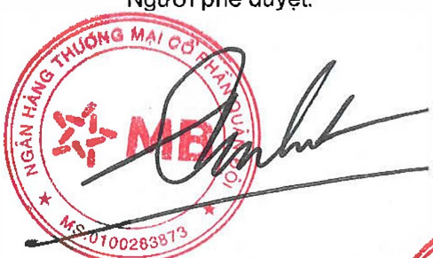

Dear CÁO TỈNH HINH TÀI CHÍNH RIÊNG (tiếp theo)

Tài ngày 31 tháng 03 năm 2026

*hàng
CÁC CHỈ TIÊU NGOÀI BÁO CÁO TÍNH HỊNH TÀI CHÍNH RIÊNG*

<table><tr><td rowspan="2"></td><td rowspan="2">Thuyét minh</td><td>31/03/2026</td><td>31/12/2025 đã kiểm toán</td></tr><tr><td>triệu đồng</td><td>triệu đồng</td></tr><tr><td>NGHIA VU NỢ TIEM AN</td><td>V.1</td><td></td><td></td></tr><tr><td>Bảo lãnh vay vốn</td><td></td><td>1.681.823</td><td>1.684.717</td></tr><tr><td>Cam kết giao dịch hồi đổiai</td><td></td><td>723.980.330</td><td>618.888.427</td></tr><tr><td>- Cam kết mua ngoại tệ</td><td></td><td>1.302.737</td><td>9.738.358</td></tr><tr><td>- Cam kết bán ngoại tệ</td><td></td><td>2.160.046</td><td>8.752.345</td></tr><tr><td>- Cam kết mua giao dịch hoán đổi ngoại tệ</td><td></td><td>359.933.489</td><td>299.830.234</td></tr><tr><td>- Cam kết bán giao dịch hoán đổi ngoại tệ</td><td></td><td>360.584.058</td><td>300.567.490</td></tr><tr><td>Cam kết trong nghiệp vụ L/C</td><td></td><td>71.759.861</td><td>59.722.523</td></tr><tr><td>Bảo lãnh khác</td><td></td><td>185.870.200</td><td>190.104.216</td></tr><tr><td>Cam kết khác</td><td></td><td>116.579.336</td><td>126.935.262</td></tr></table>

Người lập:

Guruoi kiêm soát:

Dear Lê Thị HUYEN Trang

Giám doc trung tâm kế toán

Hà Nội, Việt Nam

Ngay 28 tháng 04 năm 2026

Bà Đặng Thúy Dung

Ké toán trường

Người phê duyệt:

hplit

Bà Nguyễn Thị Thanh Nga

Giám đốc Tài chính

Ông Phạm Nhu Ánh

Tổng Giám đốc

NGAN HANG TH
QIAN DOI