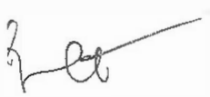
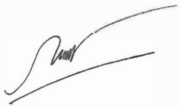
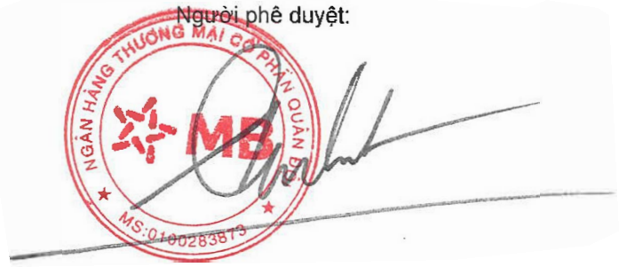

<table><tr><td rowspan="2"></td><td rowspan="2">Thuyết</td><td colspan="2">Số phát sinh Quý 1</td><td colspan="2">Lủy kế đầu năm đến cuối quý</td></tr><tr><td>Năm nay</td><td>Năm trước</td><td>Năm nay</td><td>Năm trước</td></tr><tr><td></td><td></td><td>triệu đồng</td><td>triệu đồng</td><td>triệu đồng</td><td>triệu đồng</td></tr><tr><td>Thu nhập lãi và các khoản thu nhập tương tự</td><td></td><td>26.127.526</td><td>17.545.676</td><td>26.127.526</td><td>17.545.676</td></tr><tr><td>Chi phí lãi và các khoản chi phí tương tự</td><td></td><td>(13.603.847)</td><td>(7.693.320)</td><td>(13.603.847)</td><td>(7.693.320)</td></tr><tr><td>Thu nhập lãi thuần</td><td>IV.1</td><td>12.523.679</td><td>9.852.356</td><td>12.523.679</td><td>9.852.356</td></tr><tr><td>Thu nhập từ hoạt động dịch vụ</td><td></td><td>2.255.819</td><td>1.402.596</td><td>2.255.819</td><td>1.402.596</td></tr><tr><td>Chi phí hoạt động dịch vụ</td><td></td><td>(839.529)</td><td>(655.557)</td><td>(839.529)</td><td>(655.557)</td></tr><tr><td>Lãi thuần từ hoạt động dịch vụ</td><td>IV.2</td><td>1.416.290</td><td>747.039</td><td>1.416.290</td><td>747.039</td></tr><tr><td>Lãi thuần từ hoạt động ngoại hới</td><td>IV.3</td><td>(33.079)</td><td>538.866</td><td>(33.079)</td><td>538.866</td></tr><tr><td>Lãi thuần từ chứng khoán kinh doanh</td><td>IV.4</td><td>27.153</td><td>86.951</td><td>27.153</td><td>86.951</td></tr><tr><td>Lãi thuần từ chứng khoán đầu tư</td><td>IV.4</td><td>(388.552)</td><td>462.793</td><td>(388.552)</td><td>462.793</td></tr><tr><td>Lãi thuần từ hoạt động kinh doanh khác</td><td>IV.5</td><td>1.011.057</td><td>1.048.337</td><td>1.011.057</td><td>1.048.337</td></tr><tr><td>Thu nhập từ góp vốn, mua cổ phần</td><td>IV.6</td><td>-</td><td>-</td><td>-</td><td>-</td></tr><tr><td>TỔNG THU NHẬP HOAT ĐỒNG</td><td></td><td>14.556.548</td><td>12.736.342</td><td>14.556.548</td><td>12.736.342</td></tr><tr><td>TỔNG CHI PHÍ HOAT ĐỒNG</td><td>IV.7</td><td>(3.361.707)</td><td>(3.030.640)</td><td>(3.361.707)</td><td>(3.030.640)</td></tr><tr><td>Lợi nhuận thuần từ hoạt động kinh doanh trước chi phí dự phòng r,ui ro</td><td></td><td>11.194.841</td><td>9.705.702</td><td>11.194.841</td><td>9.705.702</td></tr><tr><td>Chi phí dự phòng r,ui ro</td><td>IV.9</td><td>(2.328.616)</td><td>(2.016.534)</td><td>(2.328.616)</td><td>(2.016.534)</td></tr><tr><td>TỔNG LỢI NHUẬN TRUOC THUÉ</td><td></td><td>8.866.225</td><td>7.689.168</td><td>8.866.225</td><td>7.689.168</td></tr><tr><td>Chi phí thuế TNDN hiện hành</td><td></td><td>(1.772.429)</td><td>(1.554.673)</td><td>(1.772.429)</td><td>(1.554.673)</td></tr><tr><td>Chi phí thuế TNDN</td><td>IV.11</td><td>(1.772.429)</td><td>(1.554.673)</td><td>(1.772.429)</td><td>(1.554.673)</td></tr><tr><td>LỢI NHUẬN SAU THUÉ</td><td></td><td>7.093.796</td><td>6.134.495</td><td>7.093.796</td><td>6.134.495</td></tr></table>

Người lập:

Guoi kiêm soát:

Dear Lê Thị HUYên Trang

Giám doc trung tâm kế toán

Hà Nội, Việt Nam

Ngày 28 tháng 04 năm 2026

Bà Đặng Thúy Dung

Ké toán trường

hplit

Bà Nguyễn Thi Thanh Nga

Giám đốc Tài chính

Người phê duyệt:

Hoàn Phạm Nhu-Anh

Tổng Giám đốc