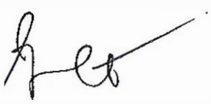
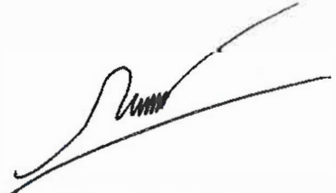
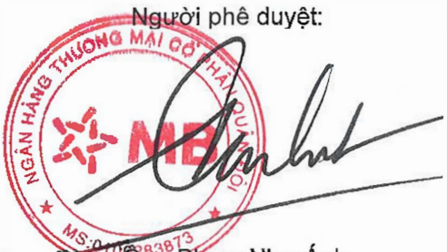

# Ngân hàng Thương mại Cổ phần Quản đối
Địa chỉ: Số 18 Lê Văn Lương – Phường Yên Hòa – Hà Nội

## -size-adjust
BÁO CÁO LƯU CHUYẾN TIÊN TỆ RIÊNG (tiếp theo)
Tại ngày 31 tháng 03 năm 2026

<table><tr><td rowspan="2"></td><td>Thuyét minh</td><td>Giai đoạn từ 01/01/2026 đến 31/03/2026</td><td>Giai đoạn từ 01/01/2025 đến 31/03/2025</td></tr><tr><td></td><td>triệu đồng</td><td>triệu đồng</td></tr><tr><td>LƯU CHUYỀN TIỀN TỪ HOẠT ĐỒNG TÀI CHÍNH</td><td></td><td></td><td></td></tr><tr><td>Tăng vốn cổ phần từ góp vốn và/hoặc phát hành cổ phiếu</td><td></td><td>-</td><td>-</td></tr><tr><td>Tiền thu từ phát hành giấy tờ có giá dài hạn đủ điều kiện tính vào vốn tự có và các khoản vốn vay dài hạn khác</td><td></td><td>-</td><td>2.198.563</td></tr><tr><td>Tiền chi thanh toán giấy tờ có giá dài hạn có đủ điều kiện tính vào vốn tự có và các khoản vốn vay dài hạn khác</td><td></td><td>(3.798.563)</td><td>-</td></tr><tr><td>Cổ tức trả cho cổ đông trong kỳ</td><td></td><td>-</td><td>-</td></tr><tr><td>Lưu chuyển tiền thuần từ hoạt động tài chính</td><td></td><td>(3.798.563)</td><td>2.198.563</td></tr><tr><td>Lưu chuyển tiền thuần trong kỳ</td><td></td><td>(63.701.278)</td><td>(25.488.455)</td></tr><tr><td>Tiền và các khoản tương đương tiền tại thời điểm đầu kỳ</td><td></td><td>238.279.619</td><td>100.666.711</td></tr><tr><td>Tiền và các khoản tương đương tiền tại thời điểm cuối kỳ</td><td>IV.12</td><td>174.578.341</td><td>75.178.256</td></tr></table>

Người lập:

Dear Lê Thị HUYên Trang

Giám doc trung tâm kế toán

Hà Nội, Việt Nam

Ngày 28 tháng 04 năm 2026

Guruoi kiêm soát:

hàng

Bà Đặng Thúy Dung

Ké toán trường

Dear Nguyen Thi Thanh Nga

Exam doc Tài chính

ong Pham Nhu Anh

Tong Giám đốc

